# Data Structures, Algorithms and Connectionist AI: Content Foundation

## Module Overview

This module is an introduction to three connected subjects for beginners with high-school mathematics. **Data structures** (Chapter 1) are ways of organising data. **Algorithms** (Chapter 2) are step-by-step methods that use those structures to solve problems efficiently. **Connectionist AI** (Chapter 3) is the family of neural-network methods that learn from data, and training them is itself an algorithm built on the ideas of the first two chapters.

This file is the shared content foundation for the team's Study Guide and Test Bank, PPT slides and video tutorials.

**Version:** Final (Stage 3), 28 November 2026.

### Intended Learners

The module is written for students meeting these subjects for the first time, such as first-year undergraduates in computing, artificial intelligence or a related science. No previous course in computer science or machine learning is assumed. Learners who already program can use the worked examples and activities to check and deepen their understanding.

### Prerequisites

- **Programming:** variables, loops, functions and lists in any language. Algorithms are written as short pseudocode, so no particular language is required.
- **Algebra:** functions, powers and logarithms.
- **Calculus (Chapter 3 only):** the idea of a derivative as a rate of change. Chapter 3, Section 3.4 reviews partial derivatives and the chain rule before they are used.

Each chapter also begins with a short **Before You Start** list of what it relies on.

### Module Learning Outcomes

By the end of the module, you should be able to:

1. Choose an appropriate data structure for a task and justify the choice in terms of the operations it makes fast.
2. Analyse an algorithm's running time with asymptotic notation, recurrences and amortised analysis.
3. Recognise the main algorithm design paradigms and apply them to small problems, including graph problems.
4. Explain how a neural network computes, learns through gradient descent and backpropagation, and differs from symbolic AI.
5. Compare the main neural-network architectures and learning approaches, and choose one for a given problem.
6. Recognise overfitting, bias and the limits of interpretability, and suggest responsible remedies.

Each chapter lists its own, more detailed learning outcomes.

### How to Use This Material

Each topic follows the same pattern: an explanation of the ideas, **worked examples** that apply them step by step, and a **Check Your Understanding** section with activities and full answers. Try each activity before reading its answer. Activities include tracing a process, predicting an outcome, comparing approaches, explaining a decision and finding an error, not only recalling definitions.

Topics build on each other in order. Where an idea depends on an earlier section, the text points to it.

### Notation

- $\log_2 n$ is the logarithm to base 2: the number of times $n$ can be halved before reaching 1. Inside $O(\cdot)$, $\Omega(\cdot)$ and $\Theta(\cdot)$, the base of a logarithm only changes a constant factor, so it is left out, as in $O(n \log n)$.
- In Chapter 3, $\log$ without a base means the natural logarithm ($\ln$), as is usual in machine learning.
- Positions in arrays, heaps and suffix arrays are counted from 0 (index 0 is the first element).
- The learning rate is written $\eta$ in Chapter 3, Topics 2–3, and $\alpha$ in Topic 6, following each field's usual convention.

## Contents

- [Module Overview](#module-overview)
- [Chapter 1: Introduction to Data Structures](#chapter-1-introduction-to-data-structures)
  - [Topic 1: Why Are Data Structures Needed?](#topic-1-why-are-data-structures-needed)
  - [Topic 2: Data vs. Data Types vs. Data Structures](#topic-2-data-vs-data-types-vs-data-structures)
  - [Topic 3: Classification and Basic Operations](#topic-3-classification-and-basic-operations)
  - [Topic 4: Real-Life Applications](#topic-4-real-life-applications)
  - [Topic 5: Fundamental Abstract Data Types (ADTs)](#topic-5-fundamental-abstract-data-types-adts)
- [Chapter 2: Algorithms](#chapter-2-algorithms)
  - [Topic 1: Foundation of Algorithms Analysis](#topic-1-foundation-of-algorithms-analysis)
  - [Topic 2: Core Algorithms Design Paradigms](#topic-2-core-algorithms-design-paradigms)
  - [Topic 3: Graph Algorithms](#topic-3-graph-algorithms)
- [Chapter 3: Connectionist AI](#chapter-3-connectionist-ai)
  - [Topic 1: Introduction to Connectionist AI](#topic-1-introduction-to-connectionist-ai)
  - [Topic 2: Biological Neurons and Artificial Neurons](#topic-2-biological-neurons-and-artificial-neurons)
  - [Topic 3: Learning Methods and Neural Network Training](#topic-3-learning-methods-and-neural-network-training)
  - [Topic 4: Neural Network Architectures](#topic-4-neural-network-architectures)
  - [Topic 5: Unsupervised Learning and Generative Models](#topic-5-unsupervised-learning-and-generative-models)
  - [Topic 6: Reinforcement Learning and Deep Reinforcement Learning](#topic-6-reinforcement-learning-and-deep-reinforcement-learning)
  - [Topic 7: Limitations, Interpretability, and Responsible AI](#topic-7-limitations-interpretability-and-responsible-ai)
  - [Topic 8: Connecting the Concepts](#topic-8-connecting-the-concepts)
- [References](#references)

---

# Chapter 1: Introduction to Data Structures

## Chapter Overview

This chapter explains how data can be organised so that programs can store, find and change it efficiently. It starts with why data structures matter, separates data, data types and data structures, and then introduces the main structures used throughout the rest of the module: arrays, linked lists, stacks, queues, hash tables, trees, heaps and graphs. Topic 5 looks inside the most important abstract data types.

Chapter 2 uses these structures directly. For example, breadth-first search needs a queue, Dijkstra's algorithm needs a priority queue, and every graph algorithm needs a way to store a graph.

### Learning Outcomes

By the end of this chapter, you should be able to:

1. Explain why the choice of data structure affects running time and memory use.
2. Distinguish data, data types, data structures and abstract data types (ADTs).
3. Choose a suitable structure for a described task and justify the choice.
4. Trace the operations of a stack, a queue and a binary heap and predict their results.
5. Compare contiguous (array) storage with linked storage.
6. Describe how maps, sets, tries and geometric data structures support fast searching.

### Before You Start

You need basic programming knowledge: variables, loops, functions and lists. The notation $O(\cdot)$ is used informally here and defined properly in Chapter 2, Topic 1.

---

## Topic 1: Why Are Data Structures Needed?

### 1.1 Overview and Core Concept

In computer science, data must be stored, accessed, processed, modified, and managed efficiently. A data structure is a way of organising and storing data so that particular operations can be performed efficiently.

Different data structures are designed to support different operations. Choosing an appropriate structure can improve an algorithm's execution time, memory usage, and maintainability.

Without a suitable data structure, a program may require excessive computation or memory as the amount of data increases. However, no single data structure is optimal for every situation. The best choice depends on the data, the operations required, and the system's performance constraints.

#### Example

Suppose a university needs to store the records of 10,000 students. Each record may contain:

- Student ID
- Name
- Age
- Department
- Examination scores

Storing every value in an unrelated variable would make the records difficult to manage. Instead, the university could organise the records using arrays, lists, hash tables, or database structures, depending on its requirements:

- **An array** may store examination scores in order.
- **A hash table** may associate student IDs with student records.
- **A tree** may represent a hierarchical organisational structure.
- **A graph** may represent connections between students or departments.

The choice of data structure affects how efficiently the information can be accessed and modified.

### 1.2 Key Motivations and Technical Advantages

#### A. Resource Efficiency: Time and Space Optimisation

Data structures influence the time and memory required to perform operations.

- **Time complexity** describes how the computational work of an algorithm grows as the input size increases.
- **Space complexity** describes how the memory requirements of an algorithm grow as the input size increases.

For example, consider searching for a student ID in a collection:

- Searching an unsorted array requires $O(n)$ time in the worst case.
- Searching a balanced Binary Search Tree (BST), a tree in which smaller keys go left and larger keys go right (Section 4.6), requires $O(\log n)$ time.
- Searching a hash table typically requires $O(1)$ time on average under suitable assumptions.

These complexities are not interchangeable guarantees. They depend on the data structure's properties, implementation, and the operation being performed.

#### Worked Example: Finding One Student Among 10,000

How many comparisons does each structure need to find one student ID among $n = 10{,}000$ records? The array and BST rows give the worst case. The hash-table row gives the average case, because a hash table's worst case is much slower when many keys collide (Section 1.5, Question 3).

| Structure | How the search works | Comparisons needed |
| :--- | :--- | :--- |
| Unsorted array | Check records one by one until the ID is found or the array ends | Up to 10,000 |
| Balanced BST | At each node, go left or right; each step discards about half of the remaining records | About 14, because a balanced tree with 10,000 records has 14 levels ($\log_2 10{,}000 \approx 13.3$) |
| Hash table | Compute the ID's bucket (Section 4.5) and look there | About 1 on average |

The structures hold the same records, yet the work differs by a factor of hundreds or thousands. This is why the choice of structure matters more as $n$ grows.

#### B. Scalability

Scalability refers to a system's ability to handle increasing amounts of data or work while maintaining acceptable performance. Data structures help manage growing collections efficiently, but they do not automatically make an application scalable. Performance also depends on algorithms, hardware, networking, concurrency, and software architecture.

#### C. Abstraction and Reusability

Data structures allow programmers to organise data behind well-defined operations. An implementation can be reused across different applications, reducing the need to rewrite the same logic.

For example, a stack can be used for:

- Undo operations in text editors
- Function-call management
- Expression evaluation
- Backtracking algorithms

#### D. Modelling Real-World Relationships

Real-world information often contains relationships that cannot be represented conveniently by isolated values.

| Relationship | Suitable Structure | Example |
| :--- | :--- | :--- |
| **Sequential** | Array or linked list | Examination scores |
| **Last in, first out** | Stack | Undo operations |
| **First in, first out** | Queue | Processing tasks in arrival order |
| **Hierarchical** | Tree | File systems |
| **Priority-based** | Priority queue | Job scheduling |
| **Interconnected** | Graph | Road networks |
| **Key-value association** | Hash table | Student ID lookup |

#### E. Trade-Offs Between Data Structures

- **Arrays** provide efficient indexed access but may require shifting elements during insertion or deletion.
- **Linked lists** support efficient insertion or deletion when the relevant position is already accessible, but indexed access is slow.
- **Hash tables** offer fast average-case lookup by key but do not inherently maintain sorted order.
- **Balanced search trees** support ordered traversal and efficient search, insertion, and deletion, generally in $O(\log n)$ time.

### 1.3 Introduction to Algorithm Analysis

Algorithm analysis helps estimate how efficiently an algorithm performs as its input grows ($n$). This section is a short preview; Chapter 2, Topic 1 defines the notation formally.

#### A. Common Time Complexities

| Complexity | Name | General Meaning | Example |
| :--- | :--- | :--- | :--- |
| $O(1)$ | Constant | Work does not grow with input size | Accessing an array element by index |
| $O(\log n)$ | Logarithmic | Work grows slowly as input increases | Binary search |
| $O(n)$ | Linear | Work grows proportionally to input size | Linear search |
| $O(n \log n)$ | Linearithmic | Common in efficient sorting | Merge sort |
| $O(n^2)$ | Quadratic | Work grows with nested iterations | Simple nested-loop comparison |

#### B. Best, Average, and Worst Cases

- **Best case:** The most favourable input conditions.
- **Average case:** Expected performance under a specified input distribution.
- **Worst case:** The maximum amount of work required for inputs of a given size.

For a linear search, the best case is finding the item in the first position (1 comparison), and the worst case is the item being last or absent ($n$ comparisons).

### 1.4 Choosing the Right Data Structure

Common operational requirements and their ideal structural match:

| Requirement | Possible Choice | Reason |
| :--- | :--- | :--- |
| **Frequent access by index** | Array | Constant-time indexed access |
| **Frequent lookup by key** | Hash table | Average-case constant-time lookup |
| **Processing items in arrival order** | Queue | First-in, first-out behaviour |
| **Reversing operations** | Stack | Last-in, first-out behaviour |
| **Selecting highest-priority item** | Priority queue | Efficient priority-based retrieval |
| **Maintaining sorted data with updates** | Balanced search tree | Efficient ordered operations |
| **Representing arbitrary connections** | Graph | Models vertices and edges |

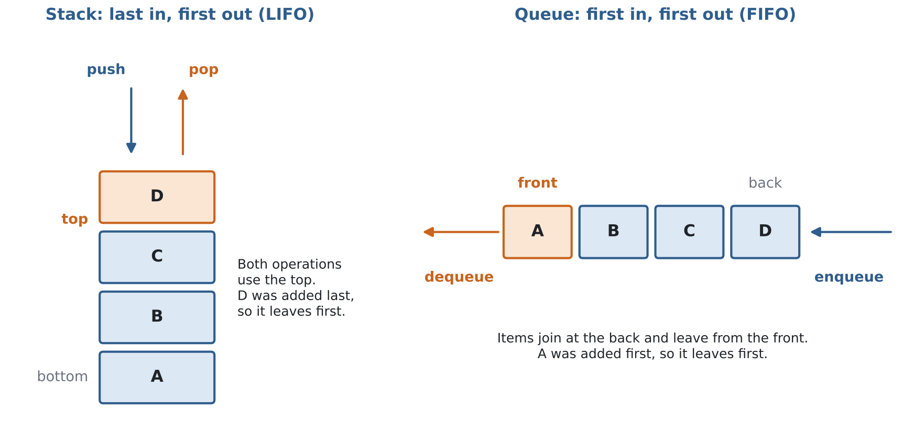

*Figure 1.1. A stack adds and removes items at the same end (the top), so the newest item leaves first. A queue adds items at the back and removes them from the front, so the oldest item leaves first.*

### 1.5 Check Your Understanding

1. **Choose and justify.** Pick the most suitable structure for each task and give a one-line reason: (a) a web browser's Back button; (b) print jobs sent to a shared printer; (c) looking up a word's definition by the word; (d) a company's management chart; (e) finding a route between two cities on a road map.
2. **Predict.** A program searches for an ID that is *not* stored. How many comparisons does it make with (a) an unsorted array of 1,000,000 IDs, and (b) a balanced BST holding the same IDs?
3. **Find the error.** A student writes: "Hash tables are always better than arrays because lookup is $O(1)$." Identify two problems with this claim.

#### Answers

1. (a) **Stack**: the most recently visited page is the first one you return to (last in, first out). (b) **Queue**: jobs are printed in the order they arrive (first in, first out). (c) **Hash table**: it maps a key (the word) directly to its value (the definition). (d) **Tree**: each employee has one manager, which is a hierarchy. (e) **Graph**: cities are vertices and roads are weighted edges.
2. (a) 1,000,000 comparisons, because every element must be checked before concluding the ID is absent. (b) About 20 comparisons, because a balanced tree with 1,000,000 records has 20 levels ($\log_2 1{,}000{,}000 \approx 19.9$).
3. First, $O(1)$ is the *average* case under suitable assumptions; if many keys collide, a lookup can take $O(n)$. Second, a hash table does not keep keys in order, so tasks such as "list all IDs in order" or "access the 5th element" are better served by an array or a balanced search tree. Arrays also give $O(1)$ access by index, with less memory overhead.

**Sources for this topic:** Cormen et al. (2022), Ch. 1–3; Sedgewick & Wayne (2011), Ch. 1.

---

## Topic 2: Data vs. Data Types vs. Data Structures

### 2.1 Definitions and Comparison

| Feature | Data | Data Type | Data Structure |
| :--- | :--- | :--- | :--- |
| **Definition** | Information represented as values or symbols | A classification defining valid values and supported operations | A way of organising and storing data elements |
| **Main Question** | What information is represented? | What kind of value is this? | How are values organised and accessed? |
| **Purpose** | Represent information | Define how values are interpreted and used | Support efficient operations on collections or relationships |
| **Examples** | `85`, `"Hello"`, `3.14`, `true` | `int`, `float`, `bool`, `str` | Array, linked list, tree, graph, hash table |

### 2.2 Abstract Data Types and Implementations

An **Abstract Data Type (ADT)** defines a data type in terms of its behaviour and supported operations, without requiring a particular internal implementation.

#### Example: Stack ADT

- `push(x)`: Add `x` to the top.
- `pop()`: Remove and return the top element.
- `peek()`: Return the top element without removing it.
- `isEmpty()`: Check whether the stack is empty.

The same Stack ADT can be implemented with an array or with a linked list. Code that only calls `push`, `pop` and `peek` works with either implementation; this separation of *what* from *how* is the point of an ADT.

#### Worked Example: Tracing a Stack

Start with an empty stack and apply each operation. The stack is written bottom → top.

| Operation | Stack afterwards | Returned value |
| :--- | :--- | :--- |
| `push(3)` | [3] | — |
| `push(7)` | [3, 7] | — |
| `pop()` | [3] | 7 |
| `push(5)` | [3, 5] | — |
| `peek()` | [3, 5] | 5 |

`pop()` returned 7, not 3, because 7 was added last.

### 2.3 Logical Organisation vs. Physical Memory Layout

- **Contiguous Storage (e.g., Arrays):** Elements occupy consecutive memory locations. Provides efficient indexed access and good memory locality.
- **Linked Storage (e.g., Linked Lists):** Elements stored in nodes connected by pointers/references across non-consecutive addresses.

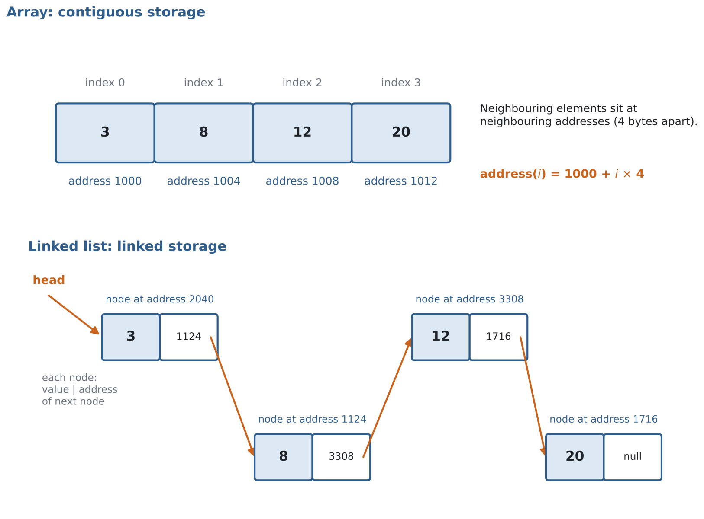

*Figure 1.2. An array stores its elements at consecutive memory addresses, so any element's address can be calculated from its index. A linked list stores each element in a separate node that also holds the address of the next node, so the nodes can be anywhere in memory. The array matches the worked example below: 4-byte integers starting at address 1000.*

#### Worked Example: Why Array Indexing Is $O(1)$

An array of 4-byte integers starts at memory address 1000. The element at index $i$ is at:

$$\text{address}(i) = \text{base} + i \times \text{element size}$$

Indices start at 0, so the element at index 5 (the sixth element) is at $1000 + 5 \times 4 = 1020$. One multiplication and one addition locate any element, whatever the array's length. A linked list has no such formula: to reach the node at index 5, the program must start at the head and follow five pointers, which takes $O(n)$ time in general.

### 2.4 Check Your Understanding

1. **Classify.** Label each item as data, data type, data structure, ADT or implementation: (a) `42`; (b) `int`; (c) the Queue ADT; (d) a queue built from a linked list; (e) a list of print jobs stored in arrival order.
2. **Trace.** Starting from an empty stack, apply: `push(4)`, `push(9)`, `pop()`, `push(2)`, `push(6)`, `pop()`, `peek()`. What do the two `pop()` calls and the `peek()` return, and what is left in the stack?
3. **Calculate.** An array of 8-byte numbers starts at address 2000. At what address is the element at index 7?
4. **Explain.** Why can an array reach element $i$ in $O(1)$ time while a linked list cannot?

#### Answers

1. (a) Data. (b) Data type. (c) ADT: it lists operations (enqueue, dequeue, front, isEmpty) but says nothing about storage. (d) Implementation of the Queue ADT. (e) Data structure: a way of organising data so it can be processed in order.
2. The `pop()` calls return 9 and then 6; `peek()` returns 2. The stack ends as [4, 2] (bottom → top).
3. $2000 + 7 \times 8 = 2056$.
4. Array elements are stored contiguously, so an element's address can be computed directly from its index. Linked-list nodes are scattered in memory and can only be reached by following pointers one at a time from the head.

**Sources for this topic:** Cormen et al. (2022), Ch. 10; Sedgewick & Wayne (2011), Section 1.3.

---

## Topic 3: Classification and Basic Operations

### 3.1 Classification of Data Structures

Data structures are commonly classified in three independent ways: by whether a type is built into the language (primitive) or built from other values (non-primitive), by the shape of the connections between elements (linear or non-linear), and by whether the size can change while the program runs (static or dynamic).

| Classification | Category | Examples |
| :--- | :--- | :--- |
| Primitive vs. non-primitive | Primitive | `int`, `float`, `char`, `bool` |
| | Non-primitive | Array, linked list, tree, graph |
| Linear vs. non-linear | Linear: each element has at most one predecessor and one successor | Array, linked list, stack, queue |
| | Non-linear: an element can connect to several others | Tree, graph |
| Static vs. dynamic | Static: size fixed when created | Fixed-size array |
| | Dynamic: grows and shrinks while the program runs | Linked list, dynamic array (Python `list`, Java `ArrayList`) |

### 3.2 Fundamental Operations

Common operations include **Traversal**, **Searching**, **Insertion**, **Deletion**, **Updating**, **Sorting**, and **Accessing**.

The cost of an operation depends on the structure. Comparing an array with a singly linked list:

| Operation | Meaning | Array | Linked list |
| :--- | :--- | :--- | :--- |
| Access by index | Read the $i$-th element | $O(1)$ | $O(n)$ |
| Search (unsorted) | Find an element with a given value | $O(n)$ | $O(n)$ |
| Insert at the front | Add a new first element | $O(n)$ (shift every element) | $O(1)$ |
| Insert at the end | Add a new last element | $O(1)$ amortised for a dynamic array (Chapter 2, Section 1.3) | $O(1)$ with a tail pointer (a reference to the last node) |
| Delete at the front | Remove the first element | $O(n)$ (shift every element) | $O(1)$ |
| Traversal | Visit every element once | $O(n)$ | $O(n)$ |

#### Worked Example: Inserting Into an Array

Insert the value 5 at index 1 of the array [3, 8, 12, 20].

1. Shift 20 one place right: [3, 8, 12, _, 20].
2. Shift 12 one place right: [3, 8, _, 12, 20].
3. Shift 8 one place right: [3, _, 8, 12, 20].
4. Write 5 into index 1: [3, 5, 8, 12, 20].

Three elements moved. Inserting at index 0 of an $n$-element array moves all $n$ elements, which is why front insertion is $O(n)$. In a linked list, the same insertion only changes two pointers once the position is reached.

### 3.3 Check Your Understanding

1. **Classify.** For each structure, state whether it is linear or non-linear, and static or dynamic: (a) a fixed-size array of 12 monthly totals; (b) the folders and files on a computer; (c) a Python `list` that grows as users sign up.
2. **Predict.** How many elements must be shifted to insert a new value at the front of an array holding 8 elements? To insert it at the end, if there is spare capacity?
3. **Compare.** A music app frequently adds and removes songs at the start of a playlist but rarely jumps to "song number 50". Should the playlist be an array or a linked list? Explain.

#### Answers

1. (a) Linear, static. (b) Non-linear (hierarchical), and dynamic, since folders and files can be added or deleted. (c) Linear, dynamic.
2. Front: all 8 elements shift. End: none shift, because the slot after the last element is free.
3. A linked list. Adding or removing at the front is $O(1)$ for a linked list but $O(n)$ for an array, and the app rarely needs indexed access, where the linked list is slower.

**Sources for this topic:** Cormen et al. (2022), Ch. 10.

---

## Topic 4: Real-Life Applications

This topic shows where each structure is used. Topic 5 explains how the most important ones work inside.

### 4.1 Arrays and Dynamic Arrays

Arrays suit collections that are read by position, because any element can be reached by its index in $O(1)$ time.

Images are stored as arrays of pixel values, spreadsheets as arrays of rows and columns, and audio as arrays of samples. A dynamic array grows automatically by allocating a larger block and copying the elements across (Chapter 2, Section 1.3 shows why each append still costs only $O(1)$ amortised).

### 4.2 Linked Lists

Linked lists suit collections in which items are often inserted or deleted at a position the program can already reach, because only a few pointers need to change.

Examples include a music player's playlist, where songs are inserted and removed often, and the free-memory lists kept by operating systems.

### 4.3 Stacks (LIFO)

Stacks are used wherever the most recent item must be handled first: undo and redo in editors, the call stack that tracks which function is running, and the evaluation of arithmetic expressions.

#### Worked Example: Undo and Redo With Two Stacks

A text editor keeps an *undo* stack and a *redo* stack. The user types A, then B, then C.

| Action | Undo stack (bottom → top) | Redo stack | Text |
| :--- | :--- | :--- | :--- |
| Type A, B, C | [A, B, C] | [ ] | ABC |
| Undo | [A, B] | [C] | AB |
| Undo | [A] | [C, B] | A |
| Redo | [A, B] | [C] | AB |

Each undo pops from the undo stack and pushes onto the redo stack; each redo does the reverse. Typing something new clears the redo stack.

### 4.4 Queues (FIFO)

Queues are used wherever items must be handled in arrival order: print jobs, requests to a web server, and breadth-first search (BFS).

A web server answers requests in the order they arrive, so that no request waits forever. BFS (Chapter 2, Section 3.1) uses a queue so that vertices are explored in order of their distance from the start.

### 4.5 Hash Tables

Hash tables are used wherever values must be found quickly by a key: caches, the symbol tables that compilers use to look up variable names, and general key–value lookups, all in $O(1)$ time on average.

A **hash function** turns a key into a bucket number. When two keys land in the same bucket, a **collision** occurs; it is handled by keeping a short list in each bucket (chaining) or by trying another bucket (open addressing).

#### Worked Example: Hashing Into 7 Buckets

With $h(k) = k \bmod 7$, the keys 15, 22 and 9 go to buckets $15 \bmod 7 = 1$, $22 \bmod 7 = 1$ and $9 \bmod 7 = 2$. Keys 15 and 22 collide in bucket 1, so with chaining, bucket 1 holds the list [15, 22]. A lookup for 22 computes bucket 1 and searches its two entries, instead of scanning every key.

### 4.6 Trees

Trees model hierarchies: folders inside folders in a file system, the nested elements of a web page (the Document Object Model, or DOM), and the structure of a program as a compiler reads it (an abstract syntax tree).

A tree has one **root**; every other node has exactly one **parent**, and nodes without children are **leaves**. In a **binary search tree (BST)**, every key in a node's left subtree is smaller than the node's key and every key in its right subtree is larger, which lets a search discard one side at each step. Visiting a BST's left subtree, then the node itself, then the right subtree (an **in-order traversal**) lists every key in increasing order.

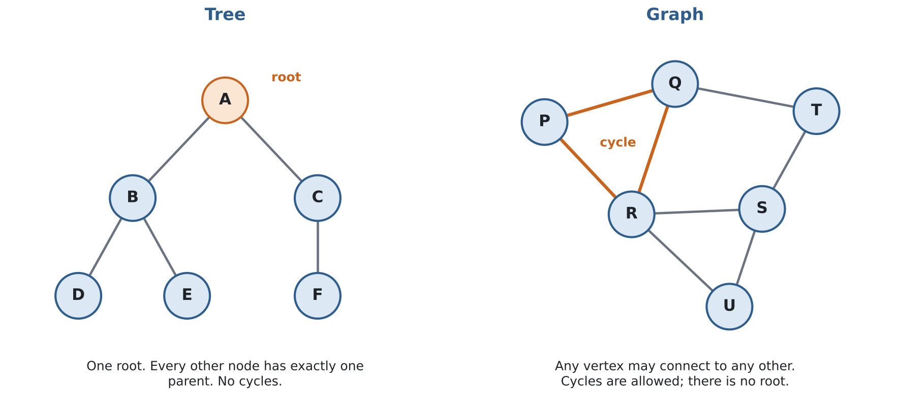

*Figure 1.3. In a tree, every node except the root has exactly one parent, and there are no cycles. In a graph, any vertex may be joined to any other, so cycles are allowed.*

### 4.7 Heaps & Priority Queues

Priority queues are used wherever the most important item must be handled next, rather than the oldest: event-driven simulations (process the earliest event next), operating-system task schedulers, and Dijkstra's shortest-path algorithm (Chapter 2, Section 3.2).

A hospital emergency department treats the most urgent patient first, not the first to arrive. A priority queue supports exactly this, and a binary heap implements it efficiently (Section 5.2).

### 4.8 Graphs

Graphs are used wherever items are connected in a network: social networks, GPS route planning, and recommendation systems that link users to products.

People or places are **vertices**, and friendships or roads are **edges**. Edges can carry **weights** such as distance or travel time. Chapter 2, Topic 3 covers the algorithms that search graphs and find shortest routes.

### 4.9 Check Your Understanding

1. **Trace.** In the undo/redo example, the user is at text "AB" (undo stack [A, B], redo stack [C]) and types D. What are the two stacks now? Can the user still redo C?
2. **Calculate.** Using $h(k) = k \bmod 7$, find the buckets for the keys 10, 17, 24 and 5. What problem do you notice?
3. **Explain.** Why does BFS use a queue, while undo uses a stack?

#### Answers

1. Undo stack [A, B, D]; redo stack [ ] (cleared). C can no longer be redone, because typing new text starts a new history.
2. 10, 17 and 24 all go to bucket 3; 5 goes to bucket 5. Three of the four keys collide, so lookups in bucket 3 must search a list of three keys. A good hash function spreads keys evenly; these keys all differ by 7, which exposes the weakness of $k \bmod 7$.
3. BFS must explore vertices in the order they were discovered (first in, first out), so that nearer vertices are processed before farther ones. Undo must reverse the most recent action first (last in, first out).

**Sources for this topic:** Cormen et al. (2022), Ch. 6, 10–12 and 20.

---

## Topic 5: Fundamental Abstract Data Types (ADTs)

Topic 2 introduced the idea of an ADT. This topic covers the ADTs used most often in this module and the structures that implement them.

### 5.1 Linear Structures

Linear structures keep elements in a sequence. The main linear ADTs are:

| ADT | Main operations | Behaviour | Typical implementation | Cost of main operations |
| :--- | :--- | :--- | :--- | :--- |
| List | get(i), insert(i, x), remove(i) | Ordered by position | Dynamic array or linked list | Depends on implementation (Section 3.2) |
| Stack | push, pop, peek | Last in, first out | Array or linked list | $O(1)$ |
| Queue | enqueue, dequeue, front | First in, first out | Linked list or circular array | $O(1)$ |
| Deque (double-ended queue) | add/remove at front and back | Both ends usable | Circular array or doubly linked list (each node also points to the previous one) | $O(1)$ |

When an array-based stack, queue or deque must grow, it copies its elements into a larger array, so its $O(1)$ cost is amortised (Chapter 2, Section 1.3).

A **circular array** implements a queue without shifting elements: two indices mark the front and back, and they wrap around to the start of the array when they reach the end.

#### Worked Example: Tracing a Queue

Start with an empty queue (front on the left).

| Operation | Queue afterwards | Returned value |
| :--- | :--- | :--- |
| `enqueue(A)` | [A] | — |
| `enqueue(B)` | [A, B] | — |
| `enqueue(C)` | [A, B, C] | — |
| `dequeue()` | [B, C] | A |
| `enqueue(D)` | [B, C, D] | — |
| `front()` | [B, C, D] | B |

Compare this with the stack trace in Section 2.2: a queue returns the *oldest* element, a stack the *newest*.

### 5.2 Priority Queues

A **priority queue** stores elements with priorities and always removes the element with the highest priority (in a *min*-priority queue, the smallest key). Its operations are `insert(x)`, `peek()` (look at the top element) and `extractMin()` (remove it).

The usual implementation is a **binary min-heap**: a complete binary tree (every level is full except possibly the last, which is filled from the left) in which every parent's key is no larger than its children's keys, so the minimum is always at the root. The tree is stored in an array: the node at index $i$ has children at $2i + 1$ and $2i + 2$, and its parent at $\lfloor (i - 1)/2 \rfloor$.

| Operation | How it works | Cost |
| :--- | :--- | :--- |
| `peek()` | Read the root | $O(1)$ |
| `insert(x)` | Add $x$ at the end, then swap it with its parent while it is smaller ("sift up") | $O(\log n)$ |
| `extractMin()` | Remove the root, move the last element to the root, then swap it with its smaller child while it is larger ("sift down") | $O(\log n)$ |

#### Worked Example: Building a Min-Heap

Insert 5, 3, 8 and 1 into an empty min-heap.

1. Insert 5: [5].
2. Insert 3 at index 1. Its parent (index 0) is 5, which is larger, so swap: [3, 5].
3. Insert 8 at index 2. Its parent is 3, which is smaller, so stop: [3, 5, 8].
4. Insert 1 at index 3. Its parent (index 1) is 5, so swap: [3, 1, 8, 5]. The new parent (index 0) is 3, so swap again: [1, 3, 8, 5].

Now `extractMin()` returns 1. The last element, 5, moves to the root: [5, 3, 8]. Its smaller child is 3, so they swap: [3, 5, 8]. The heap property holds again.

### 5.3 Maps & Sets

A **map** (also called a dictionary or associative array) stores key–value pairs, with each key appearing once. Its operations are `put(key, value)`, `get(key)`, `remove(key)` and `containsKey(key)`.

A **set** stores unique elements with no values attached. Its operations are `add(x)`, `remove(x)` and `contains(x)`, plus set operations such as union, intersection and difference.

Both ADTs have two common implementations:

| Implementation | Cost of put/get/contains | Keeps keys in order? | Example |
| :--- | :--- | :--- | :--- |
| Hash table (hash map, hash set) | $O(1)$ on average | No | Python `dict` and `set`, Java `HashMap` |
| Balanced search tree (tree map, tree set) | $O(\log n)$ | Yes | Java `TreeMap`, C++ `std::map` |

Choose a hash-based map when only lookups matter, and a tree-based map when you also need the keys in sorted order or need "all keys between $a$ and $b$".

#### Worked Example: Counting Words

To count the words in "the cat and the hat", read each word and update a map:

| Word read | Map afterwards |
| :--- | :--- |
| the | {the: 1} |
| cat | {the: 1, cat: 1} |
| and | {the: 1, cat: 1, and: 1} |
| the | {the: 2, cat: 1, and: 1} |
| hat | {the: 2, cat: 1, and: 1, hat: 1} |

The set of distinct words is {the, cat, and, hat}, which has 4 elements. For sets $A = \{1, 2, 3\}$ and $B = \{2, 3, 4\}$: $A \cup B = \{1, 2, 3, 4\}$, $A \cap B = \{2, 3\}$ and $A - B = \{1\}$.

### 5.4 Data Structures for Strings

Text search is so common that special structures exist for it.

A **trie** (prefix tree) stores a set of words character by character. Each edge is labelled with a character, and the path from the root to a marked node spells a word. Words that share a prefix share the same path, so searching for a word of length $L$ takes $O(L)$ steps, however many words are stored. This makes tries well suited to autocomplete and spell-checking.

For example, a trie holding "car", "cat" and "dog" has a path c → a that splits into r and t, and a separate path d → o → g. Searching for the prefix "ca" follows two edges and finds both "car" and "cat" below it.

A **suffix array** lists the starting positions of all suffixes of a text, sorted alphabetically. Because the suffixes are sorted, any pattern can be found with binary search in $O(m \log n)$ time, where $m$ is the pattern length and $n$ the text length.

#### Worked Example: The Suffix Array of "banana"

| Start position | Suffix |
| :--- | :--- |
| 5 | a |
| 3 | ana |
| 1 | anana |
| 0 | banana |
| 4 | na |
| 2 | nana |

The suffix array is [5, 3, 1, 0, 4, 2]. Every occurrence of the pattern "ana" begins a suffix that starts with "ana", and these sit next to each other in the sorted order (positions 3 and 1). Binary search finds that block directly.

### 5.5 Geometric Data Structures

Geometric data structures store points or shapes so that spatial questions can be answered quickly, such as "which shops are within 2 km?" (a range query) or "which taxi is nearest?" (a nearest-neighbour query). Checking every point takes $O(n)$ time per query; these structures skip regions that cannot contain an answer.

- A **k-d tree** is a binary tree over $k$-dimensional points. Each level splits the points on one coordinate, alternating between them (in 2-D: $x$, then $y$, then $x$, …). Splitting at the median keeps the tree balanced.
- A **quadtree** divides a 2-D square into four equal quadrants, and keeps dividing any quadrant that holds too many points. It is used in maps and image compression.

#### Worked Example: A 2-D k-d Tree

Build a k-d tree for the points A(2, 5), B(6, 3), C(8, 7), D(1, 1), E(4, 8), F(9, 2) and G(7, 9).

1. Sort by $x$: D, A, E, **B**, G, C, F. The median is B(6, 3), which becomes the root. Points with $x < 6$ go left; the others go right.
2. Left group {D(1, 1), A(2, 5), E(4, 8)}, sorted by $y$: the median is A(2, 5). D goes below it on the left, E on the right.
3. Right group {G(7, 9), C(8, 7), F(9, 2)}, sorted by $y$: the median is C(8, 7). F goes left, G goes right.

To find all points with $x \le 5$, start at the root B. Its $x$ is 6, so the whole right subtree (C, F, G), which holds only points with $x \ge 6$, is skipped without being examined. Only the root B and the left subtree (A, D and E) are examined.

### 5.6 Check Your Understanding

1. **Trace.** Insert 7, 2, 9, 4 and 1 into an empty min-heap, showing the array after each insertion. Then perform one `extractMin()`.
2. **Compare.** A school stores student records by ID. Which map implementation should it use if it (a) only looks up single students, or (b) often prints all students in ID order? Explain.
3. **Calculate.** Find the suffix array of "abab".
4. **Explain.** Why does searching a trie for a 6-letter word take about the same time whether it stores 100 words or 1,000,000 words?
5. **Find the error.** "A queue and a deque are the same, because both let you add at the back and remove at the front." What is missing from this statement?
6. **Predict.** Using the k-d tree built in Section 5.5, you want every point with $y \geq 8$. Which points does the search examine, which can it skip, and which points does it return?

#### Answers

1. After 7: [7]. After 2: [2, 7] (2 swaps with 7). After 9: [2, 7, 9]. After 4: [2, 4, 9, 7] (4 swaps with its parent 7, then stops below 2). After 1: [1, 2, 9, 7, 4] (1 swaps with 4, then with 2). `extractMin()` returns 1; the last element, 4, moves to the root and swaps with its smaller child 2, giving [2, 4, 9, 7].
2. (a) A hash map: single lookups take $O(1)$ on average. (b) A tree map: it keeps IDs sorted, so printing them in order is a simple in-order traversal instead of a separate $O(n \log n)$ sort each time.
3. The suffixes are 0 "abab", 1 "bab", 2 "ab", 3 "b". Sorted: "ab" (2), "abab" (0), "b" (3), "bab" (1). The suffix array is [2, 0, 3, 1].
4. The search follows one edge per character, so it takes 6 steps either way. The number of stored words affects how many branches exist, not how long one path is.
5. A deque also allows adding at the front and removing at the back. A queue is a restricted deque that uses only one end for each operation.
6. The root B splits on $x$, which says nothing about $y$, so both of its subtrees must be searched. A splits on $y = 5$, and its left subtree holds only points with $y < 5$, so D is skipped. C splits on $y = 7$, and its left subtree holds only points with $y < 7$, so F is skipped. The search examines B, A, E, C and G, and returns E(4, 8) and G(7, 9). A subtree can be skipped only at a node that splits on the coordinate the query asks about.

**Sources for this topic:** Cormen et al. (2022), Ch. 6 (heaps), 11 (hash tables) and 12–13 (search trees); Sedgewick & Wayne (2011), Section 2.4 (priority queues) and Section 5.2 (tries); Manber & Myers (1993) (suffix arrays); Bentley (1975) and de Berg et al. (2008), Ch. 5 and 14 (k-d trees and quadtrees).

---

# Chapter 2: Algorithms

## Chapter Overview

An algorithm is a finite, well-defined sequence of steps that turns an input into an output. A cooking recipe is a useful analogy: it lists exact steps that, followed correctly, always produce the dish. Algorithms are the building blocks of all software, including AI: training a neural network (Chapter 3) is itself an algorithm.

A good algorithm must be **correct** (it gives the right output for every valid input), it must **terminate** (it finishes after a finite number of steps), and each step must be **unambiguous**. Among correct algorithms, we prefer those that use less time and memory, which is what this chapter teaches you to measure.

The chapter has three topics. Topic 1 gives the tools to analyse an algorithm's cost. Topic 2 presents general strategies for designing algorithms. Topic 3 applies both to graphs, using the queues, stacks, priority queues and graphs from Chapter 1.

### Learning Outcomes

By the end of this chapter, you should be able to:

1. Describe an algorithm's growth using $O$, $\Omega$ and $\Theta$ notation, and compare common growth rates.
2. Write a recurrence for a divide-and-conquer algorithm and solve it.
3. Explain amortised cost using a dynamic array.
4. Recognise and compare divide and conquer, greedy, dynamic programming, backtracking, branch-and-bound, randomised and approximation approaches.
5. Trace BFS, DFS, Dijkstra, Kruskal, Prim and Ford–Fulkerson on small graphs.
6. Explain the classes P, NP, NP-hard and NP-complete.

### Before You Start

You need Chapter 1 (arrays, stacks, queues, priority queues, trees and graphs) and basic algebra, including logarithms: $\log_2 n$ is the number of times $n$ can be halved before reaching 1.

---

## Topic 1: Foundation of Algorithms Analysis

### Three Ways to Describe an Algorithm's Cost

There are three complementary ways to describe how much work an algorithm does:

- **Exact operation count:** a mathematical count or model of the computational operations an algorithm performs for a particular input size and a particular input.
- **Asymptotic growth:** describes how an algorithm's operation count changes as its input size becomes very large.
- **Measured execution time:** the actual time an implementation takes to run on a particular machine under particular conditions.

#### Worked Example: Three Views of Summing an Array

```text
total = 0
for each x in A:
    total = total + x
```

- **Exact count:** 1 assignment before the loop, then 1 addition and 1 assignment for each of the $n$ elements: $2n + 1$ operations.
- **Asymptotic growth:** the constant factor 2 and the "+1" stop mattering as $n$ grows, so the cost is $\Theta(n)$ (Section 1.1 defines $\Theta$): doubling the input doubles the work.
- **Measured time:** on one laptop, summing 10 million numbers might take a few milliseconds in a compiled language such as C, several hundred milliseconds with a plain Python loop, and longer again on a phone. The measurement changes with the machine and the language, but the $\Theta(n)$ growth does not.

### 1.1 Asymptotic Notation

Asymptotic notation is a mathematical system for describing how an algorithm's resource requirements grow as its input size approaches infinity.

Asymptotic analysis allows us to compare algorithms without depending on a specific processor, programming language or machine speed.

#### Main Asymptotic Notations

In each definition, $f(n)$ is the function being described (for example, an algorithm's running time) and $g(n)$ is the comparison function (for example, $n^2$).

- **Big O: Asymptotic upper bound**

  This notation gives an upper bound on the eventual growth of a function.

  $f(n) = O(g(n))$ if there exist positive constants $c$ and $n_0$ such that $0 \leq f(n) \leq c\,g(n)$ for all $n \geq n_0$.

- **Big Omega: Asymptotic lower bound**

  This notation gives a lower bound on the eventual growth of a function.

  $f(n) = \Omega(g(n))$ if there exist positive constants $c$ and $n_0$ such that $0 \leq c\,g(n) \leq f(n)$ for all $n \geq n_0$.

- **Big Theta: Tight asymptotic bound**

  This notation gives both an upper and a lower bound, so $f(n)$ grows at the same rate as $g(n)$.

  $f(n) = \Theta(g(n))$ if there exist positive constants $c_1$, $c_2$ and $n_0$ such that $0 \leq c_1 g(n) \leq f(n) \leq c_2 g(n)$ for all $n \geq n_0$.

- **Little o: Strict asymptotic upper bound**

  Little o expresses a strictly slower growth rate.

  $f(n) = o(g(n))$ if, for every constant $c > 0$, there exists $n_0 > 0$ such that $0 \leq f(n) < c\,g(n)$ for all $n \geq n_0$.

- **Little omega: Strict asymptotic lower bound**

  Little omega expresses strictly faster growth rate.

  $f(n) = \omega(g(n))$ if, for every constant $c > 0$, there exists $n_0 > 0$ such that $0 \leq c\,g(n) < f(n)$ for all $n \geq n_0$. In words, $f(n)$ eventually grows faster than every constant multiple of $g(n)$.

| Complexity | Common Name |
|:----------:|:-----------:|
| $O(1)$ | Constant |
| $O(\log n)$ | Logarithmic |
| $O(n)$ | Linear |
| $O(n\log n)$ | Linearithmic |
| $O(n^2)$ | Quadratic |
| $O(n^3)$ | Cubic |
| $O(2^n)$ | Exponential |
| $O(n!)$ | Factorial |

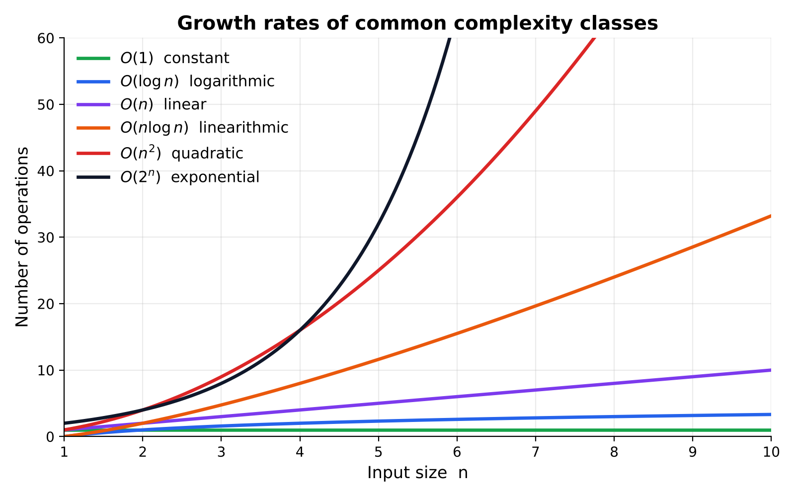

*Figure 2.1. How the common complexity classes grow with input size $n$. The table below gives values for three sizes.*

The gap between classes becomes enormous as $n$ grows:

| $n$ | $\log_2 n$ | $n \log_2 n$ | $n^2$ | $2^n$ |
| :--- | :--- | :--- | :--- | :--- |
| 10 | 3.3 | 33 | 100 | 1,024 |
| 100 | 6.6 | 664 | 10,000 | about $1.27 \times 10^{30}$ |
| 1,000 | 10.0 | 9,966 | 1,000,000 | about $1.07 \times 10^{301}$ |

#### Worked Example: Proving a $\Theta$ Bound

Show that $f(n) = 3n^2 + 5n + 2$ is $\Theta(n^2)$.

1. **Lower bound.** For every $n \geq 1$, $3n^2 \leq 3n^2 + 5n + 2$. So $c_1 = 3$ works.
2. **Upper bound.** For $n \geq 1$, $5n \leq 5n^2$ and $2 \leq 2n^2$, so $3n^2 + 5n + 2 \leq 3n^2 + 5n^2 + 2n^2 = 10n^2$. So $c_2 = 10$ works.
3. With $c_1 = 3$, $c_2 = 10$ and $n_0 = 1$, the definition of $\Theta$ is satisfied.

The lower-order terms $5n + 2$ do not change the growth rate; only the highest-order term matters.

#### Common Mistakes

- Do not confuse Big O with exact running time: $O(n)$ says how the work grows, not how many seconds it takes.
- Do not claim that Big O always means worst case: it bounds a function, and that function can describe the best, average or worst case.
- Do not compare algorithms only by asymptotic notation when inputs are small or constant factors are large (Section 1.4, Question 4 gives an example).

### 1.2 Recurrence Relations

A recurrence relation expresses a function in terms of its values on smaller inputs. In algorithm analysis, we use this to analyse recursive algorithms.

**Why?** A recursive algorithm solves a problem by calling itself on smaller inputs, so its running time depends on its own running time for those smaller inputs. Writing this relationship as a recurrence, and then solving it, gives the total cost.

#### Building a Recurrence From an Algorithm

$$T(n)=aT\left(\frac{n}{b}\right)+f(n)$$

where:

- $a$ is the number of recursive calls.
- $\frac{n}{b}$ is the size of each subproblem
- $f(n)$ is the work performed outside those recursive calls

#### Solving a Recurrence: The Master Theorem (Simplified)

When $a \geq 1$, $b > 1$ and $f(n) = \Theta(n^d)$ with $d \geq 0$, compare $d$ with $\log_b a$:

| Case | Result | Intuition |
| :--- | :--- | :--- |
| $d < \log_b a$ | $T(n) = \Theta(n^{\log_b a})$ | The recursive calls dominate |
| $d = \log_b a$ | $T(n) = \Theta(n^d \log n)$ | Every level of recursion does equal work |
| $d > \log_b a$ | $T(n) = \Theta(n^d)$ | The work outside the calls dominates |

#### Worked Example: Merge Sort

Merge sort splits an array into two halves ($a = 2$, $b = 2$), sorts each recursively, then merges them in linear time ($f(n) = \Theta(n)$, so $d = 1$):

$$T(n) = 2T\left(\frac{n}{2}\right) + cn$$

**Recursion tree view.** The top level does $cn$ work to merge. The next level has 2 subproblems of size $n/2$, doing $2 \times c(n/2) = cn$ work. Every level does $cn$ work, and halving $n$ down to 1 takes $\log_2 n$ levels. The total is $cn \log_2 n$, so $T(n) = \Theta(n \log n)$.

**Master theorem view.** $\log_b a = \log_2 2 = 1 = d$, so the middle case applies: $\Theta(n \log n)$. Both methods agree.

Binary search makes one recursive call on half the input with constant extra work: $T(n) = T(n/2) + c$. Here $a = 1$, $b = 2$, $d = 0$ and $\log_2 1 = 0 = d$, so $T(n) = \Theta(\log n)$.

#### Where Recurrences Are Used

Recurrences describe the cost of recursive algorithms, including:

- Divide-and-conquer algorithms such as merge sort
- Recursive searching, such as binary search
- Recursive tree algorithms
- Recursive matrix multiplication

### 1.3 Amortised Analysis

Amortised analysis determines the cost per operation over a sequence of operations, providing a worst-case guarantee on the sequence without relying on probabilities.

It is needed because some data-structure operations are expensive only occasionally. Judging the structure by its rare worst operation would make it look much slower than it really is over a whole sequence.

#### Amortised vs. Average-Case Analysis

- **Average-case analysis** relies on a probability distribution over inputs or operations.
- **Amortised analysis** establishes a bound over every permitted sequence of operations, subject to the data structure's rules.

#### Worked Example: A Doubling Dynamic Array

A dynamic array starts with capacity 1. When it is full, it allocates an array twice as large and copies every element across. Count the cost of 8 appends, where writing one element costs 1 and copying one element costs 1:

| Append | Array full? | Elements copied | Capacity afterwards |
| :--- | :--- | :--- | :--- |
| 1st | No | 0 | 1 |
| 2nd | Yes | 1 | 2 |
| 3rd | Yes | 2 | 4 |
| 4th | No | 0 | 4 |
| 5th | Yes | 4 | 8 |
| 6th–8th | No | 0 | 8 |

Total cost: 8 writes + $(1 + 2 + 4) = 7$ copies $= 15$, which is fewer than 2 per append. One append (the 5th) cost 5, but the expensive appends are rare. In general, $n$ appends copy fewer than $n$ elements in total, so the total cost is below $2n$ and each append costs $O(1)$ amortised.

### 1.4 Check Your Understanding

1. **True or false? Explain.** (a) $5n^3 + 100n = O(n^3)$. (b) $n^2 = O(n^3)$. (c) $n^3 = O(n^2)$. (d) $2n = o(n)$. (e) $n^2 = \Omega(n)$. (f) $n \log_2 n = \Theta(n)$.
2. **Solve.** Use the master theorem: (a) $T(n) = 4T(n/2) + n$; (b) $T(n) = 2T(n/2) + n^2$; (c) $T(n) = 8T(n/2) + n^2$ (simple recursive matrix multiplication).
3. **Trace.** Continue the dynamic-array example up to 16 appends. How many elements are copied in total, and what is the total cost?
4. **Find the error.** "Algorithm A is $O(n^2)$ and algorithm B is $O(n \log n)$, so B is faster than A for every input." Give two reasons this conclusion is unsafe.

#### Answers

1. (a) True: $5n^3 + 100n \leq 105n^3$ for $n \geq 1$. (b) True: Big O is only an upper bound, so it need not be tight. (c) False: no constant $c$ makes $n^3 \leq cn^2$ for all large $n$, because $n^3 / n^2 = n$ grows without limit. (d) False: $2n / n = 2$ does not shrink towards 0, so $2n$ is not strictly slower than $n$. (e) True: $n^2 \geq 1 \cdot n$ for all $n \geq 1$, so $c = 1$ and $n_0 = 1$ work. (f) False: $(n \log_2 n)/n = \log_2 n$ grows without limit, so no constant $c_2$ makes $n \log_2 n \leq c_2 n$ for all large $n$; the upper half of the $\Theta$ definition fails.
2. (a) $\log_2 4 = 2 > d = 1$, so $\Theta(n^2)$. (b) $\log_2 2 = 1 < d = 2$, so $\Theta(n^2)$. (c) $\log_2 8 = 3 > d = 2$, so $\Theta(n^3)$.
3. Appends 9 to 16 trigger one more resize, at the 9th append, copying 8 elements. Total copies $= 1 + 2 + 4 + 8 = 15$; total cost $= 16 + 15 = 31$, still under 2 per append.
4. First, Big O is an upper bound: A might also be $O(n \log n)$, or B's bound might not be tight. Second, asymptotic notation hides constant factors, so for small inputs A can be faster (for example, $2n^2$ is smaller than $100\,n \log_2 n$ for every $n$ from 2 to 438).

**Sources for this topic:** Cormen et al. (2022), Ch. 3 (asymptotic notation), Ch. 4 (recurrences and the master method) and Ch. 16 (amortised analysis).

---

## Topic 2: Core Algorithms Design Paradigms

A design paradigm is a general strategy for constructing algorithms. It is not one specific algorithm, rather, it is a reusable approach that can be applied to many different problems.

### 2.1 Divide and Conquer

Divide and conquer solves a problem by dividing it into smaller subproblems, solving those subproblems recursively, and combining their solutions.

The three stages in this method:

1. Divide
2. Conquer
3. Combine the solutions together

#### Example Algorithms

- Merge sort
- Binary search

#### Worked Example: Merge Sort and Binary Search

Sort [38, 27, 43, 3, 9, 82, 10] with merge sort.

1. **Divide:** [38, 27, 43, 3] and [9, 82, 10]; then [38, 27], [43, 3], [9, 82] and [10].
2. **Conquer:** sort the small pieces: [27, 38], [3, 43], [9, 82], [10].
3. **Combine:** merge pairs by repeatedly taking the smaller front element: [3, 27, 38, 43] and [9, 10, 82]; then [3, 9, 10, 27, 38, 43, 82].

Binary search for 43 in that sorted array (indices 0–6): the middle index is 3, holding 27. Since 43 > 27, search indices 4–6; their middle is index 5, which holds 43. Found after 2 comparisons instead of up to 7.

#### Conditions for Effective Divide and Conquer

- Subproblems are smaller than the original
- Their solutions can be computed recursively
- The subproblems are independent or their dependencies can be managed
- The combination step is efficient
- The recurrence yields a favourable total cost

#### Limitations

- Recursion overhead
- Memory consumption
- The possibility that the combination stage is expensive

### 2.2 Greedy Algorithms

A greedy algorithm constructs a solution incrementally by choosing what appears to be the best available option at each step.

A greedy algorithm does not generally explore every possible solution. Instead, it commits to a locally attractive choice, hoping that the sequence of choices produces a globally optimal solution.

However, a locally optimal choice is not necessarily globally optimal. Greedy algorithms require a proof that their choices preserve the possibility of an optimal solution.

#### Two Important Properties

##### Greedy-Choice Property

A problem has the greedy-choice property when there exists an optimal solution that begins with a valid greedy choice. After making that choice, the remaining problem can be solved to obtain an optimal overall solution.

This property must be established for the particular problem. It can't be assumed merely because the greedy choice seems sensible.

##### Optimal Substructure

A problem has optimal substructure when an optimal solution can be constructed using optimal solutions to appropriate smaller or residual subproblems.

Optimal substructure is also important in dynamic programming.

#### Worked Example: When Greedy Works and When It Fails

**Problem:** pay an amount using as few coins as possible. **Greedy rule:** always take the largest coin that still fits.

- Coins {1, 5, 10, 25}, amount 63: greedy takes 25, 25, 10, 1, 1, 1, which is 6 coins. This is optimal; for these coin values the greedy-choice property holds.
- Coins {1, 3, 4}, amount 6: greedy takes 4, 1, 1, which is 3 coins. But 3 + 3 uses only 2 coins. Taking the largest coin first was locally attractive but not globally optimal.

The same rule is correct for one coin system and wrong for another, which is why greedy algorithms need a proof. Section 2.3 solves the second case correctly with dynamic programming.

#### Greedy Graph Algorithms

Three important graph algorithms are greedy. Topic 3 explains and traces them; here, notice that each one makes the locally best choice at every step.

- **Kruskal's Algorithm:** Repeatedly selects the lowest-weight edge that does not create a cycle, joining separate components until all vertices are connected.
- **Prim's Algorithm:** Repeatedly adds the lowest-weight edge connecting the current tree to a vertex outside it.
- **Dijkstra's Algorithm:** Repeatedly settles (makes final) the unsettled vertex with the smallest tentative distance, under the assumption that edge weights are non-negative.

### 2.3 Dynamic Programming (DP)

Dynamic programming is a method for solving problems by breaking them into subproblems, solving each distinct subproblem once, and storing the result for reuse.

It is especially useful when subproblems overlap and the problem has optimal substructure.

In some recursive algorithms, the same subproblem may be solved many times. Dynamic programming eliminates this repeated work by remembering previously computed results.

#### Two Main Properties

##### Overlapping Subproblems

Subproblems overlap when the same smaller problem appears repeatedly during the computation.

##### Optimal Substructure

A problem has optimal substructure when its optimal solution can be expressed using optimal solutions to suitable smaller subproblems.

#### Two Implementation Approaches

##### Memoization: Top-Down Dynamic Programming

- Begin with a recursive solution.
- Store the result whenever a subproblem is solved
- Before solving a subproblem, check whether its result is already stored
- Return the stored result when available.

Memoization often preserves the structure of the original recursive definition.

##### Tabulation: Bottom-Up Dynamic Programming

- Identify the smallest subproblems.
- Compute their answers first.
- Store the result in a table.
- Use those results to calculate progressively larger subproblems.

Tabulation often avoids recursive call overhead and can make memory usage easier to optimise.

> **The quality of a dynamic programming solution depends on defining the right states, recurrence, base cases, and computation order.**

#### Worked Example: Fibonacci Numbers

The Fibonacci numbers are defined by $F(0) = 0$, $F(1) = 1$ and $F(n) = F(n-1) + F(n-2)$.

- **State:** $F(n)$. **Recurrence:** $F(n) = F(n-1) + F(n-2)$. **Base cases:** $F(0)$ and $F(1)$. **Order:** increasing $n$.
- **Plain recursion** recomputes the same values again and again: computing $F(5)$ makes 15 calls, and computing $F(30)$ makes 2,692,537 calls.
- **Memoization** computes each of $F(0), \ldots, F(n)$ once, so $F(30)$ needs only 31 distinct computations.
- **Tabulation** fills a table from the bottom:

| $n$ | 0 | 1 | 2 | 3 | 4 | 5 | 6 | 7 | 8 | 9 | 10 |
| :--- | :--- | :--- | :--- | :--- | :--- | :--- | :--- | :--- | :--- | :--- | :--- |
| $F(n)$ | 0 | 1 | 1 | 2 | 3 | 5 | 8 | 13 | 21 | 34 | 55 |

#### Worked Example: Fewest Coins, Done Correctly

Section 2.2 showed greedy failing for coins {1, 3, 4} and amount 6. Let $D(v)$ be the fewest coins that make value $v$. Then $D(0) = 0$ and

$$D(v) = 1 + \min_{\text{coin } c \,\leq\, v} D(v - c)$$

| $v$ | 0 | 1 | 2 | 3 | 4 | 5 | 6 |
| :--- | :--- | :--- | :--- | :--- | :--- | :--- | :--- |
| $D(v)$ | 0 | 1 | 2 | 1 | 1 | 2 | 2 |

For example, $D(6) = 1 + \min(D(5), D(3), D(2)) = 1 + \min(2, 1, 2) = 2$, achieved by 3 + 3. DP considers every last coin; greedy considered only the largest.

### 2.4 Backtracking & Branch-and-Bound

These two methods both explore a search space of candidate solutions, but they use different criteria to prune the search.

#### Backtracking

Backtracking constructs a candidate solution incrementally and abandons a partial candidate as soon as it violates a constraint or cannot lead to a valid solution.

It is naturally represented as a depth-first search tree:

- Each node represents a partial assignment.
- Each edge represents a choice that extends the partial assignment.
- A leaf represents a complete candidate or a dead end.
- A pruned branch is never explored further.

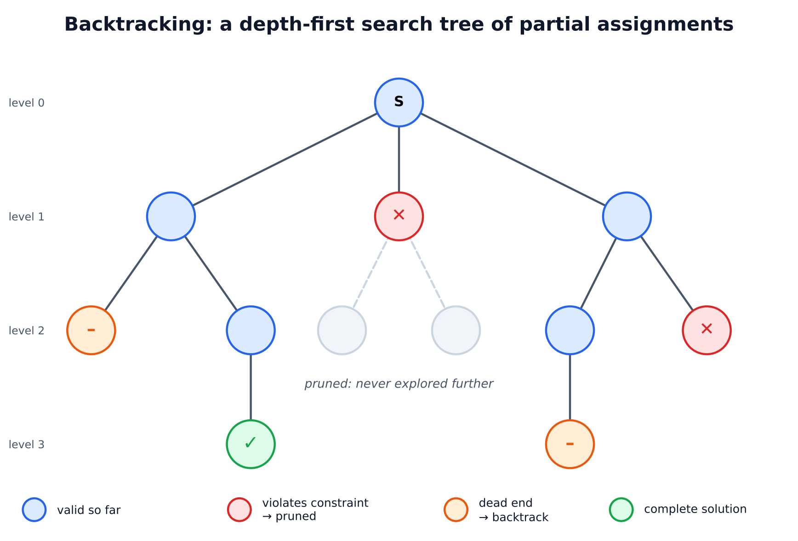

*Figure 2.2. A backtracking search tree. Each node is a partial assignment. A branch is pruned as soon as it breaks a constraint, and a dead end sends the search back to the most recent choice.*

Backtracking is particularly useful for constraint-satisfaction problems, where the objective is to find one or all assignments satisfying a set of conditions.

#### Worked Example: Subset Sum by Backtracking

Find a subset of {3, 5, 6, 7} whose sum is exactly 15. Decide for each number in turn whether to include it, and stop exploring a branch as soon as its sum exceeds 15.

1. Include 3 (sum 3), include 5 (sum 8), include 6 (sum 14).
2. Include 7: the sum would be 21 > 15, so this branch is **pruned**.
3. Exclude 7: no numbers are left and the sum is 14 ≠ 15, a **dead end**. Backtrack.
4. Return to the choice about 6 and exclude it (sum 8). Include 7: sum 15. **Solution: {3, 5, 7}.**

The search never had to list all $2^4 = 16$ subsets.

#### Branch-and-bound

Branch-and-bound is primarily an optimisation technique. It searches for the best solution and uses bounds to determine whether a partial candidate could possibly outperform the best solution already found.

It has 4 main elements:

1. **Branching:** Split the search into subproblems.
2. **Bounding:** Compute an optimistic estimate of the best objective achievable within a subproblem.
3. **Incumbent:** Maintain the best complete feasible solution found so far.
4. **Pruning:** Discard a subproblem when its bound proves that it cannot improve the incumbent.

#### Worked Example: A Small Knapsack

A bag holds at most 10 kg. Choose items to maximise total value:

| Item | Weight (kg) | Value | Value per kg |
| :--- | :--- | :--- | :--- |
| A | 4 | 40 | 10 |
| B | 6 | 42 | 7 |
| C | 5 | 25 | 5 |
| D | 3 | 12 | 4 |

**Bound:** the value already chosen, plus the remaining capacity multiplied by the best value per kg among the items not yet decided. This is optimistic, because it pretends the space could be filled with that best rate.

1. **Root:** nothing chosen; bound $= 0 + 10 \times 10 = 100$.
2. **Include A:** value 40, 6 kg left; bound $= 40 + 6 \times 7 = 82$. **Exclude A:** bound $= 0 + 10 \times 7 = 70$.
3. Expand the more promising node, "include A". **Include B:** value 82, weight 10, bag full. C and D no longer fit, so this is a complete solution and becomes the **incumbent (82)**.
4. **Include A, exclude B:** bound $= 40 + 6 \times 5 = 70 \leq 82$, so **prune**.
5. **Exclude A:** bound $70 \leq 82$, so **prune**.

The optimum is {A, B} with value 82, found without examining most of the 16 possible subsets.

### 2.5 Randomised Algorithms

A randomised algorithm uses random choices during its execution. These choices influence its behaviour, running time, or output.

Randomisation can simplify algorithms, avoid adversarial inputs, and provide strong expected performance. Analysis must account for the probability distribution induced by the random choices.

#### Las Vegas Algorithms

A Las Vegas algorithm always returns a correct answer, but its running time may vary because of random choices.

Randomised quicksort is a standard example. It randomly selects a pivot, then partitions the array around that pivot. Different pivot choices produce different partition sizes, but the final sorted array is correct.

For example, sorting [5, 2, 8, 1, 9] with pivot 8 gives [5, 2, 1] | 8 | [9], while pivot 5 gives [2, 1] | 5 | [8, 9]. The splits differ, but both runs end with [1, 2, 5, 8, 9]. The expected running time is $O(n \log n)$; the worst case, with consistently bad pivots, is $O(n^2)$ but very unlikely.

#### Monte Carlo Algorithms

A Monte Carlo algorithm has a bounded or otherwise controlled running time but may return an incorrect answer with a specified probability.

The Miller–Rabin primality test is an example. If it reports "composite", the number is certainly composite. If it reports "probably prime", it is wrong with probability at most $1/4$ for each independent round, so 10 rounds bring the error below $(1/4)^{10}$, less than one in a million.

#### Types of Error

- **One-sided error:** Only one type of mistake is possible.
- **Two-sided error:** Both false positives and false negatives may occur.

Miller–Rabin has one-sided error: it can wrongly answer "probably prime" for a composite number, but it never wrongly answers "composite".

#### Why Randomisation Helps

Randomisation can prevent an algorithm from behaving badly on inputs designed to exploit a fixed deterministic strategy. Random pivots in quicksort, random sampling, hashing, and randomised graph algorithms are important examples.

However, randomisation does not automatically guarantee efficiency. A randomised algorithm still needs an analysis of its error probability, expected cost, or probability of exceeding a chosen cost threshold.

### 2.6 Approximation Algorithms and NP-hardness

This section connects practical algorithm design with computational complexity theory. It explains what to do when exact optimisation may require an impractical amount of computation.

#### Approximation Algorithms

An approximation algorithm efficiently returns a feasible solution whose quality is guaranteed to be close to optimal.

For a minimisation problem, let:

- $C$ be the cost of the algorithm's solution.
- $C^{*}$ be the optimal cost.

An algorithm has approximation ratio at most $\rho\geq 1$ if:

$$C\leq\rho C^*$$

For a maximisation problem, one common convention is

$$C\geq\frac{C^*}{\rho}$$

#### Worked Example: A 2-Approximation for Vertex Cover

A **vertex cover** is a set of vertices that touches every edge. Finding the smallest one is NP-hard. A simple approximation:

1. Pick any edge that is not yet covered.
2. Add **both** of its endpoints to the cover.
3. Repeat until every edge is covered.

On the path a–b–c–d (edges a–b, b–c, c–d), picking a–b adds {a, b}, which also covers b–c. Then c–d adds {c, d}. The result {a, b, c, d} has 4 vertices, while the optimum {b, c} has 2, a ratio of exactly 2.

The ratio can never be worse than 2. The chosen edges share no endpoints, so any cover, including the optimal one, needs at least one endpoint of each chosen edge, while the algorithm takes two.

#### P, NP, NP-hard, and NP-complete

An algorithm runs in **polynomial time** if its running time is $O(n^k)$ for some fixed constant $k$, such as $O(n)$, $O(n^2)$ or $O(n^3)$. Exponential running times such as $O(2^n)$ are not polynomial.

A **decision problem** has a yes/no answer, such as "Is there a route shorter than 100 km?". A **certificate** is evidence for a "yes" answer, such as the route itself. A **polynomial-time reduction** converts instances of one problem into instances of another, so that a fast solver for the second would also solve the first.

- **P** is the class of decision problems solvable by a deterministic algorithm in polynomial time.
- **NP** is the class of decision problems for which a proposed yes-solution can be verified in polynomial time. Equivalently, these problems have certificates that can be checked efficiently.
- Every problem in P is also in NP, because a yes-answer can be checked simply by solving the problem.
- It is not known whether $P=NP$. In particular, the fact that a problem belongs to NP does not mean that it is known to be computationally difficult, nor does it mean that its solutions are impossible to find efficiently.
- A problem is **NP-hard** if every problem in NP can be reduced to it using an appropriate polynomial-time reduction. NP-hard problems are at least as hard as all problems in NP under that reduction framework.
- A problem is **NP-complete** if it is both in NP and NP-hard.

For example, "Does some subset of {3, 5, 6, 7} sum to 15?" is in NP: the certificate {3, 5, 7} is checked with two additions. Subset sum is also NP-complete, so no polynomial-time algorithm for it is known.

### 2.7 Check Your Understanding

1. **Identify the paradigm.** Name the design paradigm used by: (a) merge sort; (b) Dijkstra's algorithm; (c) counting the ways to climb $n$ stairs taking 1 or 2 steps at a time, by filling a table of answers for 1, 2, …, $n$ stairs; (d) solving a Sudoku by filling cells and undoing choices that break a rule; (e) randomised quicksort.
2. **Compare.** With coins {1, 6, 10} and amount 12, what does the greedy method give? What is the optimal answer? Which paradigm finds it reliably?
3. **Trace.** Extend the DP table in Section 2.3 to find $D(7)$ for coins {1, 3, 4}, and give the coins used.
4. **Explain.** Plain recursion for $F(30)$ makes 2,692,537 calls, but memoization needs 31 computations. Explain where the difference comes from.
5. **Explain a decision.** In the knapsack example, why was the "exclude A" node never expanded?
6. **Find the error.** "Monte Carlo algorithms are always correct but sometimes slow." Correct the statement.
7. **Apply.** Run the vertex-cover approximation on a star graph: a centre $x$ joined to leaves 1, 2, 3 and 4. What cover does it return, and what is the optimal cover?
8. **Classify and explain.** (a) Is the problem "Is there a path from vertex A to vertex F?" in P? (b) For the problem "Does this graph have a vertex cover with at most 2 vertices?", what would a certificate be, and how would you check it? (c) **Find the error:** "Subset sum is in NP, so it cannot be solved quickly."

#### Answers

1. (a) Divide and conquer. (b) Greedy. (c) Dynamic programming: the number of ways for $n$ stairs is the sum of the answers for $n - 1$ and $n - 2$ stairs, so the same subproblems recur, as in the Fibonacci example. (d) Backtracking. (e) Randomised (Las Vegas).
2. Greedy takes 10, 1, 1, which is 3 coins. The optimum is 6 + 6, which is 2 coins. Dynamic programming finds it reliably because it checks every possible last coin.
3. $D(7) = 1 + \min(D(6), D(4), D(3)) = 1 + \min(2, 1, 1) = 2$, using 3 + 4.
4. Plain recursion solves the same subproblems repeatedly; for example, $F(28)$ is computed once as part of $F(29)$ and again directly by $F(30)$, and this repetition multiplies at every level. Memoization stores each $F(k)$ the first time, so each of $F(0)$ to $F(30)$ is computed only once.
5. Its bound was $0 + 10 \times 7 = 70$. Even in the best case, that branch could not beat the incumbent value 82, so it was pruned.
6. That describes a Las Vegas algorithm. A Monte Carlo algorithm has a controlled running time but may give a wrong answer with a small, specified probability.
7. Picking edge $x$–1 adds $\{x, 1\}$, which already covers all four edges, so the algorithm returns $\{x, 1\}$ (2 vertices). The optimum is $\{x\}$ (1 vertex). The ratio is 2, the worst case the guarantee allows.
8. (a) Yes. BFS answers it in $O(V + E)$ time, which is polynomial. Like every problem in P, it is also in NP. (b) The certificate is the proposed set of at most 2 vertices. Check that every edge has at least one endpoint in the set; this takes time proportional to the number of edges, so the problem is in NP. (c) Being in NP only means that a yes-answer can be checked quickly, and every problem in P is also in NP, so membership says nothing about hardness. Subset sum is believed to be hard because it is NP-complete, and even that is unproven while the P versus NP question remains open.

**Sources for this topic:** Cormen et al. (2022), Ch. 2 and 4 (divide and conquer), 7 (quicksort), 14 (dynamic programming), 15 (greedy algorithms), 31 (primality testing), 34 (NP-completeness) and 35 (approximation algorithms); Kleinberg & Tardos (2006), Ch. 4–6, 8 and 11; Motwani & Raghavan (1995).

---

## Topic 3: Graph Algorithms

Graph algorithms operate on structures consisting of vertices and edges. They are fundamental to route planning, communication networks, dependency analysis, social networks, scheduling, circuit design, and transportation systems.

**Keywords:**

- **Vertex (node):** An entity represented in the graph.
- **Edge:** A connection between vertices.
- **Directed graph:** Each edge has a direction, such as $u\to v$.
- **Undirected graph:** Each edge connects two vertices without a direction.
- **Weighted graph:** Each edge has an associated value, such as distance, time, or cost.
- **Path:** A sequence of vertices connected by edges.
- **Cycle:** A path that returns to its starting vertex without repeating intermediate vertices, under the usual simple-cycle definition.
- **Connected graph:** An undirected graph in which every vertex can reach every other vertex.
- **Connected component:** A maximal connected part of an undirected graph.
- **Degree:** The number of incident edges in an undirected graph. In a directed graph, indegree and outdegree count incoming and outgoing edges separately.
- **Adjacency list:** A common way to store a graph: for each vertex, a list of its neighbours. It uses memory proportional to $V + E$, where $V$ is the number of vertices and $E$ the number of edges.

### 3.1 Graph Traversal

Graph traversal is the systematic process of visiting vertices or edges in a graph according to a defined exploration strategy.

Traversal is useful for determining reachability, identifying connected components, detecting cycles, constructing spanning trees, finding paths, and ordering dependent tasks.

The two fundamental traversal algorithms are:

- Breadth-first search (BFS).
- Depth-first search (DFS).

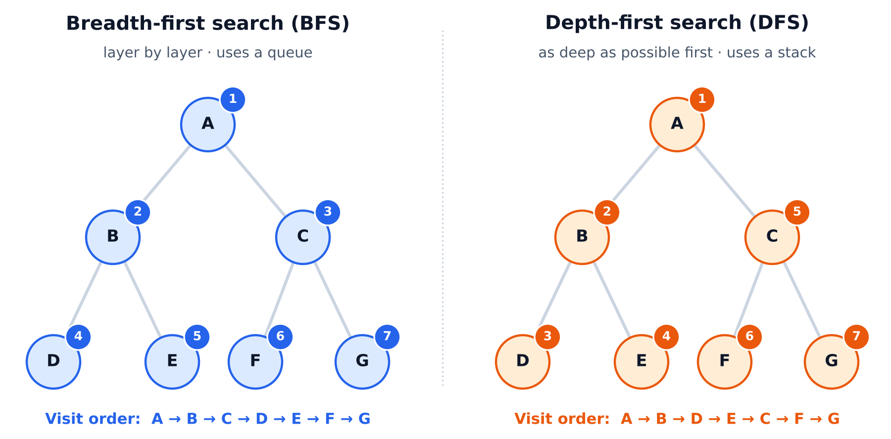

*Figure 2.3. The order in which BFS and DFS visit the vertices of the same tree, starting from A. The worked example below traces the BFS half step by step.*

#### Breadth-First Search (BFS)

BFS explores a graph in layers. Starting from a source vertex, it visits all vertices one edge away before visiting vertices two edges away, then three edges away, and so on.

It uses a queue, which follows first-in, first-out order.

BFS explores vertices in non-decreasing order of their distance from the source. A vertex is discovered through a predecessor at the preceding distance level. If a shorter path existed, the vertex would have been reachable from an earlier level, and BFS would have discovered it earlier. Therefore, BFS finds a minimum-edge-count path from the source to every reachable vertex.

**Steps:**

1. Mark the source as discovered and put it in the queue.
2. Remove the vertex at the front of the queue and visit it.
3. Add each of its neighbours that has not been discovered to the back of the queue, marking it discovered.
4. Repeat steps 2–3 until the queue is empty.

#### Worked Example: BFS on the Tree in Figure 2.3

In the tree, A is joined to B and C, B is joined to D and E, and C is joined to F and G. Start at A, and add neighbours in alphabetical order.

| Step | Vertex visited | Queue afterwards (front → back) |
| :--- | :--- | :--- |
| 1 | A | B, C |
| 2 | B | C, D, E |
| 3 | C | D, E, F, G |
| 4 | D | E, F, G |
| 5 | E | F, G |
| 6 | F | G |
| 7 | G | (empty) |

The visit order A, B, C, D, E, F, G matches the BFS half of the figure. DFS, which uses a stack (or recursion) instead of a queue, visits A, B, D, E, C, F, G.

#### Depth-First Search (DFS)

DFS explores as far as possible along a branch before returning to explore another branch. It can be implemented using recursion or an explicit stack.

DFS can be used to:

- Find reachable vertices.
- Identify connected components in undirected graphs.
- Detect cycles.
- Produce a topological order in a directed acyclic graph: an order of the vertices in which every edge points forward, such as an order for tasks that respects their dependencies.
- Find strongly connected components (groups of vertices in a directed graph in which every vertex can reach every other) using suitable extensions.
- Classify edges and analyse structural properties of graphs.

DFS does not generally find shortest paths in an unweighted graph. It prioritises depth, not distance.

### 3.2 Shortest Paths

The shortest-path problem seeks a path between vertices whose total edge weight is minimum.

A shortest path need not be the path with the fewest edges. A path with more edges can have a lower total weight.

#### Relaxation

Many shortest-path algorithms use a procedure called relaxation.

Relaxation improves a distance estimate when a cheaper route has been found. The algorithm's strategy determines when these estimates become final.

For an edge from $u$ to $v$ with weight $w(u, v)$, relaxation is:

$$\text{if } d[u] + w(u, v) < d[v] \text{ then } d[v] \leftarrow d[u] + w(u, v)$$

#### Dijkstra's Algorithm

Dijkstra's algorithm finds shortest-path distances from one source to all reachable vertices in a graph with non-negative edge weights.

Its main idea is to repeatedly select the unsettled vertex with the smallest tentative distance and finalise that distance.

**Steps:**

1. Set $d[\text{source}] = 0$ and every other $d[v] = \infty$.
2. Pick the unsettled vertex $u$ with the smallest $d[u]$ (a priority queue does this efficiently) and mark it settled. A settled distance is final and is never changed again.
3. Relax every edge from $u$ to an unsettled vertex.
4. Repeat steps 2–3 until every reachable vertex is settled.

#### Worked Example: Dijkstra's Algorithm

Directed graph with edges S→A (4), S→B (1), B→A (2), A→C (1), B→C (5) and C→D (3). Source S.

| Step | Settle | d[S] | d[A] | d[B] | d[C] | d[D] |
| :--- | :--- | :--- | :--- | :--- | :--- | :--- |
| Start | — | 0 | ∞ | ∞ | ∞ | ∞ |
| 1 | S (0) | **0** | 4 | 1 | ∞ | ∞ |
| 2 | B (1) | **0** | 3 | **1** | 6 | ∞ |
| 3 | A (3) | **0** | **3** | **1** | 4 | ∞ |
| 4 | C (4) | **0** | **3** | **1** | **4** | 7 |
| 5 | D (7) | **0** | **3** | **1** | **4** | **7** |

Bold values are final. In step 2, the route S→B→A (1 + 2 = 3) replaced the direct edge S→A (4): the shortest path used more edges but less total weight.

#### Bellman–Ford Algorithm

Bellman–Ford solves the single-source shortest-path problem even when some edge weights are negative. It requires only that no negative-weight cycle can be reached from the source. Otherwise, going round that cycle again and again lowers the path cost without limit, so no shortest path exists.

**Steps:** relax every edge, and repeat this pass $V - 1$ times. A shortest path has at most $V - 1$ edges, so this is enough. If one more pass still improves some distance, the graph contains a negative-weight cycle reachable from the source.

**Why Dijkstra needs non-negative weights.** Take edges A→B (2), A→C (5) and C→B (−4), with source A. Dijkstra settles B at distance 2 before it looks at C. The true shortest distance to B is $5 + (-4) = 1$, through C. Bellman–Ford finds 1 because it keeps relaxing every edge.

#### Floyd–Warshall Algorithm

Floyd–Warshall solves the all-pairs shortest-path problem, computing the shortest distance between every ordered pair of vertices. It uses dynamic programming.

Let $d_k(i, j)$ be the shortest distance from $i$ to $j$ using only vertices $1, \ldots, k$ as intermediate stops. Then:

$$d_k(i, j) = \min\big(d_{k-1}(i, j),\; d_{k-1}(i, k) + d_{k-1}(k, j)\big)$$

Each step asks one question: is it shorter to go through vertex $k$?

### 3.3 Minimum Spanning Trees

A spanning tree of a connected, undirected graph is a subgraph that:

1. Includes every vertex.
2. Is connected.
3. Contains no cycles.

A minimum spanning tree (MST) is a spanning tree with the smallest possible sum of edge weights.

An MST minimises the total weight required to connect all vertices. It does not generally minimise the distance from a particular source to every other vertex. That is a shortest-path-tree objective, which is different.

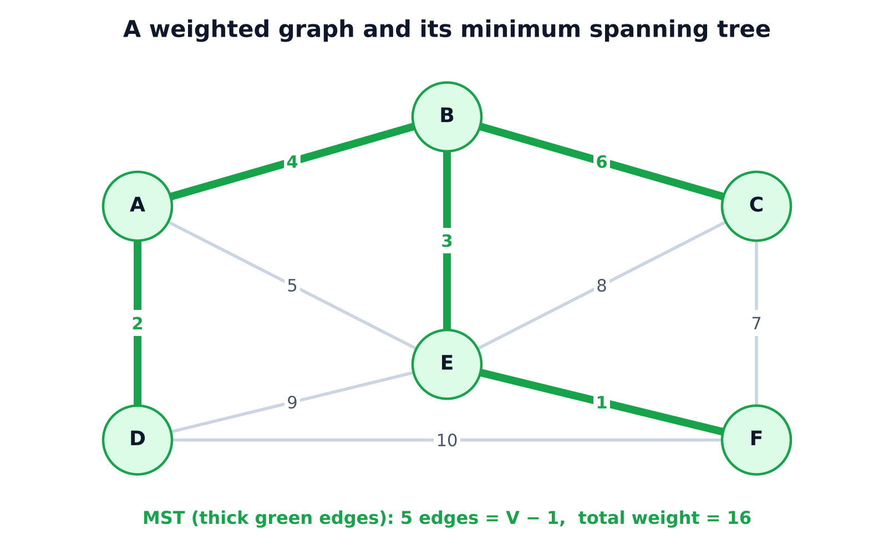

*Figure 2.4. A weighted graph with its minimum spanning tree highlighted. The worked examples below build this tree with Kruskal's and Prim's algorithms.*

#### Kruskal's Algorithm

Kruskal's algorithm considers edges in increasing order of weight and accepts an edge if adding it does not create a cycle.

**Procedure**

1. Sort all edges by non-decreasing weight.
2. Start with an empty forest in which each vertex is its own component.
3. Consider each edge in sorted order.
4. If its endpoints belong to different components, add it to the forest and merge those components.
5. Stop after selecting $V-1$ edges.

#### Worked Example: Kruskal's Algorithm on the Graph in Figure 2.4

The graph has 6 vertices and these weighted edges: A–B 4, A–D 2, A–E 5, B–C 6, B–E 3, C–E 8, C–F 7, D–E 9, E–F 1 and D–F 10. With 6 vertices, the MST needs $6 - 1 = 5$ edges.

| Edge | Weight | Decision | Reason |
| :--- | :--- | :--- | :--- |
| E–F | 1 | Accept | E and F were in different components |
| A–D | 2 | Accept | Different components |
| B–E | 3 | Accept | Different components |
| A–B | 4 | Accept | Joins {A, D} with {B, E, F} |
| A–E | 5 | Reject | A and E are already connected (A–B–E), so it would form a cycle |
| B–C | 6 | Accept | Connects C; 5 edges chosen, so stop |

Total weight $= 1 + 2 + 3 + 4 + 6 = 16$, matching the highlighted tree in the figure.

#### Prim's Algorithm

Prim's algorithm begins from an arbitrary vertex and grows a single tree. At each step, it chooses the minimum-weight edge connecting a vertex already in the tree to a vertex outside it.

Starting Prim at A on the same graph adds A–D (2), then A–B (4), B–E (3), E–F (1) and B–C (6). It chooses the same five edges in a different order, with the same total, 16.

Prim and Kruskal both produce an MST for a connected, undirected weighted graph. They differ in how they grow the solution:

- Prim grows one connected tree.
- Kruskal grows a forest and joins components.

#### Disconnected Graphs

If the graph is disconnected, no spanning tree can connect all vertices. Kruskal's algorithm instead produces a minimum spanning forest, containing a minimum spanning tree for each connected component.

Prim's algorithm must likewise be restarted in each component if a minimum spanning forest is desired.

### 3.4 Network Flow

A flow network is a directed graph in which each edge has a capacity limiting how much flow can pass through it. The network contains a source $s$, which supplies flow, and a sink $t$, which receives it.

A valid flow obeys two rules: the flow on an edge never exceeds its capacity, and at every vertex except $s$ and $t$, the flow in equals the flow out (**conservation**).

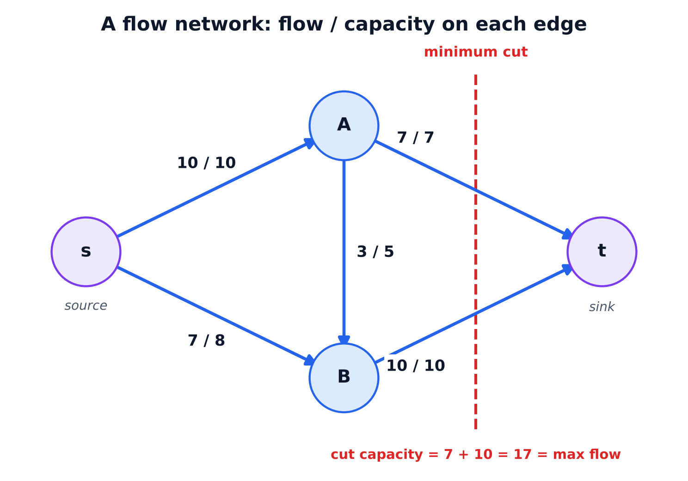

*Figure 2.5. A flow network with source $s$, sink $t$ and a capacity on each edge. The worked example below finds its maximum flow.*

Flow models include:

- Water through pipes.
- Data through communication links.
- Goods through transport networks.
- Assignments between workers and jobs.
- Bipartite matching and resource allocation.

#### The Residual Network

The residual network represents where additional flow can be sent or where existing flow can be reduced.

For an edge from $u$ to $v$ with capacity $c$ carrying flow $f$, the **residual capacity** forward is $c - f$ (how much more can be sent), and a backward residual edge from $v$ to $u$ has capacity $f$ (how much can be "sent back" by cancelling flow).

#### Augmenting Paths

An augmenting path is a path from source $s$ to sink $t$ in the residual network where every edge has positive residual capacity.

The **bottleneck** of an augmenting path is the smallest residual capacity on it; it is the most extra flow that path can carry.

#### The Ford–Fulkerson Method

The Ford–Fulkerson method repeatedly finds an augmenting path and increases the flow by its bottleneck capacity.

The high-level procedure is:

1. Initialise every edge's flow to zero.
2. Construct the residual network.
3. Find an augmenting path from source to sink.
4. Increase the flow by the path's bottleneck capacity.
5. Update the residual network.
6. Repeat until no augmenting path exists.

If every capacity is a whole number, each augmentation increases the flow value by at least one unit, so the method must stop after a finite number of rounds. With irrational capacities, a poor choice of paths can make the method run forever; the Edmonds–Karp algorithm (below) avoids this.

#### Worked Example: Ford–Fulkerson on the Network in Figure 2.5

Capacities: s→A 10, s→B 8, A→B 5, A→t 7, B→t 10.

| Round | Augmenting path | Residual capacities on the path | Bottleneck | Total flow |
| :--- | :--- | :--- | :--- | :--- |
| 1 | s → A → t | 10, 7 | 7 | 7 |
| 2 | s → A → B → t | 3, 5, 10 | 3 | 10 |
| 3 | s → B → t | 8, 7 | 7 | 17 |

After round 3, s→A, A→t and B→t are full. From $s$, only B (1 unit left on s→B) and then A (through the backward edge B→A) can be reached, and neither has spare capacity into $t$. No augmenting path remains, so the maximum flow is **17**, with the edge flows shown in the figure.

#### The Edmonds–Karp Algorithm

Edmonds–Karp is a specific implementation of Ford–Fulkerson that uses BFS to find an augmenting path with the fewest edges.

It avoids the potentially poor behaviour of arbitrary augmenting-path selection and terminates with a maximum flow in a finite graph.

#### The Max-Flow Min-Cut Theorem

Flow through any network cannot exceed the capacity of any source-sink cut. Every unit of flow reaching the sink must cross the cut, and the cut's outgoing edges limit how much flow can cross.

> The maximum-flow minimum-cut theorem states that the maximum possible flow value equals the minimum capacity of any source-sink cut.

This theorem provides both a way to certify optimality and a powerful connection between two apparently different optimisation problems.

In the example, the cut that separates {s, A, B} from {t} crosses A→t (7) and B→t (10), with capacity $7 + 10 = 17$. It equals the maximum flow, which proves that 17 cannot be beaten.

#### Applications and Reductions

- **Bipartite matching**
  - To match workers to jobs, connect a source to each worker, connect workers to the jobs they are qualified for, and connect jobs to a sink.
- **Assignment and resource allocation**
- **Circulation with demands**
  - Additional lower bounds or demand constraints can be handled by transformations to standard flow formulations.
- **Minimum cut**
  - Network reliability and partitioning problems can sometimes be represented through cut capacities.

#### Maximum Flow vs. Minimum-Cost Flow

These are different optimisation problems.

- **Maximum flow:** Maximise the total amount sent from source to sink, subject to capacities and conservation.
- **Minimum-cost flow:** Send a required amount of flow, or otherwise satisfy specified supplies and demands, while minimising the total cost.

In minimum-cost flow, each edge has both a capacity and a cost. A large-capacity route may be more expensive than a smaller-capacity route, so capacity alone is insufficient to determine the optimum.

### 3.5 Comparing Graph Algorithms

$V$ is the number of vertices and $E$ the number of edges. Running times assume adjacency lists and, where relevant, a binary heap.

| Algorithm | Problem solved | Paradigm | Weights allowed | Running time |
| :--- | :--- | :--- | :--- | :--- |
| BFS | Reachability; fewest-edge paths | Traversal (queue) | Unweighted | $O(V + E)$ |
| DFS | Reachability, cycles, topological order | Traversal (stack/recursion) | Unweighted | $O(V + E)$ |
| Dijkstra | Single-source shortest paths | Greedy | Non-negative | $O((V + E)\log V)$ |
| Bellman–Ford | Single-source shortest paths; detects negative cycles | Dynamic programming | Any | $O(VE)$ |
| Floyd–Warshall | All-pairs shortest paths | Dynamic programming | Any, no negative cycles | $O(V^3)$ |
| Kruskal | Minimum spanning tree | Greedy | Any | $O(E \log E)$ |
| Prim | Minimum spanning tree | Greedy | Any | $O(E \log V)$ |
| Edmonds–Karp | Maximum flow | Ford–Fulkerson with BFS | Non-negative capacities | $O(VE^2)$ |

### 3.6 Check Your Understanding

Use this undirected graph for questions 1 and 2. Adjacency lists, in alphabetical order: A: B, C · B: A, D · C: A, D, E · D: B, C, F · E: C, F · F: D, E.

1. **Predict.** List the BFS and DFS visit orders from A, visiting neighbours alphabetically. Give each vertex's BFS distance (number of edges) from A.
2. **Explain.** In this graph, DFS reaches C *after* D, although C is A's neighbour. Why doesn't this make DFS wrong?
3. **Trace.** Run Dijkstra's algorithm from A on the graph in Figure 2.4 (edges A–B 4, A–D 2, A–E 5, B–C 6, B–E 3, C–E 8, C–F 7, D–E 9, E–F 1, D–F 10). Give the final distance to every vertex.
4. **Find the error.** A student says: "To get from A to F as cheaply as possible, follow the minimum spanning tree." Using your answer to question 3, show why this is wrong.
5. **Explain.** Why can Dijkstra's algorithm fail when an edge has a negative weight? Give the result it reports for the graph A→B (2), A→C (5), C→B (−4).
6. **Compare.** Run Edmonds–Karp (always the augmenting path with the fewest edges; when two paths are equally short, take the one that comes first alphabetically) on the flow network in Section 3.4. Which paths are used, and is the final flow value the same as in the worked example?
7. **Trace and predict.** (a) Run Prim's algorithm from F on the graph in Figure 2.4 and list the edges in the order they are added. (b) Suppose the weight of B–C rises from 6 to 9. Which edge replaces it in the MST, and what is the new total weight?

#### Answers

1. BFS: A, B, C, D, E, F; distances A 0, B 1, C 1, D 2, E 2, F 3. DFS: A, B, D, C, E, F.
2. DFS is not meant to find shortest paths. It goes as deep as possible (A → B → D) before backing up, and D's neighbour C is undiscovered at that point, so DFS visits it next. Every vertex is still visited exactly once.
3. A 0, D 2, B 4, E 5, F 6, C 10. E is reached directly (5), not via B (7); F via E (5 + 1 = 6); C via B (4 + 6 = 10).
4. In the MST, the path from A to F is A–B–E–F, costing $4 + 3 + 1 = 8$. The shortest path is A–E–F, costing $5 + 1 = 6$. An MST minimises the total weight of the whole tree, not the distance between a particular pair of vertices.
5. Dijkstra assumes that once a vertex is settled, no later path can be shorter, which holds only if edges never decrease the distance. It settles B at 2 before exploring C, so it reports $d[B] = 2$, but the true shortest distance is $5 - 4 = 1$.
6. s→A→t (bottleneck 7), then s→B→t (8), then s→A→B→t (2). The flow value is again 17. The individual edge flows differ (for example, s→A carries 9 instead of 10), but every maximum flow has the same value.
7. (a) E–F (1), B–E (3), A–B (4), A–D (2), B–C (6), with total 16. These are the same five edges that Kruskal's algorithm chose: because all the edge weights are different, the graph has only one MST, so the starting vertex changes only the order. (b) C must still be connected, and its edges now weigh B–C 9, C–E 8 and C–F 7. Kruskal's algorithm reaches C–F first, and it joins C to the tree, so C–F replaces B–C. The new total is $1 + 2 + 3 + 4 + 7 = 17$.

**Sources for this topic:** Cormen et al. (2022), Ch. 20–24; Dijkstra (1959); Kruskal (1956); Prim (1957); Ford & Fulkerson (1956); Edmonds & Karp (1972).

---

# Chapter 3: Connectionist AI

## Chapter Overview

This chapter explains how artificial neural networks learn from data. It begins with the idea of connectionism and the single artificial neuron, then builds up the training process: loss functions, derivatives, gradient descent and backpropagation. It then compares the main network architectures, covers learning without labels and learning from rewards, and ends with the limits and responsible use of these systems.

The chapter relies on Chapter 2: training a network is an algorithm whose cost and correctness can be analysed, and gradient descent is an iterative optimisation method. Section 8.1.2 shows where the ideas of Chapters 1 and 2 reappear.

### Learning Outcomes

By the end of this chapter, you should be able to:

1. Explain how connectionist AI differs from symbolic AI.
2. Compute an artificial neuron's output and apply the perceptron learning rule.
3. Calculate mean squared error and binary cross-entropy for small examples.
4. Use partial derivatives and the chain rule to carry out a gradient-descent step and explain backpropagation.
5. Compare MLPs, CNNs, RNNs and Transformers and choose one for a task.
6. Distinguish supervised, semi-supervised, unsupervised, self-supervised and reinforcement learning.
7. Diagnose overfitting and underfitting from training and validation results and suggest remedies.
8. Discuss interpretability, bias and fairness in neural-network systems.

### Before You Start

You need basic algebra, functions and the idea of a derivative as a rate of change. Section 3.4 reviews the calculus that training needs, so you do not need to know partial derivatives beforehand.

---

## Topic 1: Introduction to Connectionist AI

### 1.1 What Is Connectionist AI?

Connectionist AI is an approach to artificial intelligence that models intelligent behaviour using networks of interconnected, simple computational units. These units are inspired by biological neurons and are commonly called **artificial neurons**.

#### 1.1.1 Main Characteristics

- **Interconnected units:** Artificial neurons are connected to form a network.
- **Learning from data:** The network adjusts its internal parameters based on examples.
- **Distributed representations:** Information can be represented across multiple neurons rather than stored in one location.
- **Nonlinear processing:** Activation functions allow networks to learn complex relationships.
- **Generalisation:** A trained network can make predictions on new data, provided it has learned useful patterns.

#### 1.1.2 Applications

Connectionist AI is used in many modern AI systems, including:

- Image recognition and object detection.
- Speech recognition and speech generation.
- Language translation and large language models.
- Recommendation systems.
- Medical image analysis.
- Robotics and autonomous vehicles.

### 1.2 Symbolic AI vs Connectionist AI

Symbolic AI represents knowledge using explicit symbols, rules, and logical relationships.

Connectionist AI learns patterns from examples instead of relying entirely on manually written rules.

| Feature | Symbolic AI | Connectionist AI |
| ------- | ----------- | ---------------- |
| Knowledge representation | Symbols and explicit rules | Numerical parameters and learned representations |
| Learning | Often requires manually defined rules or knowledge | Often learns from training data |
| Strength | Logical reasoning and interpretable rules | Pattern recognition and complex data |
| Limitation | Difficult to manually specify every relevant rule | Can require substantial data and computation |
| Example | Rule-based expert system | Image classification neural network |

**These approaches are not mutually exclusive. Some AI systems combine neural networks with symbolic reasoning.**

#### Worked Example: Recognising a Handwritten "7"

- **Symbolic approach:** a programmer writes rules such as "a horizontal stroke at the top, joined to a diagonal stroke going down-left". Real handwriting breaks these rules constantly: some people cross their 7s, slant them or curve the stroke, and every exception needs a new rule.
- **Connectionist approach:** a network is shown thousands of labelled images of handwritten digits and adjusts its weights until it classifies them well. Nobody writes the rules; the network's knowledge is spread across its weights.

The connectionist system copes better with messy handwriting, but it cannot easily explain *why* it decided an image is a 7 (see Section 7.1).

### 1.3 How Connectionist AI Learns

#### 1.3.1 The Basic Learning Process

A neural network generally learns through the following process:

1. **Input:** The network receives data, such as an image or a collection of numerical measurements.
2. **Forward propagation:** The data passes through the network to produce a prediction.
3. **Loss calculation:** The prediction is compared with the desired answer, when one is available.
4. **Backpropagation:** The network calculates how its parameters contributed to the prediction error.
5. **Optimisation:** An optimisation algorithm adjusts the parameters to reduce the error.
6. **Iteration:** The process repeats across many training examples.

The network gradually adjusts its parameters to produce better predictions. Topic 3 explains each step in detail.

#### 1.3.2 Important Terminology

- **Parameter:** A value, such as a weight or bias, that the network learns during training.
- **Hyperparameter:** A setting chosen before training rather than learned, such as the learning rate, the number of layers or the number of epochs.
- **Training:** The process of adjusting parameters using data.
- **Inference:** Using a trained model to produce a prediction.
- **Loss:** A numerical measure of how poorly a model's prediction matches its target.
- **Epoch:** One complete pass through the training dataset.
- **Generalisation:** The ability to perform well on data that was not used for training.
- **Overfitting:** When a model fits its training data very closely, including its noise, but performs poorly on new data. Section 7.3 covers it in depth.

### 1.4 Check Your Understanding

1. **Classify.** Is each system symbolic or connectionist? (a) A tax calculator applying written tax rules. (b) A phone that unlocks by recognising your face. (c) A spam filter trained on millions of emails marked "spam" or "not spam". (d) A medical expert system with 500 hand-written "if–then" rules.
2. **Explain.** What does "distributed representation" mean, and why does it make a network harder to interpret than a rule-based system?
3. **Classify.** Which of these are parameters and which are hyperparameters? Weight $w_3$; learning rate 0.01; bias $b$; 20 epochs; 3 hidden layers.

#### Answers

1. (a) Symbolic. (b) Connectionist. (c) Connectionist. (d) Symbolic.
2. Knowledge is spread across many weights and neurons instead of being stored in one readable rule. No single weight means "has a horizontal stroke", so you cannot point to the part of the network responsible for a decision, whereas a rule-based system can show exactly which rule fired.
3. Parameters (learned): $w_3$ and $b$. Hyperparameters (chosen beforehand): the learning rate, the number of epochs and the number of hidden layers.

**Sources for this topic:** Russell & Norvig (2021), Ch. 1 and 21; Goodfellow et al. (2016), Ch. 1 and 5.

---

## Topic 2: Biological Neurons and Artificial Neurons

### 2.1 Biological Neurons

#### 2.1.1 Structure of a Biological Neuron

A biological neuron is a specialised cell that receives, processes, and transmits signals.

Its main parts include:

- **Dendrites:** Receive signals from other neurons.
- **Cell body:** Maintains the cell and integrates incoming signals.
- **Axon:** Carries electrical signals away from the cell body.
- **Synapse:** The junction through which a neuron communicates with another cell.

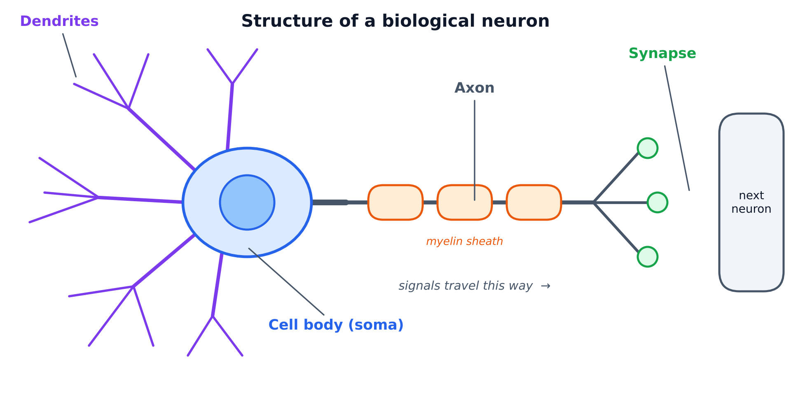

*Figure 3.1. The main parts of a biological neuron. The table below shows the loose analogy with an artificial neuron.*

> Biological neurons communicate through complex electrochemical processes while artificial neurons simplify this behaviour into mathematical operations.

The artificial neuron in Section 2.2 borrows a loose analogy from this structure:

| Biological neuron | Artificial neuron |
| :--- | :--- |
| Signals arriving at the dendrites | Inputs $x_i$ |
| Strength of each synapse | Weights $w_i$ |
| Cell body combining the signals | Weighted sum $z$ |
| Firing threshold | Bias $b$ and activation function |
| Signal sent along the axon | Output $a$ |

### 2.2 Artificial Neurons

#### 2.2.1 Basic Structure

An artificial neuron receives numerical inputs, multiplies each input by a corresponding weight, adds a bias, and applies an activation function.

Its output can be represented as:

$$z = \sum_{i=1}^{n} w_i x_i + b$$

$$a = f(z)$$

Where:

- $x_i$ is an input.
- $w_i$ is the weight associated with that input.
- $b$ is the bias.
- $z$ is the weighted sum before activation.
- $f$ is the activation function.
- $a$ is the neuron's output.

#### 2.2.2 Weights and Biases

Weights determine how strongly individual inputs influence a neuron.

Biases allow a neuron to shift its activation threshold independently of its inputs.

**For example:** a network predicting house prices might learn that house size is more influential than the colour of the front door. The corresponding weight for house size may therefore have a greater magnitude.

Both weights and biases are learned during training.

#### 2.2.3 Activation Functions

An activation function transforms the weighted sum into the neuron's output.

Common activation functions include:

- **Step function:** Produces one of two outputs depending on whether the input reaches a threshold; in this module, it outputs 1 if $z \geq 0$ and 0 otherwise. It is useful for understanding the original perceptron, but modern networks trained with backpropagation (Section 3.6) do not use it: its slope is zero everywhere except at the jump, so it gives gradient descent no information about which way to change the weights.
- **Sigmoid function:** Produces an output between 0 and 1.

  $$\sigma(z)=\frac{1}{1+e^{-z}}$$

  It is useful for interpreting an output as a probability in some binary classification models.
- **ReLU (Rectified Linear Unit):** Outputs zero for negative inputs and the input itself for positive inputs.

  $$f(z)=\max(0,z)$$

  ReLU is widely used in hidden layers because it is simple and often works well in practice.

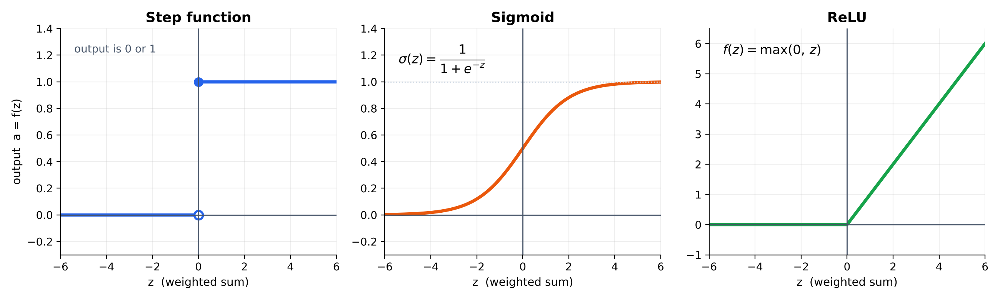

*Figure 3.2. The step function jumps from 0 to 1 at $z = 0$, the sigmoid rises smoothly from 0 towards 1, and ReLU is 0 for negative inputs and equal to $z$ for positive inputs.*

#### Worked Example: Computing a Neuron's Output

Inputs $x = (2, 3)$, weights $w = (0.5, -1)$, bias $b = 1$.

1. Weighted sum: $z = 0.5 \times 2 + (-1) \times 3 + 1 = 1 - 3 + 1 = -1$.
2. Apply each activation function:
   - Step (output 1 if $z \geq 0$): $z = -1$, so the output is **0**.
   - Sigmoid: $\sigma(-1) = 1 / (1 + e^{1}) \approx$ **0.269**.
   - ReLU: $\max(0, -1) =$ **0**.

The same weighted sum gives different outputs depending on the activation function.

### 2.3 The Perceptron

A perceptron is one of the simplest artificial neural models. It calculates a weighted sum of inputs and applies a threshold-based activation function to produce a prediction.

For binary classification, its output can be expressed as:

$$\hat{y}=\begin{cases}1 & \text{if } z \geq 0\\ 0 & \text{otherwise}\end{cases} \qquad \text{where } z=\sum_{i=1}^{n} w_i x_i + b$$

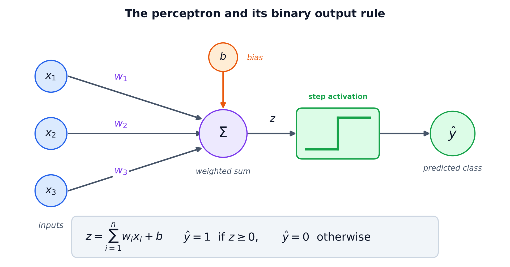

*Figure 3.3. The perceptron outputs class 1 when the weighted sum $z$ is at least 0, and class 0 otherwise.*

Here, $\hat{y}$ is the predicted class.

#### 2.3.1 The Perceptron Learning Rule

A basic perceptron learning rule adjusts its weights when its prediction is incorrect.

A common form is:

$$w_i \leftarrow w_i+\eta(y-\hat{y})x_i$$

$$b \leftarrow b+\eta(y-\hat{y})$$

Where:

- $y$ is the correct target.
- $\hat{y}$ is the prediction.
- $\eta$ is the learning rate.
- $x_i$ is the input associated with weight $w_i$.

If the prediction is correct, the error term is zero and this rule makes no update. If the prediction is incorrect, the weights and bias are adjusted.

#### Worked Example: One Perceptron Update

Weights $w = (0.2, -0.4)$, bias $b = 0$, learning rate $\eta = 0.5$. The example is $x = (1, 1)$ with target $y = 1$.

1. $z = 0.2 \times 1 + (-0.4) \times 1 + 0 = -0.2$, so $\hat{y} = 0$. The prediction is wrong; the error is $y - \hat{y} = 1$.
2. Update: $w_1 = 0.2 + 0.5 \times 1 \times 1 = 0.7$, $w_2 = -0.4 + 0.5 \times 1 \times 1 = 0.1$, $b = 0 + 0.5 \times 1 = 0.5$.
3. Check: the new $z = 0.7 + 0.1 + 0.5 = 1.3 \geq 0$, so $\hat{y} = 1$. The perceptron now classifies this example correctly.

#### 2.3.2 Limitations of the Perceptron

A single perceptron can learn linearly separable patterns, meaning the classes can be separated by a straight line in two dimensions or a hyperplane in higher dimensions.

However, it cannot solve every classification problem.

For example, the XOR problem requires a nonlinear decision boundary. A single perceptron cannot represent the required classification, but a multilayer network with suitable activation functions can.

XOR outputs 1 when exactly one input is 1: (0, 0) → 0, (0, 1) → 1, (1, 0) → 1, (1, 1) → 0. Plot the four points and try to draw one straight line with both 1s on one side and both 0s on the other: it cannot be done, because the 1s sit on opposite corners of the square.

### 2.4 Check Your Understanding

1. **Calculate.** A neuron has inputs $x = (1, 2, -1)$, weights $w = (0.4, 0.3, 0.5)$ and bias $b = -0.2$. Find $z$ and the output with a step, a sigmoid and a ReLU activation.
2. **Trace.** Train a perceptron on the AND function, (0, 0) → 0, (0, 1) → 0, (1, 0) → 0, (1, 1) → 1, starting from $w = (0, 0)$, $b = 0$ and $\eta = 1$, presenting the examples in that order. The step function outputs 1 when $z \geq 0$. What are $w$ and $b$ after the first epoch?
3. **Find the error.** "If a single perceptron can't learn XOR yet, just train it for more epochs." Explain why this will not work and what will.
4. **Explain.** What would go wrong if a neuron had no bias term?

#### Answers

1. $z = 0.4 \times 1 + 0.3 \times 2 + 0.5 \times (-1) - 0.2 = 0.3$. Step: 1 (since $z \geq 0$). Sigmoid: $\sigma(0.3) \approx 0.574$. ReLU: 0.3.
2. (0, 0): $z = 0$, so $\hat{y} = 1$, which is wrong; $b$ becomes $-1$ ($w$ is unchanged because both inputs are 0). (0, 1) and (1, 0): $z = -1$, so $\hat{y} = 0$, correct. (1, 1): $z = -1$, so $\hat{y} = 0$, wrong; $w$ becomes $(1, 1)$ and $b$ becomes $0$. After epoch 1: $w = (1, 1)$, $b = 0$. (Continuing, the perceptron classifies all four examples correctly after epoch 5, with $w = (2, 1)$ and $b = -3$.)
3. A perceptron draws one straight-line boundary, and no straight line separates XOR's classes, so no amount of training can succeed. A multilayer network with a hidden layer and nonlinear activations can represent XOR.
4. Without a bias, $z = 0$ whenever all inputs are 0, so the decision boundary must pass through the origin. The bias lets the neuron shift its threshold; for example, AND needs a negative bias so that (0, 0) gives output 0.

**Sources for this topic:** Rosenblatt (1958); Goodfellow et al. (2016), Ch. 6; Russell & Norvig (2021), Ch. 21.

---

## Topic 3: Learning Methods and Neural Network Training

### 3.1 Supervised Learning

Supervised learning trains a model using examples that contain both inputs and their correct target outputs.

For example, a dataset for predicting house prices might contain house sizes, locations, and other features alongside the actual sale prices.

#### 3.1.1 Classification and Regression

- **Classification:** Predicting a category, such as whether an email is spam.
- **Regression:** Predicting a numerical value, such as the price of a house.

#### 3.1.2 Training, Validation, and Testing

- **Training set:** Used to learn model parameters.
- **Validation set:** Used to compare model configurations and tune hyperparameters.
- **Test set:** Used to evaluate the final model on data not used for training or model selection.

Keeping these roles separate helps produce a more reliable estimate of how well the model generalises.

A common split is 70% training, 15% validation and 15% test. For 10,000 labelled emails, that is 7,000, 1,500 and 1,500 emails.

### 3.2 Semi-Supervised Learning

Semi-supervised learning uses a small amount of labelled data together with a larger amount of unlabelled data.

For example, a medical image dataset may contain thousands of scans, but only a small proportion have been labelled by medical specialists.

Semi-supervised methods attempt to use information from both labelled and unlabelled examples to improve learning.

One simple method is **self-training**: train a model on the labelled scans, use it to label the unlabelled scans it is most confident about, add those "pseudo-labels" to the training set, and retrain.

#### 3.2.1 Why It Is Useful

Labelling data can be expensive, time-consuming, or require specialist knowledge.

Semi-supervised learning can be useful when collecting raw data is easy but obtaining accurate labels is difficult. Its success depends on the dataset and the assumptions made by the learning method, and unlabelled data does not automatically improve performance.

### 3.3 Loss Functions

A loss function measures the difference between a model's prediction and the target.

The training process uses this value to determine whether the model is improving.

For example, if a model predicts a house price of \$200,000 when the actual price is \$250,000, the loss function quantifies the prediction error.

#### 3.3.1 Mean Squared Error

Mean squared error (MSE) is commonly used for regression:

$$L = \frac{1}{n}\sum_{i=1}^{n}(y_i-\hat{y}_i)^2$$

Where:

- $y_i$ is the actual value.
- $\hat{y}_i$ is the predicted value.
- $n$ is the number of examples.

Squaring the errors prevents positive and negative errors from cancelling each other out and penalises large errors more strongly.

#### Worked Example: MSE for Three Houses

Prices in thousands of dollars:

| House | Actual $y$ | Predicted $\hat{y}$ | Error $y - \hat{y}$ | Squared error |
| :--- | :--- | :--- | :--- | :--- |
| 1 | 250 | 200 | 50 | 2,500 |
| 2 | 300 | 310 | −10 | 100 |
| 3 | 200 | 190 | 10 | 100 |

$L = (2{,}500 + 100 + 100) / 3 = 900$. House 1's error is five times larger than the others' but contributes 25 times as much to the loss, which is what "penalises large errors more strongly" means.

#### 3.3.2 Cross-Entropy Loss

Cross-entropy is commonly used in classification.

For binary classification, binary cross-entropy can be written as:

$$L=-\frac{1}{n}\sum_{i=1}^{n}\left[y_i\log(\hat{y}_i)+(1-y_i)\log(1-\hat{y}_i)\right]$$

Here $y_i$ is the true class (0 or 1), $\hat{y}_i$ is the predicted probability of class 1, and $\log$ is the natural logarithm.

It penalises predictions that assign low probability to the correct class.

For more than two classes, the output layer gives one probability per class (usually with the softmax function, Section 4.4.1), and the loss for one example is $-\log$ of the probability given to the correct class. For instance, if the correct digit is 7 and the network gives it probability 0.8, the loss is $-\log 0.8 \approx 0.223$.

For one example with true class $y = 1$ (using the natural logarithm): a confident correct prediction $\hat{y} = 0.9$ gives $L = -\log 0.9 \approx 0.105$, while a confident wrong prediction $\hat{y} = 0.1$ gives $L = -\log 0.1 \approx 2.303$, about 22 times larger.

You do not need to memorise every loss function immediately. The important concept is that **the choice of loss function depends on the task and determines what the training process tries to improve.**

### 3.4 Partial Derivatives and Gradients

This section covers the mathematics that gradient descent (Section 3.5) and backpropagation (Section 3.6) rely on.

#### 3.4.1 Why Partial Derivatives Matter

A neural network can have millions of parameters. To train it, we need to understand how changing each parameter affects the loss.

A partial derivative measures how a function changes with respect to one variable while treating the other variables as constant.

For a function $f(x,y)$, the partial derivatives are:

$$\frac{\partial f}{\partial x} \qquad \text{and} \qquad \frac{\partial f}{\partial y}$$

For example, consider:

$$f(x,y)=x^2+3y$$

The partial derivatives are:

$$\frac{\partial f}{\partial x}=2x$$

$$\frac{\partial f}{\partial y}=3$$

The first derivative describes how the function changes with $x$, while the second describes how it changes with $y$.

#### 3.4.2 The Gradient

The gradient is a vector containing the partial derivatives of a function.

For the same function:

$$\nabla f=\left(\frac{\partial f}{\partial x},\ \frac{\partial f}{\partial y}\right)=(2x,\ 3)$$

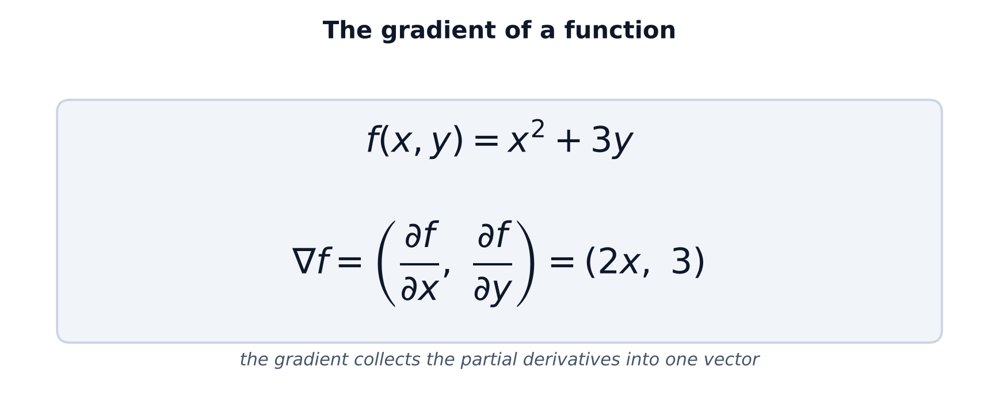

*Figure 3.4. The gradient of $f(x, y) = x^2 + 3y$ points in the direction in which $f$ increases fastest.*

At the point $(1, 2)$, the gradient is $(2, 3)$: increasing $x$ slightly raises $f$ at rate 2, and increasing $y$ slightly raises it at rate 3.

In neural network training, the gradient tells us how the loss changes with respect to the parameters.

Gradient descent uses this information to adjust those parameters.

#### 3.4.3 The Chain Rule

The chain rule allows us to differentiate a function that depends on another function.

If:

$$y=f(u), \qquad u=g(x)$$

then:

$$\frac{dy}{dx}=\frac{dy}{du}\frac{du}{dx}$$

For example, if $y = u^2$ and $u = 3x + 1$, then $\frac{dy}{du} = 2u$ and $\frac{du}{dx} = 3$, so $\frac{dy}{dx} = 2(3x + 1) \times 3$. At $x = 1$, this is $2 \times 4 \times 3 = 24$.

This is essential for backpropagation because the output of one neural network layer becomes the input to the next layer.

The chain rule allows us to calculate how a change in an early layer affects the final loss through all the intermediate layers.

> **Mathematics to learn:** Basic differentiation, partial derivatives, the chain rule, and gradients. These are core prerequisites for understanding backpropagation and gradient descent.

### 3.5 Gradient Descent

Gradient descent is an optimisation algorithm that adjusts model parameters to reduce the loss.

The basic update rule is:

$$\theta \leftarrow \theta-\eta\nabla_{\theta}L$$

Where:

- $\theta$ represents the model parameters.
- $L$ is the loss.
- $\nabla_{\theta}L$ is the gradient of the loss with respect to the parameters.
- $\eta$ is the learning rate.

The gradient points in the direction of steepest local increase. Subtracting it moves the parameters in the direction of steepest local decrease, assuming a sufficiently small step.

#### 3.5.1 Understanding the Learning Rate

The learning rate determines the size of each parameter update.

- **Too small:** Training may progress very slowly.
- **Too large:** Training may overshoot useful parameter values or become unstable.
- **Appropriate:** Training can make steady progress towards a lower loss.

#### Worked Example: Gradient Descent on One Parameter

Minimise $L(w) = (w - 3)^2$, whose lowest point is at $w = 3$. Its derivative is $\frac{dL}{dw} = 2(w - 3)$. Start at $w = 0$.

**With $\eta = 0.1$:**

| Step | $w$ | Gradient $2(w - 3)$ | New $w = w - 0.1 \times \text{gradient}$ |
| :--- | :--- | :--- | :--- |
| 1 | 0 | −6 | 0.6 |
| 2 | 0.6 | −4.8 | 1.08 |
| 3 | 1.08 | −3.84 | 1.464 |
| 4 | 1.464 | −3.072 | 1.771 |

Each step moves $w$ closer to 3, and the steps shrink as the slope flattens.

**With $\eta = 1.1$:** $w$ goes 0 → 6.6 → −1.32 → 8.18 → −3.22. Each step overshoots the minimum by more than the last, so training diverges. This is the "too large" case above.

#### 3.5.2 Types of Gradient Descent

- **Batch gradient descent:** Calculates the gradient using the entire training dataset.
- **Stochastic gradient descent (SGD):** Uses one training example per update.
- **Mini-batch gradient descent:** Uses a small group of examples per update.

Mini-batch training is widely used in deep learning because it balances computational efficiency with frequent parameter updates.

### 3.6 Backpropagation

Backpropagation is an algorithm used to calculate how the loss changes with respect to the weights and biases throughout a neural network.

It works backwards from the loss, applying the chain rule of calculus (Section 3.4.3) to determine how each parameter contributes to the final error.

Backpropagation calculates gradients. It does not, by itself, specify how the parameters are updated. An optimisation algorithm, such as gradient descent, uses those gradients to update the parameters.

#### 3.6.1 Why It Is Necessary

Consider a network with several layers. Changing a weight in an early layer can affect the activations of later layers and ultimately change the final prediction.

Backpropagation efficiently calculates these effects, allowing the network to learn which parameter changes are likely to reduce the loss.

#### 3.6.2 Basic Process

1. Pass the input through the network.
2. Calculate the prediction and loss.
3. Calculate gradients by propagating information about the loss backwards.
4. Use an optimisation algorithm to update the parameters.
5. Repeat with further training examples.

#### Worked Example: Backpropagation Through One Neuron

A single sigmoid neuron has input $x = 1$, weight $w = 0.5$ and bias $b = 0$. The target is $y = 1$ and the loss is $L = (a - y)^2$.

**Forward pass:**

1. $z = wx + b = 0.5$.
2. $a = \sigma(0.5) \approx 0.6225$.
3. $L = (0.6225 - 1)^2 \approx 0.1425$.

**Backward pass (chain rule):** $L$ depends on $a$, which depends on $z$, which depends on $w$, so

$$\frac{\partial L}{\partial w}=\frac{\partial L}{\partial a}\cdot\frac{\partial a}{\partial z}\cdot\frac{\partial z}{\partial w}$$

1. $\frac{\partial L}{\partial a} = 2(a - y) \approx -0.7551$.
2. $\frac{\partial a}{\partial z} = a(1 - a) \approx 0.2350$ (the sigmoid's derivative).
3. $\frac{\partial z}{\partial w} = x = 1$.
4. Multiply: $\frac{\partial L}{\partial w} \approx -0.7551 \times 0.2350 \times 1 \approx -0.1774$.

**Update** with gradient descent and $\eta = 1$: $w \leftarrow 0.5 - 1 \times (-0.1774) = 0.6774$. Repeating the forward pass gives $a \approx 0.6632$ and $L \approx 0.1135$, so the loss went down. In a deep network, backpropagation repeats this chain-rule step layer by layer, reusing each layer's result for the layer before it.

### 3.7 Regularisation

Regularisation refers to methods used to reduce overfitting by discouraging a model from becoming unnecessarily complex or relying too heavily on particular patterns in the training data. (Overfitting was defined in Section 1.3.2 and is covered in Section 7.3.)

One common approach is to add a penalty to the training objective:

$$L_{\text{total}}=L_{\text{data}}+\lambda R(\theta)$$

Where:

- $L_{\text{data}}$ measures prediction error.
- $R(\theta)$ is a regularisation penalty.
- $\lambda$ controls the strength of that penalty.

For example, with weights $(2, -1)$ and $\lambda = 0.1$, the L2 penalty is $0.1 \times (2^2 + (-1)^2) = 0.5$, and the L1 penalty is $0.1 \times (|2| + |-1|) = 0.3$. Training must now balance a low prediction error against keeping the weights small.

#### 3.7.1 Common Methods

- **L1 regularisation:** Penalises the absolute values of parameters and can encourage some parameters to become zero.
- **L2 regularisation:** Penalises the squared magnitudes of parameters.
- **Dropout:** Randomly disables some units during training to discourage excessive reliance on particular units.
- **Early stopping:** Stops training when validation performance stops improving.

Regularisation does not guarantee better performance. If applied too strongly, it can prevent the model from learning the underlying patterns adequately.

### 3.8 Check Your Understanding

1. **Classify.** Is each task classification or regression? (a) Predicting tomorrow's temperature in °C. (b) Deciding whether a tumour is benign or malignant. (c) Estimating a car's resale value. (d) Recognising which of 10 digits an image shows.
2. **Calculate.** Actual values (3, 5, 2), predictions (2, 5, 4). Find the MSE.
3. **Compare.** For an example whose true class is 0, compare the binary cross-entropy of the predictions $\hat{y} = 0.2$ and $\hat{y} = 0.7$. Which is penalised more, and why?
4. **Trace.** Minimise $L(w) = (w - 5)^2$ by gradient descent from $w = 1$ with $\eta = 0.25$. Give $w$ after three steps.
5. **Apply the chain rule.** Repeat the backpropagation example with $x = 2$, $w = 0.1$, $b = 0$ and target $y = 0$. Find $\frac{\partial L}{\partial w}$. Should $w$ increase or decrease?
6. **Find the error.** A team tunes its learning rate by trying ten values and keeping the one with the best *test-set* accuracy, then reports that accuracy as the final result. What is wrong?
7. **Predict.** Training loss goes 2.3 → 15.8 → 140.2 → overflow over the first three epochs. What is the most likely cause, and what should be changed?

#### Answers

1. (a) Regression. (b) Classification. (c) Regression. (d) Classification.
2. Squared errors: $(3-2)^2 = 1$, $(5-5)^2 = 0$, $(2-4)^2 = 4$. $L = 5/3 \approx 1.67$.
3. With $y = 0$, the loss is $-\log(1 - \hat{y})$. For $\hat{y} = 0.2$: $-\log 0.8 \approx 0.223$. For $\hat{y} = 0.7$: $-\log 0.3 \approx 1.204$. The second is penalised more because it gives the wrong class (1) the higher probability.
4. The gradient is $2(w - 5)$. Step 1: $1 - 0.25 \times (-8) = 3$. Step 2: $3 - 0.25 \times (-4) = 4$. Step 3: $4 - 0.25 \times (-2) = 4.5$.
5. $z = 0.2$, $a = \sigma(0.2) \approx 0.5498$, $L \approx 0.3023$. $\frac{\partial L}{\partial w} = 2(a - y) \cdot a(1 - a) \cdot x \approx 2(0.5498)(0.2475)(2) \approx 0.544$. The gradient is positive, so gradient descent *decreases* $w$, which lowers $a$ towards the target 0.
6. Choosing the learning rate with the test set makes the test set part of model selection, so the reported accuracy is optimistically biased. The learning rate should be tuned on the validation set, and the test set used once, at the end.
7. The learning rate is too large, so each update overshoots and the loss grows (as with $\eta = 1.1$ in the worked example). Lower the learning rate.

**Sources for this topic:** Goodfellow et al. (2016), Ch. 4–8; Rumelhart et al. (1986); Srivastava et al. (2014); Chapelle et al. (2006).

---

## Topic 4: Neural Network Architectures

### 4.1 Multilayer Perceptrons

A multilayer perceptron (MLP) is a feedforward neural network containing an input layer, one or more hidden layers, and an output layer.

Information flows from the input towards the output without recurrent connections.

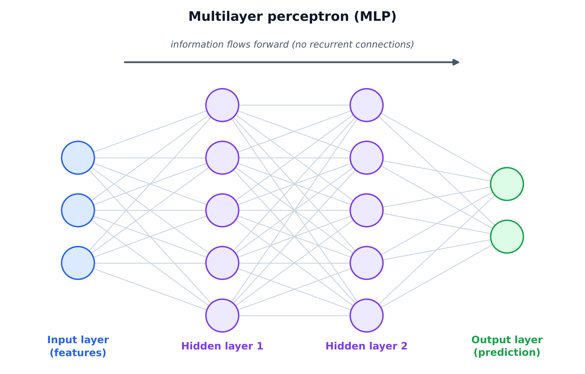

*Figure 3.5. An MLP with 3 inputs, two hidden layers of 5 neurons and 2 outputs. Information flows forward from the input layer to the output layer.*

#### 4.1.1 Structure

- **Input layer:** Receives the features.
- **Hidden layers:** Transform the input into useful representations.
- **Output layer:** Produces the final prediction.

Each layer usually contains multiple neurons, with weights connecting neurons between layers.

In the figure, 3 inputs feed 5 hidden neurons, then 5 more, then 2 outputs. Counting one weight per connection and one bias per non-input neuron gives $3 \times 5 + 5 \times 5 + 5 \times 2 = 50$ weights and $5 + 5 + 2 = 12$ biases: 62 parameters.

#### 4.1.2 Why Hidden Layers Matter

A single linear layer can only represent a linear transformation. Adding hidden layers with nonlinear activation functions allows an MLP to learn more complex relationships.

MLPs are useful for classification and regression on structured numerical data, although other architectures may be more suitable for images, sequences, or specialised data.

### 4.2 Convolutional Neural Networks

A convolutional neural network (CNN) is a neural network architecture designed to process data with spatial structure, especially images.

CNNs use filters that examine local regions of an input and learn to detect patterns.

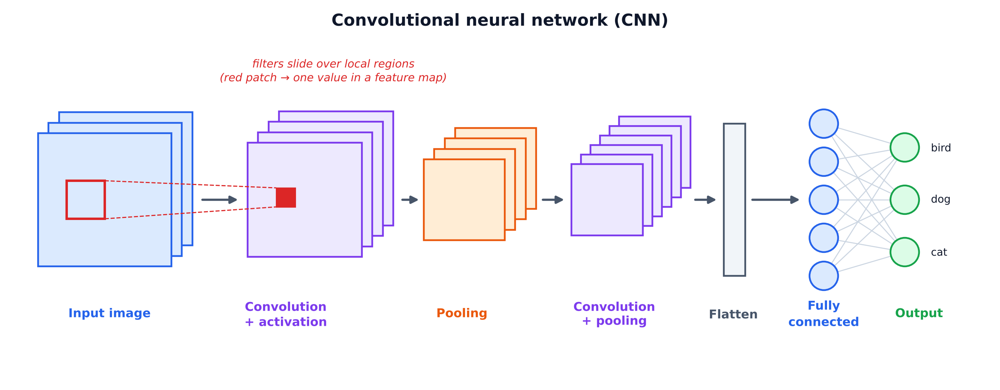

*Figure 3.6. A CNN uses convolutional layers to detect local patterns, pooling layers to shrink the feature maps, and output layers to make the prediction.*

#### 4.2.1 How Convolution Works

A convolutional filter moves across an image and calculates responses to local patterns.

Early layers may learn to detect simple features such as edges or textures. Deeper layers can combine these features into more complex patterns.

At each position, the filter's numbers are multiplied by the pixel values beneath them and the products are added. The grid of these results is called a **feature map**: it shows where in the image the filter's pattern appears.

CNNs commonly use:

- **Convolutional layers:** Detect local patterns.
- **Activation functions:** Introduce nonlinearity.
- **Pooling or other downsampling operations:** Reduce spatial dimensions when appropriate. **Max pooling**, for example, keeps only the largest value in each small block (such as $2 \times 2$) of a feature map.
- **Output layers:** Produce predictions.

#### Worked Example: Detecting a Vertical Edge

A $4 \times 4$ image is dark (0) on the left and bright (9) on the right. A $2 \times 2$ filter compares right pixels with left pixels:

$$\text{image}=\begin{bmatrix}0&0&9&9\\0&0&9&9\\0&0&9&9\\0&0&9&9\end{bmatrix}\qquad \text{filter}=\begin{bmatrix}-1&1\\-1&1\end{bmatrix}$$

Sliding the filter one pixel at a time gives a $3 \times 3$ feature map:

- Over the dark area: $(-1)(0) + (1)(0) + (-1)(0) + (1)(0) = 0$.
- Across the edge: $(-1)(0) + (1)(9) + (-1)(0) + (1)(9) = 18$.
- Over the bright area: $(-1)(9) + (1)(9) + (-1)(9) + (1)(9) = 0$.

$$\text{feature map}=\begin{bmatrix}0&18&0\\0&18&0\\0&18&0\end{bmatrix}$$

The large values mark exactly where the edge is. A CNN *learns* its filter values during training instead of having them designed by hand.

**Max pooling** example: for the feature map below, $2 \times 2$ max pooling keeps the largest value in each block.

$$\begin{bmatrix}1&3&2&0\\4&2&1&1\\0&1&5&6\\2&2&7&3\end{bmatrix}\;\longrightarrow\;\begin{bmatrix}4&2\\2&7\end{bmatrix}$$

#### 4.2.2 Applications

CNNs have been used for image classification, object detection, medical image analysis, and other tasks involving spatial data.

### 4.3 Recurrent Neural Networks

A recurrent neural network (RNN) is designed to process sequential data by maintaining a hidden state that carries information from earlier steps.

For example, when processing a sentence, an RNN can use information from previously processed words when processing the next word.

#### 4.3.1 Hidden State

At each time step, an RNN updates its hidden state using the current input and the previous hidden state.

A simplified representation is:

$$h_t=f(W_xx_t+W_hh_{t-1}+b)$$

Where:

- $x_t$ is the current input.
- $h_{t-1}$ is the previous hidden state.
- $h_t$ is the updated hidden state.
- $W_x$ and $W_h$ are learned weight matrices.

This allows the network to maintain information across a sequence.

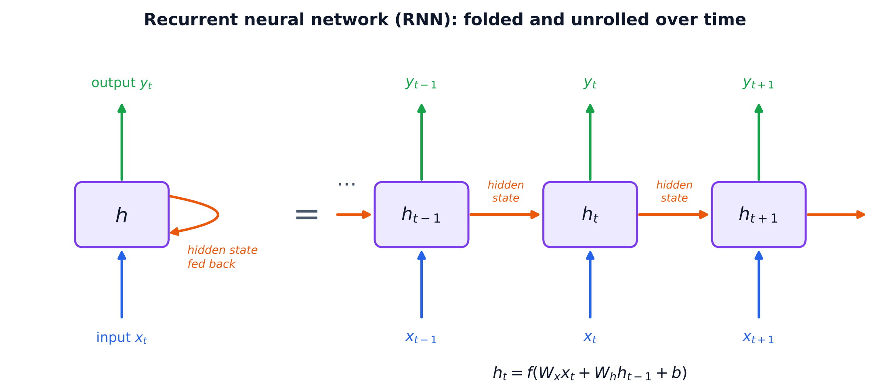

*Figure 3.7. An RNN unrolled across time steps. The same weights are used at every step, and the hidden state $h_t$ carries information forward.*

#### Worked Example: Memory Fading in a Tiny RNN

Use single numbers instead of matrices: $W_x = 1$, $W_h = 0.5$, $b = 0$, $f = \tanh$ and $h_0 = 0$. The input sequence is $1, 0, 0$. (The activation function $\tanh$, the hyperbolic tangent, has the same S-shape as the sigmoid but gives outputs between $-1$ and $1$, with $\tanh(0) = 0$.)

1. $h_1 = \tanh(1 \times 1 + 0.5 \times 0) = \tanh(1) \approx 0.762$.
2. $h_2 = \tanh(0 + 0.5 \times 0.762) \approx 0.363$.
3. $h_3 = \tanh(0 + 0.5 \times 0.363) \approx 0.180$.

The first input's effect roughly halves at every step. After a long sequence it has almost vanished, which is the limitation described next.

#### 4.3.2 Limitations

Basic RNNs can struggle to learn long-range dependencies because gradients may vanish or grow excessively during training.

Architectures such as LSTM (Long Short-Term Memory) and GRU (Gated Recurrent Unit) introduce mechanisms that help preserve useful information across longer sequences.

These mechanisms are **gates**: small learned components that output values between 0 and 1 and decide how much information to keep, forget or pass on at each step. An LSTM has input, forget and output gates; a GRU has update and reset gates.

### 4.4 Transformers

A Transformer is a neural network architecture that uses attention mechanisms to model relationships between elements in a sequence.

Transformers are widely used in language models, machine translation, and many other AI applications.

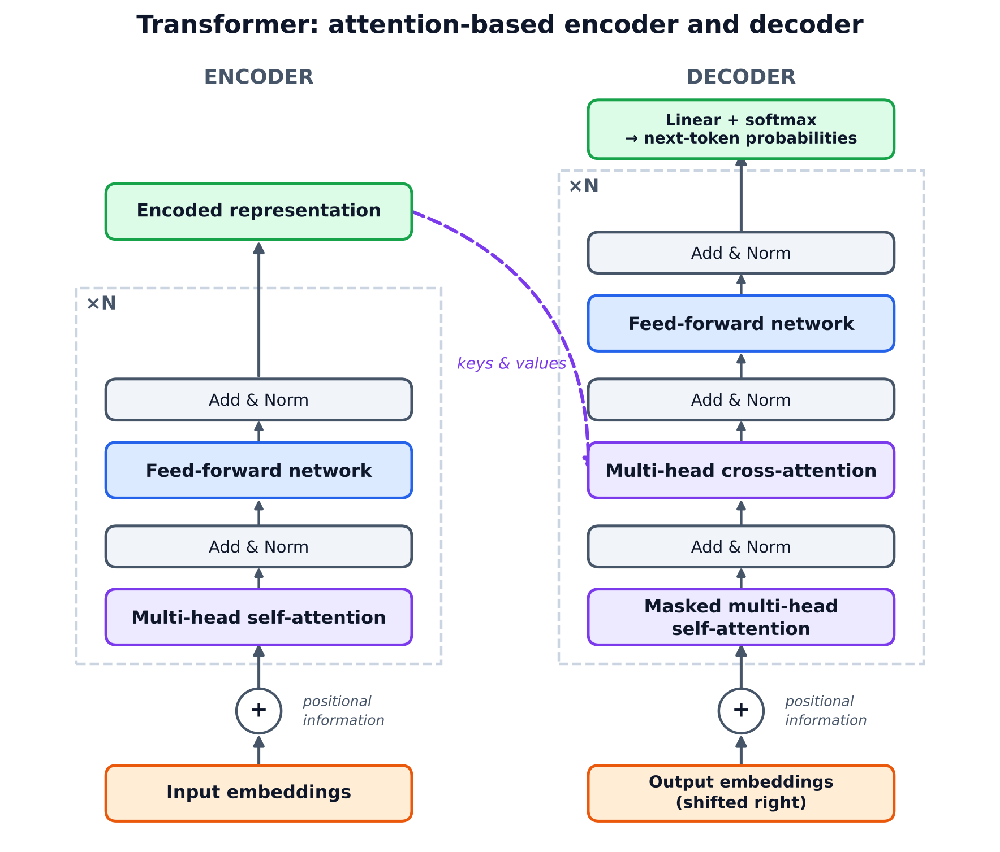

*Figure 3.8. A simplified overview of the Transformer, based on Vaswani et al. (2017). Its key component is the attention mechanism described below.*

#### 4.4.1 Attention Mechanism

Attention allows the network to assign different levels of importance to different elements when computing a representation.

For example, when interpreting a sentence, a model may use information from a distant word to understand the meaning of the current word.

The attention formula uses the **softmax** function, which turns a list of scores into positive weights that add up to 1:

$$\text{softmax}(z)_i=\frac{e^{z_i}}{\sum_j e^{z_j}}$$

For scores $(2, 1, 0)$, softmax gives approximately $(0.665, 0.245, 0.090)$: the highest score gets the largest weight, and every weight is positive.

A common attention operation is:

$$\text{Attention}(Q,K,V)=\text{softmax}\left(\frac{QK^T}{\sqrt{d_k}}\right)V$$

Where:

- $Q$ represents queries.
- $K$ represents keys.
- $V$ represents values.
- $d_k$ is the dimension of the key vectors.

Each element of the sequence is turned into three vectors by multiplying its representation by three learned weight matrices: a **query** (what this element is looking for), a **key** (what it can be matched on) and a **value** (the information it passes on). $K^T$ is $K$ transposed (rows become columns), so $QK^T$ holds the dot product of every query with every key. Dividing by $\sqrt{d_k}$ keeps these scores from growing too large.

Conceptually, the operation compares queries with keys to determine which values should contribute most to the output.

> You do not need to derive this formula in your first introduction to Transformers. Focus first on understanding why attention helps a model use information from different parts of a sequence.

#### Worked Example: Attention With Two Words

One query $q = (1, 0)$ is compared with two keys, $k_1 = (1, 0)$ and $k_2 = (0, 1)$, whose values are $v_1 = (1, 2)$ and $v_2 = (3, 4)$. Here $d_k = 2$.

1. Scores: the dot product multiplies matching entries and adds them, so $q \cdot k_1 = 1 \times 1 + 0 \times 0 = 1$ and $q \cdot k_2 = 0$. Dividing by $\sqrt{2}$ gives $0.707$ and $0$.
2. Softmax of $(0.707, 0)$: weights $\approx (0.670, 0.330)$.
3. Output: $0.670 \times (1, 2) + 0.330 \times (3, 4) \approx (1.66, 2.66)$.

The query matches the first key better, so the output is mostly the first value, with some of the second mixed in.

#### 4.4.2 Positional Information

Attention alone does not automatically encode the order of a sequence. Transformers therefore use positional information so the model can distinguish between different positions.

Without positional information or another mechanism that accounts for order, the model would not naturally distinguish many sequences that contain the same elements in different arrangements.

#### 4.4.3 Why Transformers Are Important

Transformers can process sequence elements in parallel during training, unlike the sequential hidden-state updates of a basic RNN.

They can also model relationships between distant elements effectively, although attention can become computationally expensive for very long sequences.

### 4.5 Comparing Neural Network Architectures

| Architecture | Main idea | Typical applications |
| ------------ | --------- | -------------------- |
| MLP | Layers of interconnected neurons | Structured data, Classification, and Regression |
| CNN | Filters detect local spatial patterns | Image processing |
| RNN | Hidden state carries information through a sequence | Sequential data, time series |
| Transformer | Attention models relationships between sequence elements | Language models, translation, multimodal AI |

No architecture is universally best. The appropriate choice depends on the data, task, computational requirements, and training method.

### 4.6 Check Your Understanding

1. **Choose and justify.** Pick an architecture for each task: (a) predicting a flat's rent from 12 numeric features; (b) classifying chest X-rays; (c) predicting tomorrow's electricity demand from the last 30 days; (d) translating English to Chinese.
2. **Calculate.** Apply the filter $\begin{bmatrix}1&0\\0&1\end{bmatrix}$ to the image $\begin{bmatrix}1&2&0\\0&1&3\\2&1&0\end{bmatrix}$ with a step (stride) of 1. Give the $2 \times 2$ feature map.
3. **Calculate.** Apply $2 \times 2$ max pooling to $\begin{bmatrix}5&1&0&2\\3&8&4&4\\1&0&2&9\\6&2&3&1\end{bmatrix}$.
4. **Calculate.** Find the softmax of the scores $(1, 1, 3)$.
5. **Explain.** "Dog bites man" and "man bites dog" contain the same words. Why must a Transformer be given positional information to tell them apart?
6. **Predict.** In the tiny-RNN example, what happens to $h_2$ and $h_3$ if $W_h$ is increased to 0.9? What does this suggest about memory?

#### Answers

1. (a) MLP: structured numeric features. (b) CNN: images with local spatial patterns. (c) RNN, or a Transformer: an ordered time series. (d) Transformer: long-range relationships between words, and the standard choice for translation.
2. Each output is the top-left pixel plus the bottom-right pixel of its $2 \times 2$ window: $\begin{bmatrix}1+1 & 2+3\\0+1 & 1+0\end{bmatrix}=\begin{bmatrix}2&5\\1&1\end{bmatrix}$.
3. The block maxima are 8, 4, 6 and 9: $\begin{bmatrix}8&4\\6&9\end{bmatrix}$.
4. $e^1 \approx 2.718$, $e^1 \approx 2.718$, $e^3 \approx 20.086$; the sum is about 25.52. Softmax $\approx (0.107, 0.107, 0.787)$.
5. Attention compares every word with every other word but has no built-in sense of order, so without positions both sentences produce the same set of comparisons. Positional information marks which word comes first, which decides who bites whom.
6. $h_1 \approx 0.762$, $h_2 \approx 0.595$, $h_3 \approx 0.490$. The first input fades more slowly, so a larger $W_h$ keeps information for longer, although very large values can make training unstable (exploding gradients).

**Sources for this topic:** Goodfellow et al. (2016), Ch. 9–10; LeCun et al. (1998); Hochreiter & Schmidhuber (1997); Vaswani et al. (2017).

---

## Topic 5: Unsupervised Learning and Generative Models

### 5.1 Unsupervised Learning

Unsupervised learning attempts to discover patterns or structure in data without relying on labelled target answers.

For example, a system might group customers according to purchasing behaviour without being told in advance which group each customer belongs to.

#### 5.1.1 Clustering

Clustering groups data points according to their similarity under a chosen measure.

A common example is K-means clustering, which assigns data points to $K$ clusters and updates the cluster centres to reduce the distances between points and their assigned centres.

Clustering is useful for exploratory data analysis, but the resulting groups do not automatically correspond to meaningful real-world categories.

**K-means steps:**

1. Choose $K$ starting centres.
2. Assign each point to its nearest centre.
3. Move each centre to the mean of the points assigned to it.
4. Repeat steps 2–3 until the assignments stop changing.

#### Worked Example: K-means in One Dimension

Points: 1, 2, 3, 8, 9, 10. $K = 2$, with starting centres 2 and 3.

| Round | Assignment | New centres |
| :--- | :--- | :--- |
| 1 | {1, 2} nearest 2; {3, 8, 9, 10} nearest 3 | 1.5 and 7.5 |
| 2 | {1, 2, 3} nearest 1.5; {8, 9, 10} nearest 7.5 | 2 and 9 |
| 3 | No point changes cluster | Stop |

The final clusters are {1, 2, 3} and {8, 9, 10}. Poor starting centres were corrected within two rounds.

#### 5.1.2 Dimensionality Reduction

Dimensionality reduction represents data using fewer variables while attempting to preserve useful information.

For example, a dataset with hundreds of measurements may be represented using a smaller number of components to make patterns easier to inspect.

Principal component analysis (PCA) is a common linear dimensionality-reduction technique.

As a simple case, if a dataset records each person's height in both centimetres and inches, the two columns carry the same information. PCA would find one component, "height", that captures almost all the variation.

### 5.2 Autoencoders

An autoencoder is a neural network trained to reconstruct its input.

It contains two main components:

- **Encoder:** Converts the input into a compressed or transformed representation.
- **Decoder:** Uses that representation to reconstruct the input.

The model is trained by comparing the reconstruction with the original input.

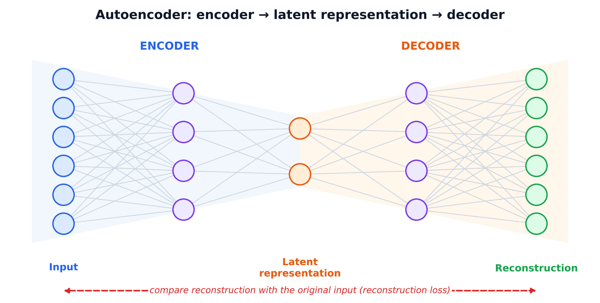

*Figure 3.9. The encoder squeezes the input into a small latent representation, and the decoder rebuilds the input from it.*

For example, an autoencoder for $28 \times 28$ greyscale images (784 pixel values) might compress each image to 32 numbers, about 24.5 times fewer, and then rebuild all 784 pixels from those 32.

#### 5.2.1 Latent Representation

The encoded representation is often called the latent representation or latent space.

If the representation is constrained appropriately, the network may learn useful features of the input data.

Autoencoders can be used for dimensionality reduction, feature learning, and certain types of anomaly detection.

#### 5.2.2 Limitations

A reconstruction that looks accurate does not necessarily mean that the latent representation captures meaningful concepts. The usefulness of the learned representation depends on the architecture, objective, and data.

### 5.3 Generative Adversarial Networks

A generative adversarial network (GAN) contains two neural networks trained in opposition:

- **Generator:** Produces synthetic samples.
- **Discriminator:** Attempts to distinguish real samples from generated samples.

The generator attempts to produce samples that the discriminator classifies as real, while the discriminator learns to identify generated samples.

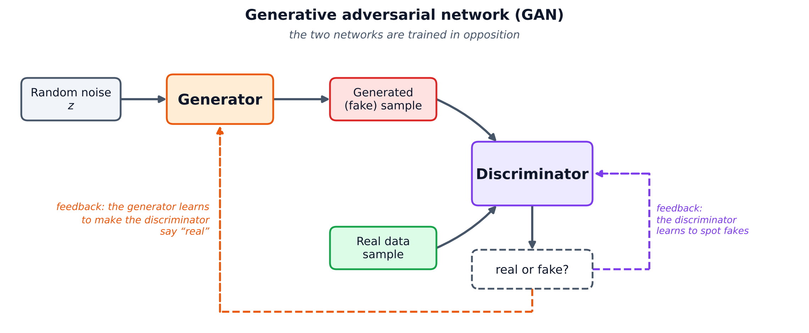

*Figure 3.10. The generator turns random noise into fake samples, and the discriminator learns to tell them apart from real samples.*

#### 5.3.1 Adversarial Training

The two networks improve through a competitive training process.

Ideally, the generator learns to produce increasingly realistic samples. In practice, training can be unstable and may fail to represent the full diversity of the training data.

**One training round:**

1. Draw random noise and pass it through the generator to make fake samples.
2. Take a batch of real samples.
3. Update the discriminator so that it scores real samples high and fake samples low.
4. Update the generator so that the discriminator scores its fakes higher.
5. Repeat.

When the generator produces only a few kinds of output that fool the discriminator, instead of the full variety of the training data, this is called **mode collapse**.

#### 5.3.2 Applications

GANs have been used for image generation, image-to-image translation, and data synthesis.

They are one family of generative models. Other approaches, including diffusion models and autoregressive models, are also important in modern generative AI.

### 5.4 Comparing Autoencoders and GANs

| Feature | Autoencoder | GAN |
| ------- | ----------- | --- |
| Main objective | Reconstruct input data | Generate realistic samples |
| Main components | Encoder and decoder | Generator and discriminator |
| Training signal | Difference between input and reconstruction | Competition between generator and discriminator |
| Typical use | Representation learning and reconstruction | Synthetic data generation |

Although both involve neural networks and can learn from unlabelled data, their objectives and training processes are different.

### 5.5 Check Your Understanding

1. **Trace.** Run K-means with $K = 2$ on the points 2, 4, 5, 10, 11, 12, starting from centres 2 and 4. Give the clusters and centres after each round.
2. **Find the error.** "K-means split our customers into 4 clusters, so there are 4 types of customer." What is wrong with this conclusion?
3. **Predict.** An autoencoder is trained only on normal bank transactions. A fraudulent transaction is passed through it. Would you expect its reconstruction error to be high or low, and how could this be used?
4. **Choose.** A hospital wants (a) to compress scans into a small set of features for later analysis, and (b) to produce new, realistic synthetic scans for training other models. Which model fits each goal?
5. **Explain.** Why is a GAN described as "adversarial"?

#### Answers

1. Round 1: 2 → centre 2; 4, 5, 10, 11, 12 → centre 4. New centres: 2 and 8.4. Round 2: 4 is 2 from centre 2 and 4.4 from 8.4, and 5 is 3 from 2 and 3.4 from 8.4, so {2, 4, 5} and {10, 11, 12}. New centres: 3.67 and 11. Round 3: no changes. Final clusters: {2, 4, 5} and {10, 11, 12}.
2. K-means always returns exactly $K$ clusters, because the number was chosen beforehand. The groups reflect similarity under the chosen distance and features, not necessarily real customer types; they must be checked against domain knowledge, and other values of $K$ compared.
3. High. The autoencoder learned to rebuild normal patterns, so an unusual transaction is rebuilt poorly. Flagging transactions whose reconstruction error exceeds a threshold is a form of anomaly detection.
4. (a) An autoencoder: its encoder produces a compact latent representation. (b) A GAN (or another generative model): it is trained to generate new realistic samples.
5. The generator and discriminator have opposing goals: the generator tries to fool the discriminator, and the discriminator tries not to be fooled. Each one's improvement makes the other's task harder.

**Sources for this topic:** Bishop (2006), Ch. 9 and 12 (K-means and PCA); Goodfellow et al. (2016), Ch. 14 and 20; Hinton & Salakhutdinov (2006); Goodfellow et al. (2014).

---

## Topic 6: Reinforcement Learning and Deep Reinforcement Learning

### 6.1 Reinforcement Learning

Reinforcement learning (RL) is a learning approach in which an agent learns to make decisions by interacting with an environment and receiving rewards or penalties.

Instead of learning only from examples with correct answers, the agent learns from the consequences of its actions.

For example, a robot learning to navigate a room may receive positive rewards for reaching its destination and negative rewards for collisions.

#### 6.1.1 Main Components

- **Agent:** The learner or decision-maker.
- **Environment:** The world in which the agent operates.
- **State:** The information describing the current situation.
- **Action:** A decision made by the agent.
- **Reward:** A numerical signal evaluating an outcome.
- **Policy:** A strategy for choosing actions.

The agent observes the state, selects an action, receives a reward, and observes the next state.

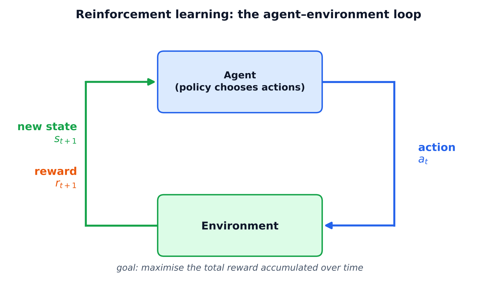

*Figure 3.11. The agent observes a state and chooses an action; the environment returns a reward and the next state.*

#### 6.1.2 Cumulative Reward

The goal is usually to maximise the total reward accumulated over time, not merely the immediate reward from the next action.

A simplified discounted return is:

$$G_t=\sum_{k=0}^{\infty}\gamma^k r_{t+k+1}$$

Where:

- $G_t$ is the return from time $t$.
- $r_{t+k+1}$ is a future reward.
- $\gamma$ is the discount factor, usually between 0 and 1.

A lower discount factor places more emphasis on immediate rewards. A higher factor places more emphasis on future rewards.

#### Worked Example: Computing a Return

A robot receives rewards 0, 0 and 10 over its next three steps, and then the episode ends.

- With $\gamma = 0.9$: $G_0 = 0 + 0.9 \times 0 + 0.9^2 \times 10 = 8.1$.
- With $\gamma = 0.5$: $G_0 = 0 + 0.5 \times 0 + 0.5^2 \times 10 = 2.5$.

The same future reward is worth much less to an agent with a low discount factor, so that agent prefers quicker, smaller rewards.

#### 6.1.3 Exploration and Exploitation

An RL agent must balance two strategies:

- **Exploration:** Trying actions to discover their consequences.
- **Exploitation:** Choosing actions that are already known to produce good results.

Too much exploration can waste time, while too little can prevent the agent from discovering better strategies.

A simple balance is the **ε-greedy** strategy: with a small probability ε (for example, 0.1), choose a random action; otherwise, choose the action currently believed to be best.

### 6.2 Deep Reinforcement Learning

Deep reinforcement learning combines reinforcement learning with deep neural networks.

The neural network can learn representations or approximate decision-making functions when the state or action space is too large for simple tables.

#### 6.2.1 Example: Deep Q-Networks

A Deep Q-Network (DQN) uses a neural network to estimate the expected future return associated with taking an action in a particular state.

These estimates are called Q-values.

The agent can use them to select actions that are expected to yield higher cumulative rewards, while also exploring when appropriate.

DQN builds on **Q-learning**, which improves a Q-value estimate after each step:

$$Q(s,a) \leftarrow Q(s,a)+\alpha\left[r+\gamma\max_{a'}Q(s',a')-Q(s,a)\right]$$

Here $\alpha$ is the learning rate (reinforcement-learning texts write $\alpha$ where Section 3.5 wrote $\eta$), $r$ the reward received and $s'$ the next state. The bracket compares the old estimate with a better-informed target: the reward just received plus the discounted value of the best next action.

#### Worked Example: One Q-learning Update

$Q(s, a) = 2$, $\alpha = 0.5$, $r = 1$, $\gamma = 0.9$, and the best Q-value in the next state is 4.

1. Target: $r + \gamma \max Q(s', a') = 1 + 0.9 \times 4 = 4.6$.
2. Difference from the current estimate: $4.6 - 2 = 2.6$.
3. Update: $Q(s, a) = 2 + 0.5 \times 2.6 = 3.3$.

A DQN replaces the table of Q-values with a neural network that predicts them, which makes huge state spaces, such as screen images, manageable.

#### 6.2.2 Applications and Challenges

Deep RL has been applied to games, robotics, and certain control problems.

However, it can require substantial interaction data and computation. Training may also be unstable, and performance in simulation may not transfer reliably to the real world.

### 6.3 Check Your Understanding

1. **Calculate.** The rewards over four steps are 1, 0, 4 and 8. Find $G_0$ with $\gamma = 0.5$ and with $\gamma = 1$.
2. **Calculate.** Perform one Q-learning update with $Q(s, a) = 0$, $\alpha = 0.1$, $r = 5$, $\gamma = 0.9$ and $\max_{a'} Q(s', a') = 10$.
3. **Predict.** What behaviour would you expect from an agent with $\gamma = 0$?
4. **Identify.** A game-playing agent uses ε-greedy with ε = 0.1. Over 1,000 moves, roughly how many are exploratory? Why not set ε = 0?
5. **Explain.** Why is reinforcement learning not the same as supervised learning, even though both learn from data?

#### Answers

1. $\gamma = 0.5$: $1 + 0.5 \times 0 + 0.25 \times 4 + 0.125 \times 8 = 1 + 0 + 1 + 1 = 3$. $\gamma = 1$: $1 + 0 + 4 + 8 = 13$.
2. Target $= 5 + 0.9 \times 10 = 14$; update $= 0 + 0.1 \times (14 - 0) = 1.4$.
3. It values only the immediate reward ($G_t = r_{t+1}$), so it acts greedily for the next reward and ignores long-term consequences, such as a move that wins a game three turns later.
4. About 100 moves are random. With ε = 0 the agent never tries new actions, so it can get stuck with a mediocre strategy it found early and never discover a better one.
5. Supervised learning is told the correct answer for each input. In RL, no one gives the correct action; the agent receives only a reward, often delayed, and must work out which earlier actions earned it.

**Sources for this topic:** Sutton & Barto (2018), Ch. 1–3 and 6; Mnih et al. (2015).

---

## Topic 7: Limitations, Interpretability, and Responsible AI

### 7.1 The Black-Box Problem

A black-box model produces outputs, but its internal reasoning may be difficult for humans to understand.

Deep neural networks can learn complex relationships distributed across many layers and parameters. Consequently, it is often difficult to explain precisely why a particular input produced a particular output.

#### 7.1.1 Why Interpretability Matters

Interpretability is important when decisions affect people's lives, such as in healthcare, financial services, and other high-stakes settings.

Understanding a model's behaviour can help identify errors, investigate unexpected predictions, and determine whether the model is relying on inappropriate information.

For example, Ribeiro et al. (2016) deliberately trained a classifier on photos in which every wolf appeared with snow in the background. The classifier learned to tell wolves from huskies by looking for snow rather than at the animal itself. A visual explanation that highlights the snow reveals the problem before the model fails on a wolf photographed on grass.

#### 7.1.2 Explainable AI

Explainable AI (XAI) refers to methods that help people understand or investigate model behaviour.

Examples include:

- Feature importance methods that estimate which inputs influence predictions.
- Visual explanations that highlight image regions relevant to a prediction.
- Simplified surrogate models that approximate a more complex model.
- Counterfactual explanations that explore how changing an input might change the output.

These methods have limitations. An explanation is not automatically faithful to the model's actual internal computation, so explanations must be evaluated carefully.

### 7.2 Bias and Fairness

#### 7.2.1 Sources of Bias

AI systems can produce biased results for several reasons:

- Training data does not adequately represent the population.
- Historical data reflects existing social inequalities.
- Labels contain errors or human biases.
- The selected features or learning objective favour certain outcomes.
- A model is deployed in a setting that differs from its training environment.

#### 7.2.2 Consequences

A model may perform well on average while performing poorly for a particular group.

For example, a speech recognition system might be less accurate for speakers whose accents were underrepresented in the training data.

#### Worked Example: An Average That Hides a Gap

A speech recogniser is tested on 1,000 speakers:

| Group | Speakers | Accuracy | Correct |
| :--- | :--- | :--- | :--- |
| Accent A | 900 | 95% | 855 |
| Accent B | 100 | 65% | 65 |
| **All** | **1,000** | **92%** | **920** |

The overall 92% looks good, but speakers with accent B are misunderstood more than a third of the time. Reporting results per group, not only overall, reveals the problem.

#### 7.2.3 Reducing Bias

Possible approaches include:

- Evaluating performance across relevant groups.
- Improving the coverage and quality of training data.
- Auditing labels, features, and evaluation procedures.
- Monitoring the model after deployment.
- Involving relevant stakeholders in the design and assessment process.

There is no single fairness metric that suits every problem. Different fairness criteria may conflict, so the appropriate approach depends on the application and its consequences.

### 7.3 Overfitting and Generalisation

#### 7.3.1 Overfitting

Overfitting occurs when a model learns details or noise specific to its training data instead of learning patterns that generalise well.

An overfitted model may perform very well on the training set but poorly on unseen examples.

#### 7.3.2 Underfitting

Underfitting occurs when a model is too limited, or has not been trained sufficiently, to capture the important patterns in the data.

It may perform poorly on both the training data and unseen data.

#### 7.3.3 Generalisation

Generalisation describes how well a trained model performs on new data drawn from the target setting.

A common way to investigate generalisation is to compare training and validation performance.

| Situation | Training performance | Validation performance | Likely interpretation |
| --------- | -------------------- | ---------------------- | --------------------- |
| Good fit | Good | Good | The model has learned useful patterns |
| Overfitting | Very good | Poorer | The model may have memorised training-specific details |
| Underfitting | Poor | Poor | The model may not have learned the important patterns |

These are common patterns rather than absolute rules. A reliable assessment also depends on how representative the validation data is.

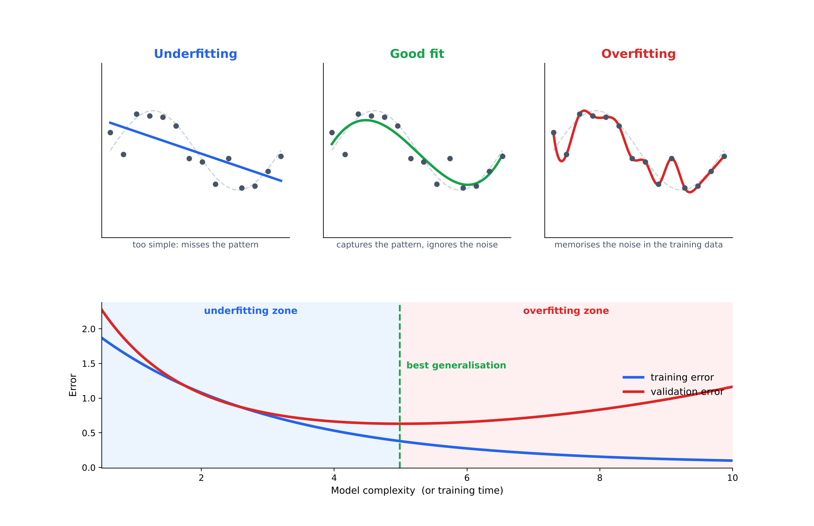

*Figure 3.12. Underfitting, a good fit and overfitting. An overfitted model has low training error but a higher validation error.*

#### 7.3.4 Reducing Overfitting

Common approaches include:

- Collecting more representative training data.
- Applying regularisation.
- Using **data augmentation** when appropriate: creating extra training examples by changing existing ones in ways that keep the label the same, for example flipping, rotating or slightly cropping images of cats.
- Reducing model complexity.
- Using early stopping.
- Evaluating on data that was not used to train or tune the model.

The aim is not simply to maximise training accuracy, but to build a model that performs reliably on the data it will encounter in practice.

### 7.4 Check Your Understanding

1. **Diagnose.** For each model, state whether it is a good fit, overfitting or underfitting, and suggest one action: (a) training accuracy 99%, validation 72%; (b) training 85%, validation 84%; (c) training 60%, validation 58%.
2. **Calculate.** A face-verification system has 97% accuracy for 800 users in group X and 70% for 200 users in group Y. What is its overall accuracy, and why is reporting only that number misleading?
3. **Find the error.** "Our heat-map explanation shows the model looked at the tumour, so the model is definitely reasoning correctly." What is wrong with this claim?
4. **Explain.** Why might a hiring model trained on ten years of past hiring decisions be unfair, even if it never sees applicants' gender?

#### Answers

1. (a) Overfitting: add regularisation or dropout, use early stopping, gather more data, or reduce the model's size. (b) Good fit: keep it, then confirm on the test set. (c) Underfitting: use a larger model, train for longer, or add better features.
2. $(800 \times 0.97 + 200 \times 0.70) / 1000 = (776 + 140) / 1000 = 91.6\%$. The overall figure hides that group Y is wrongly handled 30% of the time, ten times group X's error rate of 3%.
3. An explanation is not automatically faithful to the model's real computation. The heat map may look plausible while the decision actually depends on something else, so explanations must themselves be tested, for example by checking whether removing the highlighted region changes the prediction.
4. Past decisions may reflect historical bias. Other features, such as certain hobbies, schools or gaps in employment, can act as proxies for gender, so the model can learn the old pattern without ever seeing gender directly.

**Sources for this topic:** Ribeiro et al. (2016); Mehrabi et al. (2021); Goodfellow et al. (2016), Ch. 5 and 7; Russell & Norvig (2021), Ch. 27.

---

## Topic 8: Connecting the Concepts

### 8.1 The Complete Neural Network Learning Process

#### 8.1.1 From Data to Prediction

A typical supervised neural network training process can be summarised as follows:

1. The dataset supplies an input.
2. The network processes it through forward propagation.
3. The output is compared with the target using a loss function.
4. Backpropagation calculates the gradients of the loss.
5. An optimisation algorithm updates the weights and biases.
6. The process repeats over many examples.
7. The trained model is evaluated on separate data.

Each part serves a different purpose. The architecture defines how information is processed, the loss defines what the model is trying to improve, backpropagation calculates gradients, and the optimiser uses those gradients to update parameters.

The worked example in Section 3.6 is this whole cycle in miniature: one forward pass ($z$, $a$, $L$), one backward pass ($\partial L / \partial w$) and one gradient-descent update.

#### 8.1.2 Where Chapters 1 and 2 Appear

The Module Overview described training a network as an algorithm built on the ideas of the first two chapters. The table shows where those ideas reappear in this chapter.

| Idea in Chapter 3 | Earlier idea it uses | Connection |
| :--- | :--- | :--- |
| A CNN's input image (Section 4.2) | A 2-D array of pixel values (Chapter 1, Section 4.1) | At each position, the filter reads a small window of the array by index. |
| A layer's weights (Section 4.1) | A 2-D array, or matrix, of numbers; asymptotic cost (Chapter 2, Section 1.1) | A layer with $m$ inputs and $k$ outputs does $m \times k$ multiplications per example, so its forward pass costs $\Theta(mk)$. The MLP in Figure 3.5 does 50, one per weight. |
| Backpropagation (Section 3.6) | Storing and reusing results, as in memoization (Chapter 2, Section 2.3) | Values from the forward pass are stored, and each layer's gradient is reused for the layer before it, so all gradients together cost only a small multiple of one forward pass. |
| Gradient descent (Section 3.5) | Greedy choices (Chapter 2, Section 2.2) | Each step moves in the locally best direction, so, like a greedy algorithm without a proof, it is not guaranteed to reach the lowest possible loss. |
| Attention (Section 4.4) | Quadratic growth (Chapter 2, Section 1.1) | Every position is compared with every other, so $n$ tokens need $n^2$ scores: 1,000 tokens need 1,000,000. This is why attention becomes expensive for very long sequences. |
| Q-learning (Section 6.2) | A map from keys to values (Chapter 1, Section 5.3) | The Q-table maps each (state, action) pair to a value. A DQN replaces the map with a network when there are too many states to store. |
| K-means (Section 5.1) | Nearest-neighbour queries (Chapter 1, Section 5.5) | Each round finds every point's nearest centre, which takes $\Theta(nK)$ distance calculations for $n$ points and $K$ centres. |

### 8.2 Comparing Learning Approaches

| Approach | Type of feedback | Main objective | Example |
| -------- | ---------------- | -------------- | ------- |
| Supervised learning | Labelled target | Predict the correct output | Classifying images |
| Semi-supervised learning | Some labelled and much unlabelled data | Improve learning with limited labels | Medical image classification |
| Unsupervised learning | No target labels required | Discover structure or representations | Customer clustering |
| Reinforcement learning | Rewards from interaction | Maximise cumulative reward | Robot navigation |
| Self-supervised learning | Targets constructed from the data itself | Learn useful representations | Predicting masked words in text |

> **Important distinction:** Self-supervised learning is not the same as semi-supervised learning. Self-supervised methods create training signals from the data itself, whereas semi-supervised methods combine labelled and unlabelled data.

For example, a self-supervised language model can hide the word "sat" in "The cat ___ on the mat" and learn to predict it; the sentence supplies its own label, so no human labelling is needed.

### 8.3 Comparing the Main Architectures

Section 4.5 compares the four architectures in detail. Seen together, each one matches a shape of data from Chapter 1:

- **MLPs** take a fixed-length list of numerical features.
- **CNNs** take a grid (a 2-D array), such as an image, and exploit local spatial patterns.
- **RNNs** take a sequence one element at a time, carrying a hidden state forward.
- **Transformers** take a whole sequence at once and use attention to relate any two positions.

These categories are not mutually exclusive in all practical systems. Modern models can combine architectural ideas, and the best choice depends on the task.

### 8.4 Comparing Generative Models

Section 5.4 compares autoencoders and GANs in detail. In short, an autoencoder learns to reconstruct its input through an encoded representation, while a GAN learns to generate new samples through competition between a generator and a discriminator. Both can learn from data without human-provided class labels, but their objectives differ: an autoencoder is judged on how faithfully it rebuilds its input, and a GAN on how realistic its new samples are.

### 8.5 Chapter Review Activity

A school wants a system that reads handwritten exam marks (the digits 0–9) from scanned answer sheets. Answer each part, then check against the answers below.

1. **Choose.** Which learning approach and which architecture would you use? Why?
2. **Explain.** Which loss function fits, and what does the output layer produce?
3. **Sequence.** List, in order, what happens to one batch of training images.
4. **Diagnose.** After training, accuracy is 99.5% on the training set and 81% on the validation set. What is happening, and name two remedies.
5. **Evaluate.** The test set contains only digits written by teachers, but the system will read students' handwriting. Why is this a problem?
6. **Classify.** The school is considering other projects. Name the learning approach each would use: (a) grouping past exam answers by similarity, with no labels; (b) training on 300 marked scripts together with 30,000 unmarked ones; (c) training a model to predict words hidden in textbook sentences; (d) a timetabling agent that receives a reward whenever the number of clashes falls; (e) predicting final grades from past students' coursework marks and their recorded final grades.

#### Answers

1. Supervised learning, because labelled examples (images with the correct digit) can be collected. A CNN, because digits are images with local patterns such as strokes and curves.
2. Cross-entropy, the multi-class version of the binary cross-entropy in Section 3.3.2. The output layer has 10 neurons with a softmax, giving a probability for each digit.
3. Forward propagation through the CNN → compute the cross-entropy loss against the true digits → backpropagation to get the gradients → a gradient-descent (mini-batch) update of the weights → move on to the next batch.
4. Overfitting: the model has memorised training-specific details. Remedies: data augmentation (small rotations and shifts of the digits), dropout or L2 regularisation, early stopping, or more varied training data.
5. The test set does not represent the data the model will meet in practice, so its accuracy can overestimate real performance. This is the bias source "deployed in a setting that differs from its training environment" in Section 7.2.1. Students' handwriting should be included in the validation and test data.
6. (a) Unsupervised learning (clustering). (b) Semi-supervised learning: a few labels plus many unlabelled examples. (c) Self-supervised learning: the sentences supply their own targets, so no human labelling is needed. (d) Reinforcement learning: the agent learns from rewards, not correct answers. (e) Supervised learning (regression), because each past student comes with the correct final grade.

**Sources for this topic:** Goodfellow et al. (2016), Ch. 5–8.

---

# References

Each topic ends with a "Sources for this topic" line pointing to the entries below.

## Textbooks

- Bishop, C. M. (2006). *Pattern recognition and machine learning*. Springer.
- Chapelle, O., Schölkopf, B., & Zien, A. (Eds.). (2006). *Semi-supervised learning*. MIT Press.
- Cormen, T. H., Leiserson, C. E., Rivest, R. L., & Stein, C. (2022). *Introduction to algorithms* (4th ed.). MIT Press.
- de Berg, M., Cheong, O., van Kreveld, M., & Overmars, M. (2008). *Computational geometry: Algorithms and applications* (3rd ed.). Springer.
- Goodfellow, I., Bengio, Y., & Courville, A. (2016). *Deep learning*. MIT Press. https://www.deeplearningbook.org
- Kleinberg, J., & Tardos, É. (2006). *Algorithm design*. Pearson Addison-Wesley.
- Motwani, R., & Raghavan, P. (1995). *Randomized algorithms*. Cambridge University Press.
- Russell, S., & Norvig, P. (2021). *Artificial intelligence: A modern approach* (4th ed.). Pearson.
- Sedgewick, R., & Wayne, K. (2011). *Algorithms* (4th ed.). Addison-Wesley.
- Sutton, R. S., & Barto, A. G. (2018). *Reinforcement learning: An introduction* (2nd ed.). MIT Press.

## Original Papers

- Bentley, J. L. (1975). Multidimensional binary search trees used for associative searching. *Communications of the ACM, 18*(9), 509–517.
- Dijkstra, E. W. (1959). A note on two problems in connexion with graphs. *Numerische Mathematik, 1*, 269–271.
- Edmonds, J., & Karp, R. M. (1972). Theoretical improvements in algorithmic efficiency for network flow problems. *Journal of the ACM, 19*(2), 248–264.
- Ford, L. R., & Fulkerson, D. R. (1956). Maximal flow through a network. *Canadian Journal of Mathematics, 8*, 399–404.
- Goodfellow, I., Pouget-Abadie, J., Mirza, M., Xu, B., Warde-Farley, D., Ozair, S., Courville, A., & Bengio, Y. (2014). Generative adversarial nets. *Advances in Neural Information Processing Systems, 27*.
- Hinton, G. E., & Salakhutdinov, R. R. (2006). Reducing the dimensionality of data with neural networks. *Science, 313*(5786), 504–507.
- Hochreiter, S., & Schmidhuber, J. (1997). Long short-term memory. *Neural Computation, 9*(8), 1735–1780.
- Kruskal, J. B. (1956). On the shortest spanning subtree of a graph and the traveling salesman problem. *Proceedings of the American Mathematical Society, 7*(1), 48–50.
- LeCun, Y., Bottou, L., Bengio, Y., & Haffner, P. (1998). Gradient-based learning applied to document recognition. *Proceedings of the IEEE, 86*(11), 2278–2324.
- Manber, U., & Myers, G. (1993). Suffix arrays: A new method for on-line string searches. *SIAM Journal on Computing, 22*(5), 935–948.
- Mehrabi, N., Morstatter, F., Saxena, N., Lerman, K., & Galstyan, A. (2021). A survey on bias and fairness in machine learning. *ACM Computing Surveys, 54*(6), 1–35.
- Mnih, V., Kavukcuoglu, K., Silver, D., et al. (2015). Human-level control through deep reinforcement learning. *Nature, 518*(7540), 529–533.
- Prim, R. C. (1957). Shortest connection networks and some generalizations. *Bell System Technical Journal, 36*(6), 1389–1401.
- Ribeiro, M. T., Singh, S., & Guestrin, C. (2016). "Why should I trust you?": Explaining the predictions of any classifier. *Proceedings of the 22nd ACM SIGKDD International Conference on Knowledge Discovery and Data Mining*, 1135–1144.
- Rosenblatt, F. (1958). The perceptron: A probabilistic model for information storage and organization in the brain. *Psychological Review, 65*(6), 386–408.
- Rumelhart, D. E., Hinton, G. E., & Williams, R. J. (1986). Learning representations by back-propagating errors. *Nature, 323*(6088), 533–536.
- Srivastava, N., Hinton, G., Krizhevsky, A., Sutskever, I., & Salakhutdinov, R. (2014). Dropout: A simple way to prevent neural networks from overfitting. *Journal of Machine Learning Research, 15*, 1929–1958.
- Vaswani, A., Shazeer, N., Parmar, N., Uszkoreit, J., Jones, L., Gomez, A. N., Kaiser, Ł., & Polosukhin, I. (2017). Attention is all you need. *Advances in Neural Information Processing Systems, 30*.

## Figure Credits

| Figure file | Section | Credit |
| :--- | :--- | :--- |
| stack-vs-queue.png, array-vs-linked-list.png, tree-vs-graph.png | Ch 1, Figures 1.1–1.3 | Created for this module with AI assistance (Claude, Anthropic), 28 November 2026, using Python (Matplotlib). They replace three Stage 2 figures whose original source could not be confirmed. |
| big-o-growth-rates.png, backtracking-search-tree.png, bfs-vs-dfs-traversal.png, minimum-spanning-tree-example.png, flow-network-example.png | Ch 2, Figures 2.1–2.5 | Created for this module with AI assistance (Claude, Anthropic), November 2026, using Python (Matplotlib, NetworkX). Graph values computed in code. |
| neuron-diagram.png, activation-functions.png, perceptron-binary-output.png, gradient-of-f.png, mlp-architecture.png, cnn-architecture.png, rnn-unrolled.png, transformer-architecture.png, autoencoder-architecture.png, gan-architecture.png, rl-agent-environment-loop.png, overfitting-vs-underfitting.png | Ch 3, Figures 3.1–3.12 | Created for this module with AI assistance (Claude, Anthropic), November 2026, using Python (Matplotlib). The Transformer figure is a simplified overview based on Vaswani et al. (2017). |
