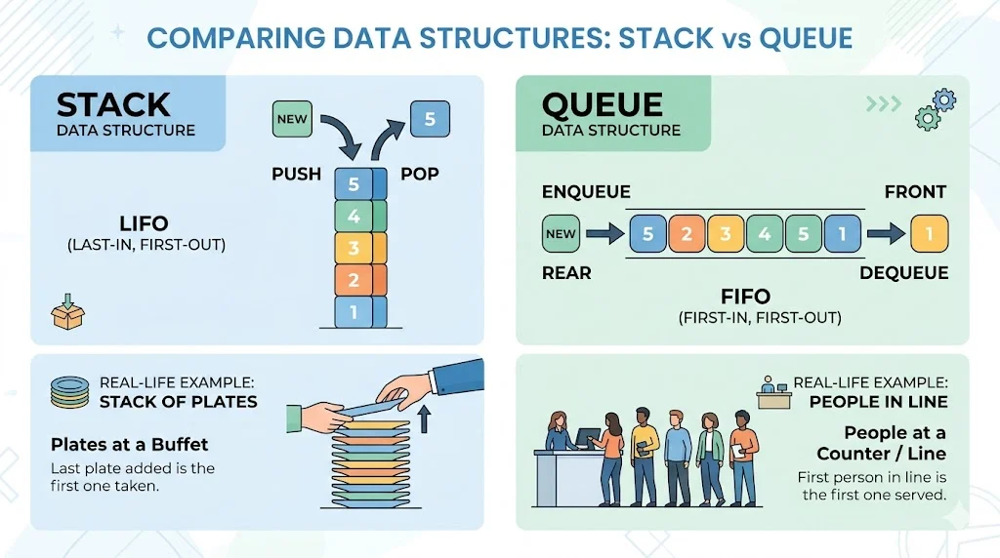
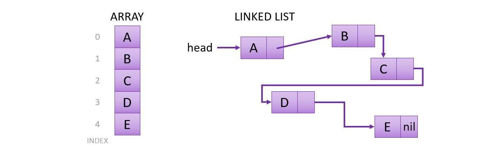
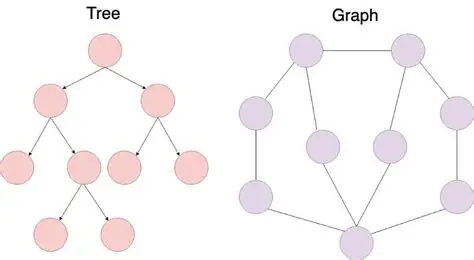

# Chapter 1: Introduction to Data Structures
## Topic 1: Why Are Data Structures Needed?

### 1.1 Overview and Core Concept
In computer science, data must be stored, accessed, processed, modified, and managed efficiently. A data structure is a way of organizing and storing data so that particular operations can be performed efficiently.

Different data structures are designed to support different operations. Choosing an appropriate structure can improve an algorithm's execution time, memory usage, and maintainability.

Without a suitable data structure, a program may require excessive computation or memory as the amount of data increases. However, no single data structure is optimal for every situation. The best choice depends on the data, the operations required, and the system's performance constraints.

#### Example
Suppose a university needs to store the records of 10,000 students. Each record may contain:
- Student ID
- Name
- Age
- Department
- Examination scores

Storing every value in an unrelated variable would make the records difficult to manage. Instead, the university could organize the records using arrays, lists, hash tables, or database structures, depending on its requirements:
* **An array** may store examination scores in order.
* **A hash table** may associate student IDs with student records.
* **A tree** may represent a hierarchical organizational structure.
* **A graph** may represent connections between students or departments.

The choice of data structure affects how efficiently the information can be accessed and modified.

---

### 1.2 Key Motivations and Technical Advantages

#### A. Resource Efficiency: Time and Space Optimization
Data structures influence the time and memory required to perform operations.
* **Time complexity** describes how the computational work of an algorithm grows as the input size increases.
* **Space complexity** describes how the memory requirements of an algorithm grow as the input size increases.

For example, consider searching for a student ID in a collection:
* Searching an unsorted array requires $O(n)$ time in the worst case.
* Searching a balanced Binary Search Tree (BST) generally requires $O(\log n)$ time.
* Searching a hash table typically requires $O(1)$ time on average under suitable assumptions.

These complexities are not interchangeable guarantees. They depend on the data structure's properties, implementation, and the operation being performed.

#### B. Scalability
Scalability refers to a system's ability to handle increasing amounts of data or work while maintaining acceptable performance. Data structures help manage growing collections efficiently, but they do not automatically make an application scalable. Performance also depends on algorithms, hardware, networking, concurrency, and software architecture.

#### C. Abstraction and Reusability
Data structures allow programmers to organize data behind well-defined operations. An implementation can be reused across different applications, reducing the need to rewrite the same logic. 

For example, a stack can be used for:
* Undo operations in text editors
* Function-call management
* Expression evaluation
* Backtracking algorithms

#### D. Modeling Real-World Relationships
Real-world information often contains relationships that cannot be represented conveniently by isolated values.

| Relationship | Suitable Structure | Example |
| :--- | :--- | :--- |
| **Sequential** | Array or linked list | Examination scores |
| **Last in, first out** | Stack | Undo operations |
| **First in, first out** | Queue | Processing tasks in arrival order |
| **Hierarchical** | Tree | File systems |
| **Priority-based** | Priority queue | Job scheduling |
| **Interconnected** | Graph | Road networks |
| **Key-value association** | Hash table | Student ID lookup |

#### E. Trade-Offs Between Data Structures
* **Arrays** provide efficient indexed access but may require shifting elements during insertion or deletion.
* **Linked lists** support efficient insertion or deletion when the relevant position is already accessible, but indexed access is slow.
* **Hash tables** offer fast average-case lookup by key but do not inherently maintain sorted order.
* **Balanced search trees** support ordered traversal and efficient search, insertion, and deletion, generally in $O(\log n)$ time.

---

### 1.3 Introduction to Algorithm Analysis
Algorithm analysis helps estimate how efficiently an algorithm performs as its input grows ($n$).

#### A. Common Time Complexes
| Complexity | Name | General Meaning | Example |
| :--- | :--- | :--- | :--- |
| $O(1)$ | Constant | Work does not grow with input size | Accessing an array element by index |
| $O(\log n)$ | Logarithmic | Work grows slowly as input increases | Binary search |
| $O(n)$ | Linear | Work grows proportionally to input size | Linear search |
| $O(n \log n)$ | Linearithmic | Common in efficient sorting | Merge sort |
| $O(n^2)$ | Quadratic | Work grows with nested iterations | Simple nested-loop comparison |

#### B. Best, Average, and Worst Cases
* **Best case:** The most favorable input conditions.
* **Average case:** Expected performance under a specified input distribution.
* **Worst case:** The maximum amount of work required for inputs of a given size.

---

### 1.4 Choosing the Right Data Structure
Common operational requirements and their ideal structural match:
| Requirement | Possible Choice | Reason |
| :--- | :--- | :--- |
| **Frequent access by index** | Array | Constant-time indexed access |
| **Frequent lookup by key** | Hash table | Average-case constant-time lookup |
| **Processing items in arrival order** | Queue | First-in, first-out behavior |
| **Reversing operations** | Stack | Last-in, first-out behavior |
| **Selecting highest-priority item** | Priority queue | Efficient priority-based retrieval |
| **Maintaining sorted data with updates**| Balanced search tree | Efficient ordered operations |
| **Representing random connections** | Graph | Models vertices and edges |

---

## Topic 2: Data vs. Data Types vs. Data Structures

### 2.1 Definitions and Comparison
| Feature | Data | Data Type | Data Structure |
| :--- | :--- | :--- | :--- |
| **Definition** | Information represented as values or symbols | A classification defining valid values and supported operations | A way of organizing and storing data elements |
| **Main Question** | What information is represented? | What kind of value is this? | How are values organized and accessed? |
| **Purpose** | Represent information | Define how values are interpreted and used | Support efficient operations on collections or relationships |
| **Examples** | `85`, `"Hello"`, `3.14`, `true` | `int`, `float`, `bool`, `str` | Array, linked list, tree, graph, hash table |

---

### 2.2 Abstract Data Types and Implementations
An **Abstract Data Type (ADT)** defines a data type in terms of its behavior and supported operations, without requiring a particular internal implementation.

#### Example: Stack ADT
* `push(x)`: Add `x` to the top.
* `pop()`: Remove and return the top element.
* `peek()`: Return the top element without removing it.
* `isEmpty()`: Check whether the stack is empty.

---

### 2.3 Logical Organization vs. Physical Memory Layout
* **Contiguous Storage (e.g., Arrays):** Elements occupy consecutive memory locations. Provides efficient indexed access and good memory locality.
* **Linked Storage (e.g., Linked Lists):** Elements stored in nodes connected by pointers/references across non-consecutive addresses.

---

## Topic 3: Classification and Basic Operations

### 3.1 Classification of Data Structures
* **Primitive vs. Non-Primitive:** Basic programming types vs. complex grouped structures.
* **Linear vs. Non-Linear:** Sequential sequences (Arrays, Queues) vs. hierarchical/interconnected layouts (Trees, Graphs).
* **Static vs. Dynamic:** Fixed capacity vs. resizable during execution.

### 3.2 Fundamental Operations
Common operations include **Traversal**, **Searching**, **Insertion**, **Deletion**, **Updating**, **Sorting**, and **Accessing**.

---

## Topic 4: Real-Life Applications

* **4.1 Arrays and Dynamic Arrays:** Best for indexed collections and sequential numerical sets ($O(1)$ lookup).
* **4.2 Linked Lists:** Ideal for frequent insertions/deletions at accessible pointers.
* **4.3 Stacks ($LIFO$):** Used in undo/redo actions, call stacks, and expression evaluations.
* **4.4 Queues ($FIFO$):** Used in printer scheduling, server requests, and Breadth-First Search (BFS).
* **4.5 Hash Tables:** Excellent for caching, symbol tables, and key-value lookups ($O(1)$ average case).
* **4.6 Trees:** Hierarchical file systems, DOM trees, and Abstract Syntax Trees (ASTs).

* **4.7 Heaps & Priority Queues:** Event-driven simulations, task queues, and Dijkstra's algorithm.
* **4.8 Graphs:** Social networks, GPS routing, and recommendation systems.

---

# Chapter 2: Algorithms
What is an algorithm? An algorithm is basically a recipe to a recipe. A list of steps that turns input into output which doesn't vary, furthermore it is the building block of every AI.

## Topic 1: Foundation of Algorithms Analysis
There are 3 ways to analyse an algorithm:
- Exact operation count
  a mathematical count or model of the computational operations an algorithm performs for a   
  particular input size and a particular input.
- Asymptotic growth
  Describes how an algorithm's operation count changes as its input size becomes very large
- Measured Execution time
  The actual time an implementation tkaes to run on a particular machine under particular 
  conditions.

  
### 1.1 Asymptotic notation
Asymptotic notation is a mathematical system for describing how an algorithm's resource requirements grow as its input size approaches infinity.
 
 
Asymptotic analysis allows us to compare algorithms without depending on a specific processor, programming language or machine speed. 
 
#### Main asymptotic notations
- Big O: Asymptotic upper bound
  This notation gives the upper bound on the eventual growth of a function. 
  $T(n) = O(g(n))$ where $0 \leq f(n) \leq cg(n)$   for all   $n \geq n_0$ 
- Big Omega: Asymptotic lower bound
  This notation gives the lower bound on the eventual growth of a function
  $T(n) = \Omega(g(n))$ where $0 \leq cg(n) \leq f(n)$   for all   $n \geq n_0$ 
- Big Theta: Tight asymptotic bound
  This notation gives an upper and lower bound
  $T(n) = \Theta(g(n))$ where $0 \leq c_1g(n) \leq f(n) \leq c_2g(n)$   for all   $n \geq n_0$ 
- Little o: Strict asymptotic upper bound
  Little o expresses a strictly slower growth rate
  $T(n) = o(g(n))$ where $0 \leq c_1g(n) \leq f(n) \leq c_2g(n)$   for all   $n \geq n_0$ 
- Little omega: Strict asymptotic lower bound
  Little omega expresses strictly faster growth rate
   $T(n) = \omega(g(n))$ where $f(n)$ eventually grows faster than every constant multiple 
   $g(n)$
 

| Complexity | Common Name |
|:----------:|:-----------:|
| $O(1)$ | Constant |
| $O(\log n)$ | Logarithmic |
| $O(n)$ | Linear |
| $O(n\log n)$ | Linearithmic|
| $O(n^2)$ | Quadratic |
| $O(n^3)$ | Cubic |
| $O(2^n)$ | Exponential |
| $O(n!)$ | Factorial|

 

#### Common mistakes
- Do not confuse Big O with exact running time
- Do not claim that Big O always means worst case
- Do not compare algorithms solely by asymptotic notations when inputs are small or implementation constants are significant.  

### 1.2 Recurrence Relations
A recurrence relation expresses a function in terms of its values on smaller inputs. 
In algorithm analysis, we use this to analyse recursive algorithms. 
Why? 
Because recursive algorithms have looping steps, which means the normal conventional way won't capture the actual number of steps 

#### Building a recurrence from an algorithm
$T(n)=aT(\frac{n}{b})+f(n)$ 
where: 
- $a$ is the number of recursive calls.
- $\frac{n}{b}$ is the size of each subproblem
- $f(n)$ is the work performed outside those recursive calls

#### Why do we even learn this?
It's useful for:
- Divide-and-conquer algorithms such as merge sort
- Recursive searching, such as binary search
- Recursive tree algorithms
- Recursive matrix multiplication

### 1.3 Amortized Analysis
Amortised analysis determines the cost per operation over a sequence of operations, providing a worst-case guarantee on the sequence without relying on probabilities. 
Because some data-structure operations are expensive only in certain conditions.

#### Amortized vs average-case analysis
- Average-case analysis relies on a probability distribution over inputs or operations.
- Amortized analysis establishes a bound over every permitted sequence of operations, subject 
  to the data structure's rules

## Topic 2: Core Algorithms Design Paradigms
A design paradigm is a general strategy for constructing algorithms. It is not one specific algorithm, rather, it is a reusable approach that can be applied to many different problems.  

### 2.1 Divide and Conquer
Divide and conquer solves a problem by dividing it into smaller subproblems, solving those subproblems recursively, and combining their solutions.
  
The three stages in this method:
1. Divide
2. Conquer
3. Combine the solutions together 

#### Example algorithms:

- Merge sort
- Binary search

  
#### Conditions for effective divide and conquer
- Subproblems are smaller than the original
- Their solutions can be computed recursively
- The subproblems are independent or their dependencies can be managed 
- The combination step is efficient
- The recurrence yields a favorable total cost

#### Limitations:
- Recursion overhead
- Memory consumption
- The possibility that the combination stage is expensive  

### 2.2 Greedy Algorithms 
A greedy algorithm constructs a solution incrementally by choosing what appears to be the best available option at each step.  
A greedy algorithm does not generally explore every possible solution. Instead, it commits to a locally attractive choice, hoping that the sequence of choices produces a globally optimal solution.  
However, a locally optimal choice is not necessarily globally optimal. Greedy algorithms require a proof that their chices preserve the possibility of an optimal solution.

#### 2 important properties:

- ##### Greedy-choice property
  A problem has the greedy-choice property when there exists an optimal solution that begins with a valid greedy choice. After making that choice, the remaining problem can be solved to obtain an optimal overall solution.  This property must be established for the particular problem. It can't be assumed merely because the greedy choice seems sensible.  
- ##### Optimal substructure
  A problem has optimal substructure when an optimal solution can be constructed using optimal solutions to appropriate smaller or residual subproblems.  Optimal substructure is also important in dynamic programming.  

#### Greedy graph algorithms:
- Kruskal's Algorithm: Repeatedly selects the lowest-weight edge connecting the current tree to a vertex outside it.
- Prim's Algorithm: Repeatedly adds the lwoest-weight edge connecting the current tree to a vertex outside it
- Dijkstra's Algorithm: Repeatedly finalises the unvisited vertex with the smallest tentative distance, under the assumption that edge weights are non-negative  
### 2.3 Dynamic Programming(DP)
Dynamic programming is a method for solving problems by breaking them into subproblems, solving each distinct subproblem once, and storing the result for reuse.   It is especially useful when subproblems overlap and the problem has optimal substructure.  In some recursive algorithms, the same subproblem may be solved many times. Dynamic programming eliminates this repeated work by remembering previously computed results.  

#### 2 main properties:
- ##### Overlapping subproblems
  Subproblems overlap when the same smaller problem appears repeatedly during the computation.
- ##### Optimal substructure
  A problem has optimal substructure when its optimal solution can be expressed using optimal solutions to suitable smaller subproblems.

#### 2 Implementation approaches
- ##### Memoization: Top-down dynamic programming
  - Begin with a recursive solution.
  - Store the result whenever a subproblem is solved
  - Before solving a subproblem, check whether its result is already stored
  - Return the stored result when available.  
  Memoization often preverses the structure of the original recursive definition.  
- ##### Tabulation: Bottom-up dynamic programming
  - Identify the smallest subproblems.
  - Compute their answers first.
  - Store the result in a table.
  - Use those results to calculate progressively larger subproblems.  
  Tabulation often avoids recursive call overhead and can make memory usage easier to optimise  

  ##### The quality of a dynamic programming solution depends on defining the right states, recurrence, base cases, and computation order.  

### 2.4 Backtracking & Branch-and-Bound
These two methods both explore a search space of candidate solutions, but they use different
criteria to prune the search.  

- #### Backtracking
  Backtracking constructs a candidate solution incrementally and abandons a partial candidate as soon as it violates a constraint or cannot lead to a valid solution. 
  It is naturally represented as a depth-first search tree:
  - Each node represents a partial assignment.
  - Each node represents a partial assignment.
  - A leaf represents a complete candidate or a dead end.
  - A pruned branch is never explored further.  
  Backtracking is particularly useful for constraint-satisfaction problems, where the objective is to find one or all assignments satisfying a set of conditions.  
- #### Branch-and-bound
  Branch-and-bound is primarily an optimisation technique. It searches for the best solution and uses bounds to determine whether a partial candidate could possibly outperform the best solution already found. 
  It has 4 main elements:
  1. Branching: Split the search into subproblems.
  2. Bounding: Compute an optimistic estimate of the best objective achievable within a subproblem
  3. Incumbent: Maintain the best complete feasible solution found so far.
  4. Pruning: Discard a subproblem when its bound proves that it cannot improve the incumbent  

### 2.5 Randomized Algorithms
A randomized algorithm uses random choices during its execution. These choices influence its behaviour, running time, or output.  
Randomization can simplify algorithms, avoid adversarial inputs, and provide strong expected performance. Analysis must account for the probability distribution induced by the random choices.  
#### Las Vegas Algorithms
A Las Vegas algorithm always returns a correct answer, but its running time may vary because of random choices.  
Randomized quicksort is a standard example. It randomly selects a pivot, then partitions the array around that pivot. Different pivot choices produce different partition sizes, but the final sorted array is correct.
#### Monte Carlo Algorithms
A Monte Carlo algorithm has a bounded or otherwise controlled running time but may return an incorrect answer with a specified probability.

#### Types of error:
- One-sided error: Only one type of mistake is possible.
- Two-sided error: Both false positives and false negatives may occur.

#### Why randomisation helps
Randomization can prevent an algorithm from behaving badly on inputs designed to exploit a fixed deterministic strategy. Random pivots in quicksort, random sampling, hashing, and randomized graph algorithms are important examples.  However, randomization does not automatically guarantee efficiency. A randomized algorithm still needs an analysis of its error probability, expected cost, or probability of exceeding a chosen cost threshold.

### 2.6 Approximation Algorithms and NP-hardness
This topic connects practical algorithm design with computational complexity theory. It explains what to do when exact optimisation may require an impractical amount of computation.

#### Approximation algorithms
An approximation algorithm efficiently returns a feasible solution whose quality is guaranteed to be close to optimal.  
For a minimisation problem, let:
- $C$ be the cost of the algorithm's solution.
- $C^{*}$ be the optimal cost.
  
An algorithm has approximation ratio at most $\rho\geq 1$ if: 
$C\leq\rho C^*$

For a maximisation problem, one common convention is 
$C\geq\frac{C^*}{\rho}$

#### P, NP, NP-hard, and NP-complete
- P is the class of decision problems solvable by a deterministic algorithm in polynomial time.  
- NP is the class of decision problems for which a proposed yes-solution can be verified in polynomial time. Equivalently, these problems have certificates that can be checked efficiently.  
- It is not known whether $P=NP$. In particular, the fact that a problem belongs to NP does not mean that it is known to be computationally difficult, nor does it mean that its solutions are impossible to find efficiently.  
- A problem is NP-hard if every problem in NP can be reduced to it using an appropriate polynomial-time reduction. NP-hard problems are at least as hard as all problems in NP under that reduction framework.  
- A problem is NP-complete if it is both in NP and NP-hard.  

## Topic 3: Graph Algorithms
Graph algorithms operate on structures consisting of vertices and edges. They are fundamental to route planning, communication networks, dependency analysis, social networks, scheduling, circuit design, and transportation systems. 
Keywords:

- Vertex (node): An entity represented in the graph.
- Edge: A connection between vertices.
- Directed graph: Each edge has a direction, such as $u\to v$
- Undirected graph: Each edge connects two vertices without a direction.
- Weighted graph: Each edge has an associated value, such as distance, time, or cost.
- Path: A sequence of vertices connected by edges.
- Cycle: A path that returns to its starting vertex without repeating intermediate vertices, under the usual simple-cycle definition.
- Connected graph: An undirected graph in which every vertex can reach every other vertex.
- Connected component: A maximal connected part of an undirected graph.
- Degree: The number of incident edges in an undirected graph. In a directed graph, indegree and outdegree count incoming and outgoing edges separately.

### 3.1 Graph Traversal
Graph traversal is the systematic process of visiting vertices or edges in a graph according to a defined exploration strategy.  
Traversal is useful for determining reachability, identifying connected components, detecting cycles, constructing spanning trees, finding paths, and ordering dependent tasks. 
The two fundamental traversal algorithms are:
- Breadth-first search (BFS).
- Depth-first search (DFS).

#### Breadth-first search(BFS)
BFS explores a graph in layers. Starting from a source vertex, it visits all vertices one edge away before visiting vertices two edges away, then three edges away, and so on.
  
It uses a queue, which follows first-in, first-out order.
  
BFS explores vertices in non-decreasing order of their distance from the source. A vertex is discovered through a predecessor at the preceding distance level. If a shorter path existed, the vertex would have been reachable from an earlier level, and BFS would have discovered it earlier. Therefore, BFS finds a minimum-edge-count path from the source to every reachable vertex.

#### Depth-first search(DFS)
DFS explores as far as possible along a branch before returning to explore another branch. It can be implemented using recursion or an explicit stack. 
DFS can be used to:
- Find reachable vertices.
- Identify connected components in undirected graphs.
- Detect cycles.
- Produce topological order in directed acyclic graphs.
- Find strongly connected components using suitable extensions.
- Classify edges and analyse structural properties of graphs.  
DFS does not generally find shortest paths in an unweighted graph. It prioritises depth, not distance.

### 3.2 Shortest Paths
The shortest-path problem seeks a path between vertices whose total edge weight is minimum. 
A shortest path need not be the path with the fewest edges. A path with more edges can have a lower total weight.  
#### Relaxation
Many shortest-path algorithms use a procedure called relaxation. 
Relaxation improves a distance estimate when a cheaper route has been found. The algorithm's strategy determines when these estimates become final.   
#### Dijkstra's Algorithm
Dijkstra's algorithm finds shortest-path distances from one source to all reachable vertices in a graph with non-negative edge weights. 
Its main idea is to repeatedly select the unsettled vertex with the smallest tentative distance and finalise that distance.
#### Bellman-Ford Algorithm
Bellman-Ford solves the single-source shortest-path problem even when negative edge weights are present, provided there is no negative-weight cycle reachable from the source if finite shortest-path distances are required.
#### Floyd-Warshall Algorithm
Floyd-Warshall solves the all-pairs shortest-path problem, computing the shortest distance between every ordered pair of vertices. It uses dynamic programming.

### 3.3 Minimum Spanning Trees
A spanning tree of a connected, undirected graph is a subgraph that:
1. Includes every vertex.
2. Is connected.
3. Contains no cycles. 
A minimum spanning tree (MST) is a spanning tree with the smallest possible sum of edge weights.
An MST minimises the total weight required to connect all vertices. It does not generally minimise the distance from a particular source to every other vertex. That is a shortest-path-tree objective, which is different.

#### Kruskal's Algorithm
Kruskal's algorithm considers edges in increasing order of weight and accepts an edge if adding it does not create a cycle. 
Procedure
1. Sort all edges by non-decreasing weight.
2. Start with an empty forest in which each vertex is its own component.
3. Consider each edge in sorted order.
4. If its endpoints belong to different components, add it to the forest and merge those components.
5. Stop after selecting \(V-1\) edges.

#### Prim's Algorithm
Prim's algorithm begins from an arbitrary vertex and grows a single tree. At each step, it chooses the minimum-weight edge connecting a vertex already in the tree to a vertex outside it.
  
Prim and Kruskal both produce an MST for a connected, undirected weighted graph. They differ in how they grow the solution:
- Prim grows one connected tree.
- Kruskal grows a forest and joins components.

#### Disconnected graphs
If the graph is disconnected, no spanning tree can connect all vertices. Kruskal's algorithm instead produces a minimum spanning forest, containing a minimum spanning tree for each connected component.  
Prim's algorithm must likewise be restarted in each component if a minimum spanning forest is desired.

### 3.4 Network Flow
A flow network is a directed graph in which each edge has a capacity limiting how much flow can pass through it. The network contains a source \(s\), which supplies flow, and a sink \(t\), which receives it. 
Flow models include:
- Water through pipes.
- Data through communication links.
- Goods through transport networks.
- Assignments between workers and jobs.
- Bipartite matching and resource allocation.

#### The residual network
The residual network represents where additional flow can be sent or where existing flow can be reduced. 

#### Augmenting paths
An augmenting path is a path from source s to sink t in the residual network where every edge has positive residual capacity.

#### The Ford-Fulkerson method
The Ford-Fulkerson method repeatedly finds an augmenting path and increases the flow by its bottleneck capacity.  

The high-level procedure is:
1. Initialise every edge's flow to zero.
2. Construct the residual network.
3. Find an augmenting path from source to sink.
4. Increase the flow by the path's bottleneck capacity.
5. Update the residual network.
6. Repeat until no augmenting path exists.
  

If capacities are integral and augmenting paths are chosen appropriately, each augmentation increases the flow value by at least one unit, so the method terminates for finite integral-capacity networks.  

#### Edmonds-Karp algorithms
Edmonds-Karp is a specific implementation of Ford-Fulkerson that uses BFS to find an augmenting path with the fewest number of edges. 
It avoids the potentially poor behaviour of arbitrary augmenting-path selection and terminates with a maximum flow in a finite graph.

#### Maximum-flow minimum-cut theorem
Flow through any network cannot exceed the capacity of any source-sink cut. Every unit of flow reaching the sink must cross the cut, and the cut's outgoing edges limit how much flow can cross.  

> The maximum-flow minimum-cut theorem states that the maximum possible flow value equals the minimum capacity of any source-sink cut.  
This theorem provides both a way to certify optimality and a powerful connection between two apparently different optimisation problems.

#### Application and reductions
- Bipartite matching
To match workers to jobs, connect a source to each worker, connect workers to the jobs they are qualified for, and connect jobs to a sink.
- Assignment and resource allocation
- Circulation with demands
Additional lower bounds or demand constraints can be handled by transformations to standard flow formulations.
- Minimum cut
Network reliability and partitioning problems can sometimes be represented through cut capacities.

#### Maximum flow vs Minimum cost flow
These are different optimisation problems.
- Maximum flow: Maximise the total amount sent from source to sink, subject to capacities and conservation.
- Minimum-cost flow: Send a required amount of flow, or otherwise satisfy specified supplies and demands, while minimising the total cost.  
In minimum-cost flow, each edge has both a capacity and a cost. A large-capacity route may be more expensive than a smaller-capacity route, so capacity alone is insufficient to determine the optimum.

   

# Chapter 3: Connectionist AI
## Topic 1: Introduction to Connectionist AI
### 1.1 What Is Connectionist AI?
Connectionist AI is an approach to artificial intelligence that models intelligent behaviour using networks of interconnected, simple computational units. These units are inspired by biological neurons and are commonly called **artificial neurons**.
  
#### 1.1.1 Main Characteristics
- **Interconnected units** 
  Artificial neurons are connected to form a network.
- **Learning from data** 
  The network adjusts its internal parameters based on examples.
- **Distributed representations** 
  Information can be represented across multiple neurons rather than stored in one location.
- **Nonlinear processing**  Activation functions allow networks to learn complex relationships.
- **Generalisation**  A trained network can make predictions on new data, provided it has learned useful patterns.
 

#### 1.1.2 Applications
Connectionist AI is used in many modern AI systems, including:
* Image recognition and object detection.
* Speech recognition and speech generation.
* Language translation and large language models.
* Recommendation systems.
* Medical image analysis.
* Robotics and autonomous vehicles.
 

### 1.2 Symbolic AI vs Connectionist AI
Symbolic AI represents knowledge using explicit symbols, rules, and logical relationships.
 
Connectionist AI learns patterns from examples instead of relying entirely on manually written rules.

| Feature |	Symbolic AI |	Connectionist AI |
| ------- | ----------- | ---------------- |
| Knowledge representation | Symbols and explicit rules | Numerical parameters and learned representations |
| Learning | Often requires manually defined rules or knowledge | Often learns from training data |
| Strength | Logical reasoning and interpretable rules | Pattern recognition and complex data
| Limitation | Difficult to manually specify every relevant rule | Can require substantial data and computation |
| Example |	Rule-based expert system | Image classification neural network |
 

**These approaches are not mutually exclusive. Some AI systems combine neural networks with symbolic reasoning.**
  

### 1.3 How Connectionist AI Learns
#### 1.3.1 The Basic Learning Process
A neural network generally learns through the following process:
1. **Input:**   The network receives data, such as an image or a collection of numerical measurements.
2. **Forward propagation:**   The data passes through the network to produce a prediction.
3. **Loss calculation:**   The prediction is compared with the desired answer, when one is available.
4. **Backpropagation:**   The network calculates how its parameters contributed to the prediction error.
5. **Optimisation:**   An optimisation algorithm adjusts the parameters to reduce the error.
6. **Iteration:**   The process repeats across many training examples.
The network gradually adjusts its parameters to produce better predictions.
 

#### 1.3.2 Important Terminology
* Parameter: A value, such as a weight or bias, that the network learns during training.
* Training: The process of adjusting parameters using data.
* Inference: Using a trained model to produce a prediction.
* Loss: A numerical measure of how poorly a model's prediction matches its target.
* Epoch: One complete pass through the training dataset.
* Generalisation: The ability to perform well on data that was not used for training.

## Topic 2: Biological Neurons and Artificial Neurons
### 2.1 Biological Neurons
2.1.1 Structure of a Biological Neuron
A biological neuron is a specialised cell that receives, processes, and transmits signals.

Its main parts include:
* **Dendrites:** Receive signals from other neurons.
* **Cell body:** Maintains the cell and integrates incoming signals.
* **Axon:** Carries electrical signals away from the cell body.
* **Synapse:** The junction through which a neuron communicates with another cell.
 

> Biological neurons communicate through complex electrochemical processes while artificial neurons simplify this behaviour into mathematical operations.  

### 2.2 Artificial Neurons
#### 2.2.1 Basic Structure
An artificial neuron receives numerical inputs, multiplies each input by a corresponding weight, adds a bias, and applies an activation function.

Its output can be represented as: 
$z = \sum_{i=1}^{n} w_i x_i + b$

$a = f(z)$

Where:
* $x_i$ is an input.
* $w_i$ is the weight associated with that input.
* $b$ is the bias.
* $z$ is the weighted sum before activation.
* $f$ is the activation function.
* $a$ is the neuron's output.
 

#### 2.2.2 Weights and Biases
Weights determine how strongly individual inputs influence a neuron. 
Biases allow a neuron to shift its activation threshold independently of its inputs.

**For example:**  
a network predicting house prices might learn that house size is more influential than the colour of the front door. The corresponding weight for house size may therefore have a greater magnitude.

Both weights and biases are learned during training.

#### 2.2.3 Activation Functions
An activation function transforms the weighted sum into the neuron's output.

Common activation functions include:

* **Step function:**   
Produces one of two outputs depending on whether the input exceeds a threshold. It is useful for understanding the original perceptron, but it is not commonly used in modern networks trained through standard backpropagation.

**Sigmoid function:** Produces an output between 0 and 1.
$\sigma(z)=\frac{1}{1+e^{-z}}$
It is useful for interpreting an output as a probability in some binary classification models.

**ReLU (Rectified Linear Unit):** 
Outputs zero for negative inputs and the input itself for positive inputs.
$f(z)=\max(0,z)$
ReLU is widely used in hidden layers because it is simple and often works well in practice.

### 2.3 The Perceptron
A perceptron is one of the simplest artificial neural models. It calculates a weighted sum of inputs and applies a threshold-based activation function to produce a prediction.

For binary classification, its output can be expressed as:

Here, $hat{y}$ is the predicted class.

#### 2.3.1 The Perceptron Learning Rule
A basic perceptron learning rule adjusts its weights when its prediction is incorrect.

A common form is:
$w_i \leftarrow w_i+\eta(y-\hat{y})x_i$

$b \leftarrow b+\eta(y-\hat{y})$

Where:
* $y$ is the correct target.
* $\hat{y}$ is the prediction.
* $\eta$ is the learning rate.
* $x_i$ is the input associated with weight \(w_i\).

If the prediction is correct, the error term is zero and this rule makes no update. If the prediction is incorrect, the weights and bias are adjusted.

#### 2.3.2 Limitations of the Perceptron
A single perceptron can learn linearly separable patterns, meaning the classes can be separated by a straight line in two dimensions or a hyperplane in higher dimensions.

However, it cannot solve every classification problem.

For example, the XOR problem requires a nonlinear decision boundary. A single perceptron cannot represent the required classification, but a multilayer network with suitable activation functions can.

## Topic 3: Learning Methods and Neural Network Training
### 3.1 Supervised Learning
Supervised learning trains a model using examples that contain both inputs and their correct target outputs.

For example, a dataset for predicting house prices might contain house sizes, locations, and other features alongside the actual sale prices.

#### 3.1.1 Classification and Regression
* Classification: Predicting a category, such as whether an email is spam.
* Regression: Predicting a numerical value, such as the price of a house.

#### 3.1.2 Training, Validation, and Testing
* Training set: Used to learn model parameters.
* Validation set: Used to compare model configurations and tune hyperparameters.
* Test set: Used to evaluate the final model on data not used for training or model selection.

Keeping these roles separate helps produce a more reliable estimate of how well the model generalises.

### 3.2 Semi-Supervised Learning
Semi-supervised learning uses a small amount of labelled data together with a larger amount of unlabelled data.

For example, a medical image dataset may contain thousands of scans, but only a small proportion have been labelled by medical specialists.

Semi-supervised methods attempt to use information from both labelled and unlabelled examples to improve learning.

#### 3.2.1 Why It Is Useful
Labelling data can be expensive, time-consuming, or require specialist knowledge.

Semi-supervised learning can be useful when collecting raw data is easy but obtaining accurate labels is difficult. Its success depends on the dataset and the assumptions made by the learning method and unlabeled data does not automatically improve performance.

### 3.3 Loss Functions
A loss function measures the difference between a model's prediction and the target.

The training process uses this value to determine whether the model is improving.

For example, if a model predicts a house price of $200,000 when the actual price is $250,000, the loss function quantifies the prediction error.

#### 3.3.1 Mean Squared Error
Mean squared error (MSE) is commonly used for regression:
$L = \frac{1}{n}\sum_{i=1}^{n}(y_i-\hat{y}_i)^2$

Where:
* $y_i$ is the actual value.
* $hat{y}_i$ is the predicted value.
* $n$ is the number of examples.

Squaring the errors prevents positive and negative errors from cancelling each other out and penalises large errors more strongly.

#### 3.3.2 Cross-Entropy Loss
Cross-entropy is commonly used in classification.

For binary classification, binary cross-entropy can be written as:
$L=-\frac{1}{n}\sum_{i=1}^{n}
\left[y_i\log(\hat{y}_i)+(1-y_i)\log(1-\hat{y}_i)\right]$

It penalises predictions that assign low probability to the correct class.

You do not need to memorise every loss function immediately. The important concept is that **the choice of loss function depends on the task and determines what the training process tries to improve.**

### 3.4 Backpropagation
Backpropagation is an algorithm used to calculate how the loss changes with respect to the weights and biases throughout a neural network.

It works backwards from the loss, applying the chain rule of calculus to determine how each parameter contributes to the final error.

Backpropagation calculates gradients. It does not, by itself, specify how the parameters are updated. An optimisation algorithm, such as gradient descent, uses those gradients to update the parameters.

#### 3.4.1 Why It Is Necessary
Consider a network with several layers. Changing a weight in an early layer can affect the activations of later layers and ultimately change the final prediction.

Backpropagation efficiently calculates these effects, allowing the network to learn which parameter changes are likely to reduce the loss.

#### 3.4.2 Basic Process
1. Pass the input through the network.
2. Calculate the prediction and loss.
3. Calculate gradients by propagating information about the loss backwards.
4. Use an optimisation algorithm to update the parameters.
5. Repeat with further training examples.

### 3.5 Gradient Descent
Gradient descent is an optimisation algorithm that adjusts model parameters to reduce the loss.

The basic update rule is: 
$\theta \leftarrow \theta-\eta\nabla_{\theta}L$

Where:
* $\theta$ represents the model parameters.
* $L$ is the loss.
* $\nabla_{\theta}L$ is the gradient of the loss with respect to the parameters.
* $\eta$ is the learning rate.

The gradient points in the direction of steepest local increase. Subtracting it moves the parameters in the direction of steepest local decrease, assuming a sufficiently small step.

#### 3.5.1 Understanding the Learning Rate
The learning rate determines the size of each parameter update.
* Too small: Training may progress very slowly.
* Too large: Training may overshoot useful parameter values or become unstable.
* Appropriate: Training can make steady progress towards a lower loss.

#### 3.5.2 Types of Gradient Descent
* Batch gradient descent: Calculates the gradient using the entire training dataset.
* Stochastic gradient descent (SGD): Uses one training example per update.
* Mini-batch gradient descent: Uses a small group of examples per update.

Mini-batch training is widely used in deep learning because it balances computational efficiency with frequent parameter updates.

### 3.6 Partial Derivatives and Gradients
#### 3.6.1 Why Partial Derivatives Matter
A neural network can have millions of parameters. To train it, we need to understand how changing each parameter affects the loss.

A partial derivative measures how a function changes with respect to one variable while treating the other variables as constant.

For a function $f(x,y)$, the partial derivatives are: 
$\frac{\partial f}{\partial x}
\qquad
\text{and}
\qquad
\frac{\partial f}{\partial y}$
 
For example, consider:
$f(x,y)=x^2+3y$
 
The partial derivatives are: 
$\frac{\partial f}{\partial x}=2x$

$\frac{\partial f}{\partial y}=3$

The first derivative describes how the function changes with $x$, while the second describes how it changes with $y$.

#### 3.6.2 The Gradient
The gradient is a vector containing the partial derivatives of a function.

For the same function: 

In neural network training, the gradient tells us how the loss changes with respect to the parameters.
  
Gradient descent uses this information to adjust those parameters.

#### 3.6.3 The Chain Rule
The chain rule allows us to differentiate a function that depends on another function.

If: 
$y=f(u), \qquad u=g(x)$

then: 
$\frac{dy}{dx}=\frac{dy}{du}\frac{du}{dx}$
 
This is essential for backpropagation because the output of one neural network layer becomes the input to the next layer.
 
The chain rule allows us to calculate how a change in an early layer affects the final loss through all the intermediate layers.
 
Mathematics to learn: Basic differentiation, partial derivatives, the chain rule, and gradients. These are core prerequisites for understanding backpropagation and gradient descent.

### 3.7 Regularisation
Regularisation refers to methods used to reduce overfitting by discouraging a model from becoming unnecessarily complex or relying too heavily on particular patterns in the training data.

One common approach is to add a penalty to the training objective: 
$L_{\text{total}}=L_{\text{data}}+\lambda R(\theta)$

Where:
* $L_{\text{data}}$ measures prediction error.
* $R(\theta)$ is a regularisation penalty.
* $\lambda$ controls the strength of that penalty.

#### 3.7.2 Common Methods
* **L1 regularisation:**  
Penalises the absolute values of parameters and can encourage some parameters to become zero.
* **L2 regularisation:**   
Penalises the squared magnitudes of parameters.
* **Dropout:**   Randomly disables some units during training to discourage excessive reliance on particular units.
* **Early stopping:**   Stops training when validation performance stops improving.
Regularisation does not guarantee better performance. If applied too strongly, it can prevent the model from learning the underlying patterns adequately.

## Topic 4: Neural Network Architectures
### 4.1 Multilayer Perceptrons
A multilayer perceptron (MLP) is a feedforward neural network containing an input layer, one or more hidden layers, and an output layer.

Information flows from the input towards the output without recurrent connections.

#### 4.1.2 Structure
* **Input layer:** Receives the features.
* **Hidden layers:** Transform the input into useful representations.
* **Output layer:** Produces the final prediction.
 
Each layer usually contains multiple neurons, with weights connecting neurons between layers.

#### 4.1.3 Why Hidden Layers Matter
A single linear layer can only represent a linear transformation. Adding hidden layers with nonlinear activation functions allows an MLP to learn more complex relationships.
 
MLPs are useful for classification and regression on structured numerical data, although other architectures may be more suitable for images, sequences, or specialised data.

### 4.2 Convolutional Neural Networks
A convolutional neural network (CNN) is a neural network architecture designed to process data with spatial structure, especially images. 
CNNs use filters that examine local regions of an input and learn to detect patterns.

#### 4.2.1 How Convolution Works
A convolutional filter moves across an image and calculates responses to local patterns.
  
Early layers may learn to detect simple features such as edges or textures. Deeper layers can combine these features into more complex patterns.

CNNs commonly use:
* **Convolutional layers:** Detect local patterns.
* **Activation functions:** Introduce nonlinearity.
* **Pooling or other downsampling operations:** Reduce spatial dimensions when appropriate.
* **Output layers:** Produce predictions.

#### 4.2.2 Applications
CNNs have been used for image classification, object detection, medical image analysis, and other tasks involving spatial data.

### 4.3 Recurrent Neural Networks
A recurrent neural network (RNN) is designed to process sequential data by maintaining a hidden state that carries information from earlier steps.

For example, when processing a sentence, an RNN can use information from previously processed words when processing the next word.

#### 4.3.1 Hidden State
At each time step, an RNN updates its hidden state using the current input and the previous hidden state.

A simplified representation is: 
$h_t=f(W_xx_t+W_hh_{t-1}+b)$

Where:
* $x_t$ is the current input.
* $h_{t-1}$ is the previous hidden state.
* $h_t$ is the updated hidden state.
* $W_x$ and $W_h$ are learned weight matrices.
 
This allows the network to maintain information across a sequence.
 

#### 4.3.2 Limitations
Basic RNNs can struggle to learn long-range dependencies because gradients may vanish or grow excessively during training.
  
Architectures such as LSTM (Long Short-Term Memory) and GRU (Gated Recurrent Unit) introduce mechanisms that help preserve useful information across longer sequences.
 

### 4.4 Transformers
A Transformer is a neural network architecture that uses attention mechanisms to model relationships between elements in a sequence.
  
Transformers are widely used in language models, machine translation, and many other AI applications.

#### 4.4.1 Attention Mechanism
Attention allows the network to assign different levels of importance to different elements when computing a representation.

For example, when interpreting a sentence, a model may use information from a distant word to understand the meaning of the current word.

A common attention operation is:

$Attention(Q,K,V)=softmax\left(\frac{QK^T}{\sqrt{d_k}}\right)V$

Where:
* $Q$ represents queries.
* $K$ represents keys.
* $V$ represents values.
* $d_k$ is the dimension of the key vectors. 
 
Conceptually, the operation compares queries with keys to determine which values should contribute most to the output.
 
> You do not need to derive this formula in your first introduction to Transformers. Focus first on understanding why attention helps a model use information from different parts of a sequence.  
#### 4.4.2 Positional Information
Attention alone does not automatically encode the order of a sequence. Transformers therefore use positional information so the model can distinguish between different positions.
  
Without positional information or another mechanism that accounts for order, the model would not naturally distinguish many sequences that contain the same elements in different arrangements.  

#### 4.4.3 Why Transformers Are Important
Transformers can process sequence elements in parallel during training, unlike the sequential hidden-state updates of a basic RNN.
  
They can also model relationships between distant elements effectively, although attention can become computationally expensive for very long sequences.

### 4.5 Comparing Neural Network Architectures

| Architecture | Main idea | Typical applications |
| ------------ | --------- | -------------------- |
| MLP |	Layers of interconnected neurons | Structured data, Classification, and Regression |
| CNN	Filters | detect local spatial patterns |	Image processing |
| RNN	Hidden | state carries information through a sequence |	Sequential data, time series |
|Transformer | Attention models relationships between sequence elements |	Language models, translation, multimodal AI |

 

No architecture is universally best. The appropriate choice depends on the data, task, computational requirements, and training method.

## Topic 5: Unsupervised Learning and Generative Models
### 5.1 Unsupervised Learning
Unsupervised learning attempts to discover patterns or structure in data without relying on labelled target answers.
  
For example, a system might group customers according to purchasing behaviour without being told in advance which group each customer belongs to.
  
#### 5.1.1 Clustering
Clustering groups data points according to their similarity under a chosen measure.
  
A common example is K-means clustering, which assigns data points to \(K\) clusters and updates the cluster centres to reduce the distances between points and their assigned centres.
  
Clustering is useful for exploratory data analysis, but the resulting groups do not automatically correspond to meaningful real-world categories.
  
#### 5.1.2 Dimensionality Reduction
Dimensionality reduction represents data using fewer variables while attempting to preserve useful information.
  
For example, a dataset with hundreds of measurements may be represented using a smaller number of components to make patterns easier to inspect. 
Principal component analysis (PCA) is a common linear dimensionality-reduction technique.
  
### 5.2 Autoencoders
An autoencoder is a neural network trained to reconstruct its input.
 
It contains two main components:
* Encoder: Converts the input into a compressed or transformed representation.
* Decoder: Uses that representation to reconstruct the input.
  
The model is trained by comparing the reconstruction with the original input.
  
#### 5.2.1 Latent Representation
The encoded representation is often called the latent representation or latent space.
  
If the representation is constrained appropriately, the network may learn useful features of the input data.
  
Autoencoders can be used for dimensionality reduction, feature learning, and certain types of anomaly detection.  

#### 5.2.3 Limitations
A reconstruction that looks accurate does not necessarily mean that the latent representation captures meaningful concepts. The usefulness of the learned representation depends on the architecture, objective, and data.  

### 5.3 Generative Adversarial Networks
A generative adversarial network (GAN) contains two neural networks trained in opposition:
* Generator: Produces synthetic samples.
* Discriminator: Attempts to distinguish real samples from generated samples.
  
The generator attempts to produce samples that the discriminator classifies as real, while the discriminator learns to identify generated samples.
  
#### 5.3.1 Adversarial Training
The two networks improve through a competitive training process.
  
Ideally, the generator learns to produce increasingly realistic samples. In practice, training can be unstable and may fail to represent the full diversity of the training data.
  
#### 5.3.2 Applications
GANs have been used for image generation, image-to-image translation, and data synthesis. 
They are one family of generative models. Other approaches, including diffusion models and autoregressive models, are also important in modern generative AI.  

### 5.4 Comparing Autoencoders and GANs
| Feature |	Autoencoder	| GAN |
| ------- | ----------- | ---- |
| Main objective |	Reconstruct input data | Generate realistic samples |
| Main components	| Encoder and decoder |	Generator and discriminator |
| Training signal |	Difference between input and reconstruction	| Competition between generator and discriminator |
| Typical use |	Representation learning and reconstruction	| Synthetic data generation |

  
Although both involve neural networks and can learn from unlabelled data, their objectives and training processes are different.

## Topic 6: Reinforcement Learning and Deep Reinforcement Learning
### 6.1 Reinforcement Learning
Reinforcement learning (RL) is a learning approach in which an agent learns to make decisions by interacting with an environment and receiving rewards or penalties.
  
Instead of learning only from examples with correct answers, the agent learns from the consequences of its actions.
  
For example, a robot learning to navigate a room may receive positive rewards for reaching its destination and negative rewards for collisions.
  
#### 6.1.1 Main Components
* Agent: The learner or decision-maker.
* Environment: The world in which the agent operates.
* State: The information describing the current situation.
* Action: A decision made by the agent.
* Reward: A numerical signal evaluating an outcome.
* Policy: A strategy for choosing actions.
  
The agent observes the state, selects an action, receives a reward, and observes the next state.
  
#### 6.1.2 Cumulative Reward
The goal is usually to maximise the total reward accumulated over time, not merely the immediate reward from the next action.
 
A simplified discounted return is: 
$G_t=\sum_{k=0}^{\infty}\gamma^k r_{t+k+1}$

Where:
* $G_t$ is the return from time \(t\).
* $r_{t+k+1}$ is a future reward.
* $\gamma$ is the discount factor, usually between 0 and 1.
  
A lower discount factor places more emphasis on immediate rewards. A higher factor places more emphasis on future rewards.
  
#### 6.1.3 Exploration and Exploitation
An RL agent must balance two strategies:
* Exploration: Trying actions to discover their consequences.
* Exploitation: Choosing actions that are already known to produce good results.
  
Too much exploration can waste time, while too little can prevent the agent from discovering better strategies.
  
### 6.2 Deep Reinforcement Learning
Deep reinforcement learning combines reinforcement learning with deep neural networks.
 
The neural network can learn representations or approximate decision-making functions when the state or action space is too large for simple tables.
  

#### 6.2.1 Example: Deep Q-Networks
A Deep Q-Network (DQN) uses a neural network to estimate the expected future return associated with taking an action in a particular state.
 
These estimates are called Q-values.
  
The agent can use them to select actions that are expected to yield higher cumulative rewards, while also exploring when appropriate.  
#### 6.2.2 Applications and Challenges
Deep RL has been applied to games, robotics, and certain control problems.
 
However, it can require substantial interaction data and computation. Training may also be unstable, and performance in simulation may not transfer reliably to the real world.
  
## Topic 7: Limitations, Interpretability, and Responsible AI
### 7.1 The Black-Box Problem
A black-box model produces outputs, but its internal reasoning may be difficult for humans to understand.
 
Deep neural networks can learn complex relationships distributed across many layers and parameters. Consequently, it is often difficult to explain precisely why a particular input produced a particular output.
  
#### 7.1.1 Why Interpretability Matters
Interpretability is important when decisions affect people's lives, such as in healthcare, financial services, and other high-stakes settings.
 
Understanding a model's behaviour can help identify errors, investigate unexpected predictions, and determine whether the model is relying on inappropriate information.
  
#### 7.1.2 Explainable AI
Explainable AI (XAI) refers to methods that help people understand or investigate model behaviour.
 
Examples include:
* Feature importance methods that estimate which inputs influence predictions.
* Visual explanations that highlight image regions relevant to a prediction.
* Simplified surrogate models that approximate a more complex model.
* Counterfactual explanations that explore how changing an input might change the output.
These methods have limitations. An explanation is not automatically faithful to the model's actual internal computation, so explanations must be evaluated carefully.
  
### 7.2 Bias and Fairness
#### 7.2.1 Sources of Bias
AI systems can produce biased results for several reasons:
* Training data does not adequately represent the population.
* Historical data reflects existing social inequalities.
* Labels contain errors or human biases.
* The selected features or learning objective favour certain outcomes.
* A model is deployed in a setting that differs from its training environment.
  
#### 7.2.2 Consequences
A model may perform well on average while performing poorly for a particular group.
 
For example, a speech recognition system might be less accurate for speakers whose accents were underrepresented in the training data.
  
#### 7.2.3 Reducing Bias
Possible approaches include:
* Evaluating performance across relevant groups.
* Improving the coverage and quality of training data.
* Auditing labels, features, and evaluation procedures.
* Monitoring the model after deployment.
* Involving relevant stakeholders in the design and assessment process.
  
There is no single fairness metric that suits every problem. Different fairness criteria may conflict, so the appropriate approach depends on the application and its consequences.
  
### 7.3 Overfitting and Generalisation
#### 7.3.1 Overfitting
Overfitting occurs when a model learns details or noise specific to its training data instead of learning patterns that generalise well.
 
An overfitted model may perform very well on the training set but poorly on unseen examples.
#### 7.3.2 Underfitting
Underfitting occurs when a model is too limited, or has not been trained sufficiently, to capture the important patterns in the data.
 
It may perform poorly on both the training data and unseen data.
  
#### 7.3.3 Generalisation
Generalisation describes how well a trained model performs on new data drawn from the target setting.
 
A common way to investigate generalisation is to compare training and validation performance. 
| Situation |	Training performance | Validation performance | Likely interpretation |
| --------- | -------------------- | ---------------------- | --------------------- |
| Good fit	| Good |	Good | The model has learned useful patterns |
| Overfitting	| Very good |	Poorer | The model may have memorised training-specific details |
| Underfitting |	Poor |	Poor |	The model may not have learned the important patterns |

These are common patterns rather than absolute rules. A reliable assessment also depends on how representative the validation data is.  

#### 7.3.4 Reducing Overfitting
Common approaches include:
* Collecting more representative training data.
* Applying regularisation.
* Using data augmentation when appropriate.
* Reducing model complexity.
* Using early stopping.
* Evaluating on data that was not used to train or tune the model.
  
The aim is not simply to maximise training accuracy, but to build a model that performs reliably on the data it will encounter in practice.
  

## Topic 8: Connecting the Concepts
### 8.1 The Complete Neural Network Learning Process
#### 8.1.1 From Data to Prediction
A typical supervised neural network training process can be summarised as follows:
1. The dataset supplies an input.
2. The network processes it through forward propagation.
3. The output is compared with the target using a loss function.
4. Backpropagation calculates the gradients of the loss.
5. An optimisation algorithm updates the weights and biases.
6. The process repeats over many examples.
7. The trained model is evaluated on separate data.
  
Each part serves a different purpose. The architecture defines how information is processed, the loss defines what the model is trying to improve, backpropagation calculates gradients, and the optimiser uses those gradients to update parameters.
  
### 8.2 Comparing Learning Approaches
| Approach | Type of feedback |	Main objective | Example |
| -------- | ---------------- | -------------- | --------|
| Supervised learning |	Labelled target	| Predict the correct output | Classifying images |
| Semi-supervised learning | Some labelled and much unlabeled data | Improve learning with limited labels |	Medical image classification |
| Unsupervised learning |	No target labels required	| Discover structure or representations	| Customer clustering |
| Reinforcement learning |	Rewards from interaction |	Maximize cumulative reward | Robot navigation |
| Self-supervised learning | Targets constructed from the data itself |	Learn useful representations | Predicting masked words in text |

Important distinction: Self-supervised learning is not the same as semi-supervised learning. Self-supervised methods create training signals from the data itself, whereas semi-supervised methods combine labelled and unlabelled data.
### 8.3 Comparing the Main Architectures
The main architectures differ in how they represent and process information:
* MLPs are general-purpose networks for numerical features.
* CNNs are designed to exploit local spatial patterns.
* RNNs process sequences using a recurrent hidden state.
* Transformers use attention to model relationships between sequence elements.
  
These categories are not mutually exclusive in all practical systems. Modern models can combine architectural ideas, and the best choice depends on the task.
 
### 8.4 Comparing Generative Models
8.4.1 Autoencoders and GANs
An autoencoder learns to reconstruct its input through an encoded representation. 
A GAN learns to generate samples through competition between a generator and a discriminator.
  
Both can learn from data without ordinary human-provided class labels, but their objectives differ.
